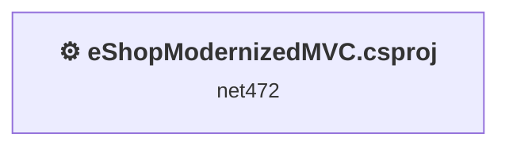
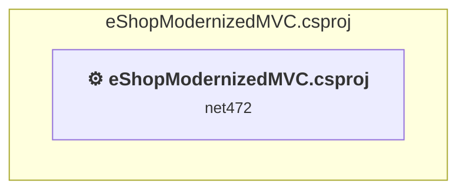

# Projects and dependencies analysis

This document provides a comprehensive overview of the projects and their dependencies in the context of upgrading to .NETCoreApp,Version=v10.0.

## Table of Contents

- [Executive Summary](#executive-Summary)
  - [Highlevel Metrics](#highlevel-metrics)
  - [Projects Compatibility](#projects-compatibility)
  - [Package Compatibility](#package-compatibility)
  - [API Compatibility](#api-compatibility)
  - [Binding Redirect Configuration](#binding-redirect-configuration)
- [Aggregate NuGet packages details](#aggregate-nuget-packages-details)
- [Top API Migration Challenges](#top-api-migration-challenges)
  - [Technologies and Features](#technologies-and-features)
  - [Most Frequent API Issues](#most-frequent-api-issues)
- [Projects Relationship Graph](#projects-relationship-graph)
- [Project Details](#project-details)

  - [src\eShopModernizedMVC\eShopModernizedMVC.csproj](#srceshopmodernizedmvceshopmodernizedmvccsproj)

## Executive Summary

### Highlevel Metrics

| Metric | Count | Status |
| :--- | :---: | :--- |
| Total Projects | 1 | All require upgrade |
| Total NuGet Packages | 146 | 64 need upgrade |
| Total Code Files | 41 |  |
| Total Code Files with Incidents | 6 |  |
| Total Lines of Code | 2577 |  |
| Total Number of Issues | 179 |  |
| Estimated LOC to modify | 0+ | at least 0.0% of codebase |

### Projects Compatibility

| Project | Target Framework | Difficulty | Package Issues | API Issues | Binding Issues | Est. LOC Impact | Description |
| :--- | :---: | :---: | :---: | :---: | :---: | :---: | :--- |
| [src\eShopModernizedMVC\eShopModernizedMVC.csproj](#srceshopmodernizedmvceshopmodernizedmvccsproj) | net472 | 🔴 High | 148 | 0 | 25 |  | Wap, Sdk Style = False |

### Package Compatibility

| Status | Count | Percentage |
| :--- | :---: | :---: |
| ✅ Compatible | 82 | 56.2% |
| ⚠️ Incompatible | 40 | 27.4% |
| 🔄 Upgrade Recommended | 24 | 16.4% |
| ***Total NuGet Packages*** | ***146*** | ***100%*** |

### API Compatibility

| Category | Count | Impact |
| :--- | :---: | :--- |
| 🔴 Binary Incompatible | 0 | High - Require code changes |
| 🟡 Source Incompatible | 0 | Medium - Needs re-compilation and potential conflicting API error fixing |
| 🔵 Behavioral change | 0 | Low - Behavioral changes that may require testing at runtime |
| ✅ Compatible | 0 |  |
| ***Total APIs Analyzed*** | ***0*** |  |

### Binding Redirect Configuration

| Severity | Count | Description |
| :--- | :---: | :--- |
| 🔴Mandatory | 13 | Must be fixed to avoid runtime failures |
| 🟡Potential | 12 | May cause issues in certain scenarios |
| ***Total Binding Issues*** | ***25*** | ***Across 1 project(s)*** |

## Aggregate NuGet packages details

| Package | Current Version | Suggested Version | Projects | Description |
| :--- | :---: | :---: | :--- | :--- |
| Antlr | 3.5.0.2 |  | [eShopModernizedMVC.csproj](#srceshopmodernizedmvceshopmodernizedmvccsproj) | Needs to be replaced with Replace with new package Antlr4=4.6.6 |
| Autofac | 4.9.4 |  | [eShopModernizedMVC.csproj](#srceshopmodernizedmvceshopmodernizedmvccsproj) | ✅Compatible |
| Autofac.Mvc5 | 4.0.2 |  | [eShopModernizedMVC.csproj](#srceshopmodernizedmvceshopmodernizedmvccsproj) | ⚠️NuGet package is incompatible |
| bootstrap | 4.3.1 |  | [eShopModernizedMVC.csproj](#srceshopmodernizedmvceshopmodernizedmvccsproj) | ✅Compatible |
| EntityFramework | 6.3.0 | 6.5.2 | [eShopModernizedMVC.csproj](#srceshopmodernizedmvceshopmodernizedmvccsproj) | NuGet package upgrade is recommended |
| jQuery | 3.5.0 |  | [eShopModernizedMVC.csproj](#srceshopmodernizedmvceshopmodernizedmvccsproj) | ⚠️NuGet package is deprecated |
| jQuery.Validation | 1.19.4 |  | [eShopModernizedMVC.csproj](#srceshopmodernizedmvceshopmodernizedmvccsproj) | ✅Compatible |
| log4net | 2.0.12 | 3.5.0 | [eShopModernizedMVC.csproj](#srceshopmodernizedmvceshopmodernizedmvccsproj) | NuGet package contains security vulnerability |
| log4net.Appender.Azure | 1.4.3.0 |  | [eShopModernizedMVC.csproj](#srceshopmodernizedmvceshopmodernizedmvccsproj) | ⚠️NuGet package is incompatible |
| Microsoft.ApplicationInsights | 2.11.0 |  | [eShopModernizedMVC.csproj](#srceshopmodernizedmvceshopmodernizedmvccsproj) | ⚠️NuGet package is deprecated |
| Microsoft.ApplicationInsights.Agent.Intercept | 2.4.0 |  | [eShopModernizedMVC.csproj](#srceshopmodernizedmvceshopmodernizedmvccsproj) | ⚠️NuGet package is incompatible |
| Microsoft.ApplicationInsights.DependencyCollector | 2.11.2 |  | [eShopModernizedMVC.csproj](#srceshopmodernizedmvceshopmodernizedmvccsproj) | ⚠️NuGet package is deprecated |
| Microsoft.ApplicationInsights.Log4NetAppender | 2.11.0 |  | [eShopModernizedMVC.csproj](#srceshopmodernizedmvceshopmodernizedmvccsproj) | ⚠️NuGet package is deprecated |
| Microsoft.ApplicationInsights.PerfCounterCollector | 2.11.2 |  | [eShopModernizedMVC.csproj](#srceshopmodernizedmvceshopmodernizedmvccsproj) | ⚠️NuGet package is deprecated |
| Microsoft.ApplicationInsights.ServiceFabric | 2.3.1 |  | [eShopModernizedMVC.csproj](#srceshopmodernizedmvceshopmodernizedmvccsproj) | ✅Compatible |
| Microsoft.ApplicationInsights.TraceListener | 2.11.0 |  | [eShopModernizedMVC.csproj](#srceshopmodernizedmvceshopmodernizedmvccsproj) | ⚠️NuGet package is deprecated |
| Microsoft.ApplicationInsights.Web | 2.11.2 |  | [eShopModernizedMVC.csproj](#srceshopmodernizedmvceshopmodernizedmvccsproj) | ⚠️NuGet package is incompatible |
| Microsoft.ApplicationInsights.WindowsServer | 2.11.2 |  | [eShopModernizedMVC.csproj](#srceshopmodernizedmvceshopmodernizedmvccsproj) | ⚠️NuGet package is deprecated |
| Microsoft.ApplicationInsights.WindowsServer.TelemetryChannel | 2.11.0 |  | [eShopModernizedMVC.csproj](#srceshopmodernizedmvceshopmodernizedmvccsproj) | ⚠️NuGet package is deprecated |
| Microsoft.AspNet.Mvc | 5.2.7 |  | [eShopModernizedMVC.csproj](#srceshopmodernizedmvceshopmodernizedmvccsproj) | NuGet package functionality is included with framework reference |
| Microsoft.AspNet.Razor | 3.2.7 |  | [eShopModernizedMVC.csproj](#srceshopmodernizedmvceshopmodernizedmvccsproj) | NuGet package functionality is included with framework reference |
| Microsoft.AspNet.SessionState.SessionStateModule | 1.1.0 |  | [eShopModernizedMVC.csproj](#srceshopmodernizedmvceshopmodernizedmvccsproj) | NuGet package functionality is included with framework reference |
| Microsoft.AspNet.TelemetryCorrelation | 1.0.7 | 1.0.3 | [eShopModernizedMVC.csproj](#srceshopmodernizedmvceshopmodernizedmvccsproj) | ⚠️NuGet package is incompatible |
| Microsoft.AspNet.Web.Optimization | 1.1.3 |  | [eShopModernizedMVC.csproj](#srceshopmodernizedmvceshopmodernizedmvccsproj) | ⚠️NuGet package is incompatible |
| Microsoft.AspNet.WebPages | 3.2.7 |  | [eShopModernizedMVC.csproj](#srceshopmodernizedmvceshopmodernizedmvccsproj) | NuGet package functionality is included with framework reference |
| Microsoft.Azure.KeyVault | 3.0.4 |  | [eShopModernizedMVC.csproj](#srceshopmodernizedmvceshopmodernizedmvccsproj) | ⚠️Replace with Azure.Security.KeyVault.Secrets: Each resource has a separate client (Secrets/Keys/Certificates); use Azure.Identity for authentication |
| Microsoft.Azure.KeyVault.Core | 3.0.4 |  | [eShopModernizedMVC.csproj](#srceshopmodernizedmvceshopmodernizedmvccsproj) | ⚠️NuGet package is deprecated |
| Microsoft.Azure.KeyVault.WebKey | 3.0.4 |  | [eShopModernizedMVC.csproj](#srceshopmodernizedmvceshopmodernizedmvccsproj) | ⚠️NuGet package is deprecated |
| Microsoft.Azure.Services.AppAuthentication | 1.3.1 |  | [eShopModernizedMVC.csproj](#srceshopmodernizedmvceshopmodernizedmvccsproj) | ✅Compatible |
| Microsoft.Bcl.AsyncInterfaces | 1.0.0 | 10.0.14 | [eShopModernizedMVC.csproj](#srceshopmodernizedmvceshopmodernizedmvccsproj) | NuGet package upgrade is recommended |
| Microsoft.CodeDom.Providers.DotNetCompilerPlatform | 2.0.1 |  | [eShopModernizedMVC.csproj](#srceshopmodernizedmvceshopmodernizedmvccsproj) | NuGet package functionality is included with framework reference |
| Microsoft.Configuration.ConfigurationBuilders.Azure | 2.0.0-beta |  | [eShopModernizedMVC.csproj](#srceshopmodernizedmvceshopmodernizedmvccsproj) | ⚠️NuGet package is incompatible |
| Microsoft.Configuration.ConfigurationBuilders.Base | 2.0.0-beta |  | [eShopModernizedMVC.csproj](#srceshopmodernizedmvceshopmodernizedmvccsproj) | ⚠️NuGet package is incompatible |
| Microsoft.Configuration.ConfigurationBuilders.Environment | 2.0.0-beta |  | [eShopModernizedMVC.csproj](#srceshopmodernizedmvceshopmodernizedmvccsproj) | ⚠️NuGet package is incompatible |
| Microsoft.Configuration.ConfigurationBuilders.UserSecrets | 2.0.0-beta |  | [eShopModernizedMVC.csproj](#srceshopmodernizedmvceshopmodernizedmvccsproj) | ⚠️NuGet package is incompatible |
| Microsoft.Data.Edm | 5.8.4 |  | [eShopModernizedMVC.csproj](#srceshopmodernizedmvceshopmodernizedmvccsproj) | ✅Compatible |
| Microsoft.Data.OData | 5.8.4 |  | [eShopModernizedMVC.csproj](#srceshopmodernizedmvceshopmodernizedmvccsproj) | ✅Compatible |
| Microsoft.Data.Services.Client | 5.8.4 |  | [eShopModernizedMVC.csproj](#srceshopmodernizedmvceshopmodernizedmvccsproj) | ✅Compatible |
| Microsoft.Extensions.Configuration | 3.0.0 | 10.0.14 | [eShopModernizedMVC.csproj](#srceshopmodernizedmvceshopmodernizedmvccsproj) | NuGet package upgrade is recommended |
| Microsoft.Extensions.Configuration.Abstractions | 3.0.0 | 10.0.14 | [eShopModernizedMVC.csproj](#srceshopmodernizedmvceshopmodernizedmvccsproj) | NuGet package upgrade is recommended |
| Microsoft.Extensions.Configuration.Binder | 3.0.0 | 10.0.14 | [eShopModernizedMVC.csproj](#srceshopmodernizedmvceshopmodernizedmvccsproj) | NuGet package upgrade is recommended |
| Microsoft.Extensions.Configuration.FileExtensions | 3.0.0 | 10.0.14 | [eShopModernizedMVC.csproj](#srceshopmodernizedmvceshopmodernizedmvccsproj) | NuGet package upgrade is recommended |
| Microsoft.Extensions.Configuration.Json | 3.0.0 | 10.0.14 | [eShopModernizedMVC.csproj](#srceshopmodernizedmvceshopmodernizedmvccsproj) | NuGet package upgrade is recommended |
| Microsoft.Extensions.FileProviders.Abstractions | 3.0.0 | 10.0.14 | [eShopModernizedMVC.csproj](#srceshopmodernizedmvceshopmodernizedmvccsproj) | NuGet package upgrade is recommended |
| Microsoft.Extensions.FileProviders.Physical | 3.0.0 | 10.0.14 | [eShopModernizedMVC.csproj](#srceshopmodernizedmvceshopmodernizedmvccsproj) | NuGet package upgrade is recommended |
| Microsoft.Extensions.FileSystemGlobbing | 3.0.0 | 10.0.14 | [eShopModernizedMVC.csproj](#srceshopmodernizedmvceshopmodernizedmvccsproj) | NuGet package upgrade is recommended |
| Microsoft.Extensions.Primitives | 3.0.0 | 10.0.14 | [eShopModernizedMVC.csproj](#srceshopmodernizedmvceshopmodernizedmvccsproj) | NuGet package upgrade is recommended |
| Microsoft.IdentityModel.Clients.ActiveDirectory | 5.2.4 |  | [eShopModernizedMVC.csproj](#srceshopmodernizedmvceshopmodernizedmvccsproj) | ⚠️Replace with Microsoft.Identity.Client: Switch to MSAL-based authentication; adjust code for scopes/resources; update token caching |
| Microsoft.IdentityModel.JsonWebTokens | 5.6.0 | 8.23.0 | [eShopModernizedMVC.csproj](#srceshopmodernizedmvceshopmodernizedmvccsproj) | NuGet package contains security vulnerability |
| Microsoft.IdentityModel.Logging | 5.6.0 |  | [eShopModernizedMVC.csproj](#srceshopmodernizedmvceshopmodernizedmvccsproj) | ⚠️NuGet package is deprecated |
| Microsoft.IdentityModel.Protocol.Extensions | 1.0.4.403061554 |  | [eShopModernizedMVC.csproj](#srceshopmodernizedmvceshopmodernizedmvccsproj) | ⚠️NuGet package is incompatible |
| Microsoft.IdentityModel.Protocols | 5.6.0 |  | [eShopModernizedMVC.csproj](#srceshopmodernizedmvceshopmodernizedmvccsproj) | ⚠️NuGet package is deprecated |
| Microsoft.IdentityModel.Protocols.OpenIdConnect | 5.6.0 |  | [eShopModernizedMVC.csproj](#srceshopmodernizedmvceshopmodernizedmvccsproj) | ⚠️NuGet package is deprecated |
| Microsoft.IdentityModel.Tokens | 5.6.0 |  | [eShopModernizedMVC.csproj](#srceshopmodernizedmvceshopmodernizedmvccsproj) | ⚠️NuGet package is deprecated |
| Microsoft.jQuery.Unobtrusive.Validation | 3.2.11 |  | [eShopModernizedMVC.csproj](#srceshopmodernizedmvceshopmodernizedmvccsproj) | ⚠️NuGet package is deprecated |
| Microsoft.Net.Compilers | 3.3.1 |  | [eShopModernizedMVC.csproj](#srceshopmodernizedmvceshopmodernizedmvccsproj) | NuGet package functionality is included with framework reference |
| Microsoft.NETCore.Platforms | 3.0.0 |  | [eShopModernizedMVC.csproj](#srceshopmodernizedmvceshopmodernizedmvccsproj) | NuGet package functionality is included with framework reference |
| Microsoft.Owin | 4.2.2 |  | [eShopModernizedMVC.csproj](#srceshopmodernizedmvceshopmodernizedmvccsproj) | ⚠️NuGet package is incompatible |
| Microsoft.Owin.Host.SystemWeb | 4.0.1 |  | [eShopModernizedMVC.csproj](#srceshopmodernizedmvceshopmodernizedmvccsproj) | ⚠️NuGet package is incompatible |
| Microsoft.Owin.Security | 4.0.1 |  | [eShopModernizedMVC.csproj](#srceshopmodernizedmvceshopmodernizedmvccsproj) | ⚠️NuGet package is incompatible |
| Microsoft.Owin.Security.Cookies | 4.2.2 |  | [eShopModernizedMVC.csproj](#srceshopmodernizedmvceshopmodernizedmvccsproj) | ⚠️Replace with Microsoft.AspNetCore.Authentication.Cookies: Use AddAuthentication().AddCookie() in Startup; adjust cookie options |
| Microsoft.Owin.Security.OpenIdConnect | 4.0.1 |  | [eShopModernizedMVC.csproj](#srceshopmodernizedmvceshopmodernizedmvccsproj) | ⚠️Replace with Microsoft.AspNetCore.Authentication.OpenIdConnect: Configure via AddOpenIdConnect(); integrate with cookie auth properly |
| Microsoft.Rest.ClientRuntime | 2.3.24 |  | [eShopModernizedMVC.csproj](#srceshopmodernizedmvceshopmodernizedmvccsproj) | ⚠️NuGet package is deprecated |
| Microsoft.Rest.ClientRuntime.Azure | 3.3.19 |  | [eShopModernizedMVC.csproj](#srceshopmodernizedmvceshopmodernizedmvccsproj) | ⚠️NuGet package is deprecated |
| Microsoft.Web.Infrastructure | 1.0.0.0 |  | [eShopModernizedMVC.csproj](#srceshopmodernizedmvceshopmodernizedmvccsproj) | NuGet package functionality is included with framework reference |
| Microsoft.Web.RedisSessionStateProvider | 4.0.1 |  | [eShopModernizedMVC.csproj](#srceshopmodernizedmvceshopmodernizedmvccsproj) | ⚠️NuGet package is incompatible |
| Microsoft.Win32.Primitives | 4.3.0 |  | [eShopModernizedMVC.csproj](#srceshopmodernizedmvceshopmodernizedmvccsproj) | NuGet package functionality is included with framework reference |
| Microsoft.WindowsAzure.ConfigurationManager | 3.2.3 |  | [eShopModernizedMVC.csproj](#srceshopmodernizedmvceshopmodernizedmvccsproj) | ⚠️NuGet package is incompatible |
| Modernizr | 2.8.3 |  | [eShopModernizedMVC.csproj](#srceshopmodernizedmvceshopmodernizedmvccsproj) | ✅Compatible |
| NETStandard.Library | 2.0.3 |  | [eShopModernizedMVC.csproj](#srceshopmodernizedmvceshopmodernizedmvccsproj) | NuGet package functionality is included with framework reference |
| Newtonsoft.Json | 13.0.2 | 13.0.4 | [eShopModernizedMVC.csproj](#srceshopmodernizedmvceshopmodernizedmvccsproj) | NuGet package upgrade is recommended |
| Owin | 1.0 |  | [eShopModernizedMVC.csproj](#srceshopmodernizedmvceshopmodernizedmvccsproj) | ⚠️NuGet package is incompatible |
| Pipelines.Sockets.Unofficial | 2.1.0 |  | [eShopModernizedMVC.csproj](#srceshopmodernizedmvceshopmodernizedmvccsproj) | ✅Compatible |
| popper.js | 1.14.3 |  | [eShopModernizedMVC.csproj](#srceshopmodernizedmvceshopmodernizedmvccsproj) | ✅Compatible |
| Respond | 1.4.2 |  | [eShopModernizedMVC.csproj](#srceshopmodernizedmvceshopmodernizedmvccsproj) | ✅Compatible |
| StackExchange.Redis | 2.0.601 |  | [eShopModernizedMVC.csproj](#srceshopmodernizedmvceshopmodernizedmvccsproj) | ✅Compatible |
| System.AppContext | 4.3.0 |  | [eShopModernizedMVC.csproj](#srceshopmodernizedmvceshopmodernizedmvccsproj) | NuGet package functionality is included with framework reference |
| System.Buffers | 4.5.1 |  | [eShopModernizedMVC.csproj](#srceshopmodernizedmvceshopmodernizedmvccsproj) | NuGet package functionality is included with framework reference |
| System.Collections | 4.3.0 |  | [eShopModernizedMVC.csproj](#srceshopmodernizedmvceshopmodernizedmvccsproj) | NuGet package functionality is included with framework reference |
| System.Collections.Concurrent | 4.3.0 |  | [eShopModernizedMVC.csproj](#srceshopmodernizedmvceshopmodernizedmvccsproj) | NuGet package functionality is included with framework reference |
| System.Collections.Immutable | 1.6.0 | 10.0.14 | [eShopModernizedMVC.csproj](#srceshopmodernizedmvceshopmodernizedmvccsproj) | NuGet package upgrade is recommended |
| System.Collections.NonGeneric | 4.3.0 |  | [eShopModernizedMVC.csproj](#srceshopmodernizedmvceshopmodernizedmvccsproj) | NuGet package functionality is included with framework reference |
| System.ComponentModel.EventBasedAsync | 4.3.0 |  | [eShopModernizedMVC.csproj](#srceshopmodernizedmvceshopmodernizedmvccsproj) | NuGet package functionality is included with framework reference |
| System.ComponentModel.Primitives | 4.3.0 |  | [eShopModernizedMVC.csproj](#srceshopmodernizedmvceshopmodernizedmvccsproj) | NuGet package functionality is included with framework reference |
| System.ComponentModel.TypeConverter | 4.3.0 |  | [eShopModernizedMVC.csproj](#srceshopmodernizedmvceshopmodernizedmvccsproj) | NuGet package functionality is included with framework reference |
| System.Console | 4.3.1 |  | [eShopModernizedMVC.csproj](#srceshopmodernizedmvceshopmodernizedmvccsproj) | NuGet package functionality is included with framework reference |
| System.Diagnostics.Debug | 4.3.0 |  | [eShopModernizedMVC.csproj](#srceshopmodernizedmvceshopmodernizedmvccsproj) | NuGet package functionality is included with framework reference |
| System.Diagnostics.DiagnosticSource | 4.6.0 | 10.0.14 | [eShopModernizedMVC.csproj](#srceshopmodernizedmvceshopmodernizedmvccsproj) | NuGet package upgrade is recommended |
| System.Diagnostics.PerformanceCounter | 4.6.0 | 10.0.14 | [eShopModernizedMVC.csproj](#srceshopmodernizedmvceshopmodernizedmvccsproj) | NuGet package upgrade is recommended |
| System.Diagnostics.Tools | 4.3.0 |  | [eShopModernizedMVC.csproj](#srceshopmodernizedmvceshopmodernizedmvccsproj) | NuGet package functionality is included with framework reference |
| System.Diagnostics.Tracing | 4.3.0 |  | [eShopModernizedMVC.csproj](#srceshopmodernizedmvceshopmodernizedmvccsproj) | NuGet package functionality is included with framework reference |
| System.Dynamic.Runtime | 4.3.0 |  | [eShopModernizedMVC.csproj](#srceshopmodernizedmvceshopmodernizedmvccsproj) | NuGet package functionality is included with framework reference |
| System.Globalization | 4.3.0 |  | [eShopModernizedMVC.csproj](#srceshopmodernizedmvceshopmodernizedmvccsproj) | NuGet package functionality is included with framework reference |
| System.Globalization.Calendars | 4.3.0 |  | [eShopModernizedMVC.csproj](#srceshopmodernizedmvceshopmodernizedmvccsproj) | NuGet package functionality is included with framework reference |
| System.IdentityModel.Tokens.Jwt | 5.6.0 | 8.23.0 | [eShopModernizedMVC.csproj](#srceshopmodernizedmvceshopmodernizedmvccsproj) | NuGet package contains security vulnerability |
| System.IO | 4.3.0 |  | [eShopModernizedMVC.csproj](#srceshopmodernizedmvceshopmodernizedmvccsproj) | NuGet package functionality is included with framework reference |
| System.IO.Compression | 4.3.0 |  | [eShopModernizedMVC.csproj](#srceshopmodernizedmvceshopmodernizedmvccsproj) | NuGet package functionality is included with framework reference |
| System.IO.Compression.ZipFile | 4.3.0 |  | [eShopModernizedMVC.csproj](#srceshopmodernizedmvceshopmodernizedmvccsproj) | NuGet package functionality is included with framework reference |
| System.IO.FileSystem | 4.3.0 |  | [eShopModernizedMVC.csproj](#srceshopmodernizedmvceshopmodernizedmvccsproj) | NuGet package functionality is included with framework reference |
| System.IO.FileSystem.Primitives | 4.3.0 |  | [eShopModernizedMVC.csproj](#srceshopmodernizedmvceshopmodernizedmvccsproj) | NuGet package functionality is included with framework reference |
| System.IO.Pipelines | 4.6.0 | 10.0.14 | [eShopModernizedMVC.csproj](#srceshopmodernizedmvceshopmodernizedmvccsproj) | NuGet package upgrade is recommended |
| System.Linq | 4.3.0 |  | [eShopModernizedMVC.csproj](#srceshopmodernizedmvceshopmodernizedmvccsproj) | NuGet package functionality is included with framework reference |
| System.Linq.Expressions | 4.3.0 |  | [eShopModernizedMVC.csproj](#srceshopmodernizedmvceshopmodernizedmvccsproj) | NuGet package functionality is included with framework reference |
| System.Linq.Queryable | 4.3.0 |  | [eShopModernizedMVC.csproj](#srceshopmodernizedmvceshopmodernizedmvccsproj) | NuGet package functionality is included with framework reference |
| System.Memory | 4.5.4 |  | [eShopModernizedMVC.csproj](#srceshopmodernizedmvceshopmodernizedmvccsproj) | NuGet package functionality is included with framework reference |
| System.Net.Http | 4.3.4 |  | [eShopModernizedMVC.csproj](#srceshopmodernizedmvceshopmodernizedmvccsproj) | NuGet package functionality is included with framework reference |
| System.Net.Primitives | 4.3.1 |  | [eShopModernizedMVC.csproj](#srceshopmodernizedmvceshopmodernizedmvccsproj) | NuGet package functionality is included with framework reference |
| System.Net.Requests | 4.3.0 |  | [eShopModernizedMVC.csproj](#srceshopmodernizedmvceshopmodernizedmvccsproj) | NuGet package functionality is included with framework reference |
| System.Net.Sockets | 4.3.0 |  | [eShopModernizedMVC.csproj](#srceshopmodernizedmvceshopmodernizedmvccsproj) | NuGet package functionality is included with framework reference |
| System.Numerics.Vectors | 4.5.0 |  | [eShopModernizedMVC.csproj](#srceshopmodernizedmvceshopmodernizedmvccsproj) | NuGet package functionality is included with framework reference |
| System.ObjectModel | 4.3.0 |  | [eShopModernizedMVC.csproj](#srceshopmodernizedmvceshopmodernizedmvccsproj) | NuGet package functionality is included with framework reference |
| System.Reflection | 4.3.0 |  | [eShopModernizedMVC.csproj](#srceshopmodernizedmvceshopmodernizedmvccsproj) | NuGet package functionality is included with framework reference |
| System.Reflection.Extensions | 4.3.0 |  | [eShopModernizedMVC.csproj](#srceshopmodernizedmvceshopmodernizedmvccsproj) | NuGet package functionality is included with framework reference |
| System.Reflection.Primitives | 4.3.0 |  | [eShopModernizedMVC.csproj](#srceshopmodernizedmvceshopmodernizedmvccsproj) | NuGet package functionality is included with framework reference |
| System.Resources.ResourceManager | 4.3.0 |  | [eShopModernizedMVC.csproj](#srceshopmodernizedmvceshopmodernizedmvccsproj) | NuGet package functionality is included with framework reference |
| System.Runtime | 4.3.1 |  | [eShopModernizedMVC.csproj](#srceshopmodernizedmvceshopmodernizedmvccsproj) | NuGet package functionality is included with framework reference |
| System.Runtime.CompilerServices.Unsafe | 4.6.0 | 6.1.2 | [eShopModernizedMVC.csproj](#srceshopmodernizedmvceshopmodernizedmvccsproj) | NuGet package upgrade is recommended |
| System.Runtime.Extensions | 4.3.1 |  | [eShopModernizedMVC.csproj](#srceshopmodernizedmvceshopmodernizedmvccsproj) | NuGet package functionality is included with framework reference |
| System.Runtime.Handles | 4.3.0 |  | [eShopModernizedMVC.csproj](#srceshopmodernizedmvceshopmodernizedmvccsproj) | ✅Compatible |
| System.Runtime.InteropServices | 4.3.0 |  | [eShopModernizedMVC.csproj](#srceshopmodernizedmvceshopmodernizedmvccsproj) | NuGet package functionality is included with framework reference |
| System.Runtime.InteropServices.RuntimeInformation | 4.3.0 |  | [eShopModernizedMVC.csproj](#srceshopmodernizedmvceshopmodernizedmvccsproj) | NuGet package functionality is included with framework reference |
| System.Runtime.Numerics | 4.3.0 |  | [eShopModernizedMVC.csproj](#srceshopmodernizedmvceshopmodernizedmvccsproj) | NuGet package functionality is included with framework reference |
| System.Security.Cryptography.Algorithms | 4.3.1 |  | [eShopModernizedMVC.csproj](#srceshopmodernizedmvceshopmodernizedmvccsproj) | NuGet package functionality is included with framework reference |
| System.Security.Cryptography.Encoding | 4.3.0 |  | [eShopModernizedMVC.csproj](#srceshopmodernizedmvceshopmodernizedmvccsproj) | NuGet package functionality is included with framework reference |
| System.Security.Cryptography.Primitives | 4.3.0 |  | [eShopModernizedMVC.csproj](#srceshopmodernizedmvceshopmodernizedmvccsproj) | NuGet package functionality is included with framework reference |
| System.Security.Cryptography.X509Certificates | 4.3.2 |  | [eShopModernizedMVC.csproj](#srceshopmodernizedmvceshopmodernizedmvccsproj) | NuGet package functionality is included with framework reference |
| System.Spatial | 5.8.4 |  | [eShopModernizedMVC.csproj](#srceshopmodernizedmvceshopmodernizedmvccsproj) | ✅Compatible |
| System.Text.Encoding | 4.3.0 |  | [eShopModernizedMVC.csproj](#srceshopmodernizedmvceshopmodernizedmvccsproj) | NuGet package functionality is included with framework reference |
| System.Text.Encoding.Extensions | 4.3.0 |  | [eShopModernizedMVC.csproj](#srceshopmodernizedmvceshopmodernizedmvccsproj) | NuGet package functionality is included with framework reference |
| System.Text.Encodings.Web | 4.7.2 | 10.0.14 | [eShopModernizedMVC.csproj](#srceshopmodernizedmvceshopmodernizedmvccsproj) | NuGet package upgrade is recommended |
| System.Text.Json | 4.6.0 | 10.0.14 | [eShopModernizedMVC.csproj](#srceshopmodernizedmvceshopmodernizedmvccsproj) | NuGet package upgrade is recommended |
| System.Text.RegularExpressions | 4.3.1 |  | [eShopModernizedMVC.csproj](#srceshopmodernizedmvceshopmodernizedmvccsproj) | NuGet package functionality is included with framework reference |
| System.Threading | 4.3.0 |  | [eShopModernizedMVC.csproj](#srceshopmodernizedmvceshopmodernizedmvccsproj) | NuGet package functionality is included with framework reference |
| System.Threading.Channels | 4.6.0 | 10.0.14 | [eShopModernizedMVC.csproj](#srceshopmodernizedmvceshopmodernizedmvccsproj) | NuGet package upgrade is recommended |
| System.Threading.Tasks | 4.3.0 |  | [eShopModernizedMVC.csproj](#srceshopmodernizedmvceshopmodernizedmvccsproj) | NuGet package functionality is included with framework reference |
| System.Threading.Tasks.Dataflow | 4.10.0 | 10.0.14 | [eShopModernizedMVC.csproj](#srceshopmodernizedmvceshopmodernizedmvccsproj) | NuGet package upgrade is recommended |
| System.Threading.Tasks.Extensions | 4.5.3 |  | [eShopModernizedMVC.csproj](#srceshopmodernizedmvceshopmodernizedmvccsproj) | NuGet package functionality is included with framework reference |
| System.Threading.Tasks.Parallel | 4.3.0 |  | [eShopModernizedMVC.csproj](#srceshopmodernizedmvceshopmodernizedmvccsproj) | NuGet package functionality is included with framework reference |
| System.Threading.Timer | 4.3.0 |  | [eShopModernizedMVC.csproj](#srceshopmodernizedmvceshopmodernizedmvccsproj) | NuGet package functionality is included with framework reference |
| System.ValueTuple | 4.5.0 |  | [eShopModernizedMVC.csproj](#srceshopmodernizedmvceshopmodernizedmvccsproj) | NuGet package functionality is included with framework reference |
| System.Xml.ReaderWriter | 4.3.1 |  | [eShopModernizedMVC.csproj](#srceshopmodernizedmvceshopmodernizedmvccsproj) | NuGet package functionality is included with framework reference |
| System.Xml.XDocument | 4.3.0 |  | [eShopModernizedMVC.csproj](#srceshopmodernizedmvceshopmodernizedmvccsproj) | NuGet package functionality is included with framework reference |
| Validation | 2.4.22 |  | [eShopModernizedMVC.csproj](#srceshopmodernizedmvceshopmodernizedmvccsproj) | ✅Compatible |
| WebGrease | 1.6.0 |  | [eShopModernizedMVC.csproj](#srceshopmodernizedmvceshopmodernizedmvccsproj) | ✅Compatible |
| WindowsAzure.ServiceBus | 6.0.0 |  | [eShopModernizedMVC.csproj](#srceshopmodernizedmvceshopmodernizedmvccsproj) | ⚠️Replace with Azure.Messaging.ServiceBus: Use ServiceBusClient/Sender/Processor pattern |
| WindowsAzure.Storage | 9.3.3 |  | [eShopModernizedMVC.csproj](#srceshopmodernizedmvceshopmodernizedmvccsproj) | ⚠️Replace with Azure.Storage.Blobs: Adopt new Azure Storage SDKs (Azure.Storage.Blobs/Queues/Files/Tables); update blob, queue, file, and table operations accordingly |

## Top API Migration Challenges

### Technologies and Features

| Technology | Issues | Percentage | Migration Path |
| :--- | :---: | :---: | :--- |

### Most Frequent API Issues

| API | Count | Percentage | Category |
| :--- | :---: | :---: | :--- |

## Projects Relationship Graph

Legend:
📦 SDK-style project
⚙️ Classic project

## Project Details

### src\eShopModernizedMVC\eShopModernizedMVC.csproj

#### Project Info

- **Current Target Framework:** net472
- **Proposed Target Framework:** net10.0-windows
- **SDK-style**: False
- **Project Kind:** Wap
- **Dependencies**: 0
- **Dependants**: 0
- **Number of Files**: 149
- **Number of Files with Incidents**: 6
- **Lines of Code**: 2577
- **Estimated LOC to modify**: 0+ (at least 0.0% of the project)

#### Dependency Graph

Legend:
📦 SDK-style project
⚙️ Classic project

### API Compatibility

| Category | Count | Impact |
| :--- | :---: | :--- |
| 🔴 Binary Incompatible | 0 | High - Require code changes |
| 🟡 Source Incompatible | 0 | Medium - Needs re-compilation and potential conflicting API error fixing |
| 🔵 Behavioral change | 0 | Low - Behavioral changes that may require testing at runtime |
| ✅ Compatible | 0 |  |
| ***Total APIs Analyzed*** | ***0*** |  |

#### Binding Redirect Configuration

| Rule | Severity | Details | Recommendation |
| :--- | :---: | :--- | :--- |
| Manual redirect conflicts with auto-generated version | 🔴Mandatory | Manual redirect for Newtonsoft.Json targets 12.0.0.0 but auto-generation would target 13.0.2 (MSB3836 conflict) | Remove the conflicting manual binding redirect or disable auto-generation. |
| Manual redirect conflicts with auto-generated version | 🔴Mandatory | Manual redirect for WebGrease targets 1.6.5135.21930 but auto-generation would target 1.6.0 (MSB3836 conflict) | Remove the conflicting manual binding redirect or disable auto-generation. |
| Manual redirect conflicts with auto-generated version | 🔴Mandatory | Manual redirect for System.Diagnostics.DiagnosticSource targets 4.0.3.1 but auto-generation would target 4.6.0 (MSB3836 conflict) | Remove the conflicting manual binding redirect or disable auto-generation. |
| Manual redirect conflicts with auto-generated version | 🔴Mandatory | Manual redirect for Microsoft.IdentityModel.Protocol.Extensions targets 1.0.2.28 but auto-generation would target 1.0.4.403061554 (MSB3836 conflict) | Remove the conflicting manual binding redirect or disable auto-generation. |
| Manual redirect conflicts with auto-generated version | 🔴Mandatory | Manual redirect for Microsoft.IdentityModel.Logging targets 5.4.0.0 but auto-generation would target 5.6.0 (MSB3836 conflict) | Remove the conflicting manual binding redirect or disable auto-generation. |
| Manual redirect conflicts with auto-generated version | 🔴Mandatory | Manual redirect for System.Numerics.Vectors targets 4.1.4.0 but auto-generation would target 4.5.0 (MSB3836 conflict) | Remove the conflicting manual binding redirect or disable auto-generation. |
| Manual redirect conflicts with auto-generated version | 🔴Mandatory | Manual redirect for System.Buffers targets 4.0.3.0 but auto-generation would target 4.5.1 (MSB3836 conflict) | Remove the conflicting manual binding redirect or disable auto-generation. |
| Manual redirect conflicts with auto-generated version | 🔴Mandatory | Manual redirect for System.Runtime.CompilerServices.Unsafe targets 4.0.5.0 but auto-generation would target 4.6.0 (MSB3836 conflict) | Remove the conflicting manual binding redirect or disable auto-generation. |
| Manual redirect conflicts with auto-generated version | 🔴Mandatory | Manual redirect for System.Memory targets 4.0.1.1 but auto-generation would target 4.5.4 (MSB3836 conflict) | Remove the conflicting manual binding redirect or disable auto-generation. |
| Manual redirect conflicts with auto-generated version | 🔴Mandatory | Manual redirect for System.Threading.Tasks.Extensions targets 4.2.0.1 but auto-generation would target 4.5.3 (MSB3836 conflict) | Remove the conflicting manual binding redirect or disable auto-generation. |
| Manual redirect conflicts with auto-generated version | 🔴Mandatory | Manual redirect for System.Threading.Channels targets 4.0.1.0 but auto-generation would target 4.6.0 (MSB3836 conflict) | Remove the conflicting manual binding redirect or disable auto-generation. |
| Manual redirect conflicts with auto-generated version | 🔴Mandatory | Manual redirect for System.IO.Pipelines targets 4.0.1.0 but auto-generation would target 4.6.0 (MSB3836 conflict) | Remove the conflicting manual binding redirect or disable auto-generation. |
| Manual redirect conflicts with auto-generated version | 🔴Mandatory | Manual redirect for System.ValueTuple targets 4.0.3.0 but auto-generation would target 4.5.0 (MSB3836 conflict) | Remove the conflicting manual binding redirect or disable auto-generation. |
| Binding redirect forces version downgrade | 🟡Potential | Binding redirect for Microsoft.IdentityModel.Logging targets 5.4.0.0 but package provides 5.6.0 | Update the binding redirect newVersion to match the version provided by the NuGet package. |
| Binding redirect forces version downgrade | 🟡Potential | Binding redirect for Microsoft.IdentityModel.Protocol.Extensions targets 1.0.2.28 but package provides 1.0.4.403061554 | Update the binding redirect newVersion to match the version provided by the NuGet package. |
| Binding redirect forces version downgrade | 🟡Potential | Binding redirect for Newtonsoft.Json targets 12.0.0.0 but package provides 13.0.2 | Update the binding redirect newVersion to match the version provided by the NuGet package. |
| Binding redirect forces version downgrade | 🟡Potential | Binding redirect for System.Buffers targets 4.0.3.0 but package provides 4.5.1 | Update the binding redirect newVersion to match the version provided by the NuGet package. |
| Binding redirect forces version downgrade | 🟡Potential | Binding redirect for System.Diagnostics.DiagnosticSource targets 4.0.3.1 but package provides 4.6.0 | Update the binding redirect newVersion to match the version provided by the NuGet package. |
| Binding redirect forces version downgrade | 🟡Potential | Binding redirect for System.IO.Pipelines targets 4.0.1.0 but package provides 4.6.0 | Update the binding redirect newVersion to match the version provided by the NuGet package. |
| Binding redirect forces version downgrade | 🟡Potential | Binding redirect for System.Memory targets 4.0.1.1 but package provides 4.5.4 | Update the binding redirect newVersion to match the version provided by the NuGet package. |
| Binding redirect forces version downgrade | 🟡Potential | Binding redirect for System.Numerics.Vectors targets 4.1.4.0 but package provides 4.5.0 | Update the binding redirect newVersion to match the version provided by the NuGet package. |
| Binding redirect forces version downgrade | 🟡Potential | Binding redirect for System.Runtime.CompilerServices.Unsafe targets 4.0.5.0 but package provides 4.6.0 | Update the binding redirect newVersion to match the version provided by the NuGet package. |
| Binding redirect forces version downgrade | 🟡Potential | Binding redirect for System.Threading.Channels targets 4.0.1.0 but package provides 4.6.0 | Update the binding redirect newVersion to match the version provided by the NuGet package. |
| Binding redirect forces version downgrade | 🟡Potential | Binding redirect for System.Threading.Tasks.Extensions targets 4.2.0.1 but package provides 4.5.3 | Update the binding redirect newVersion to match the version provided by the NuGet package. |
| Binding redirect forces version downgrade | 🟡Potential | Binding redirect for System.ValueTuple targets 4.0.3.0 but package provides 4.5.0 | Update the binding redirect newVersion to match the version provided by the NuGet package. |

