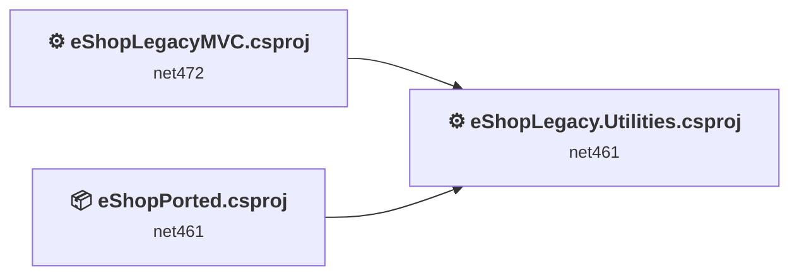
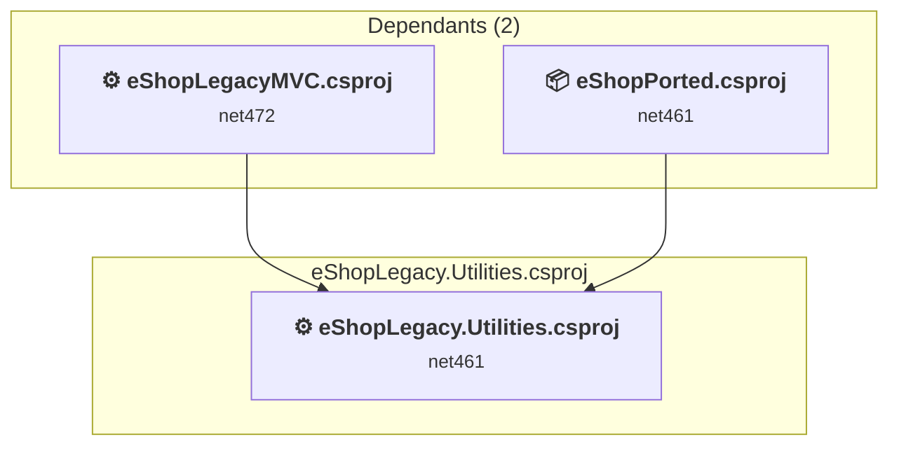
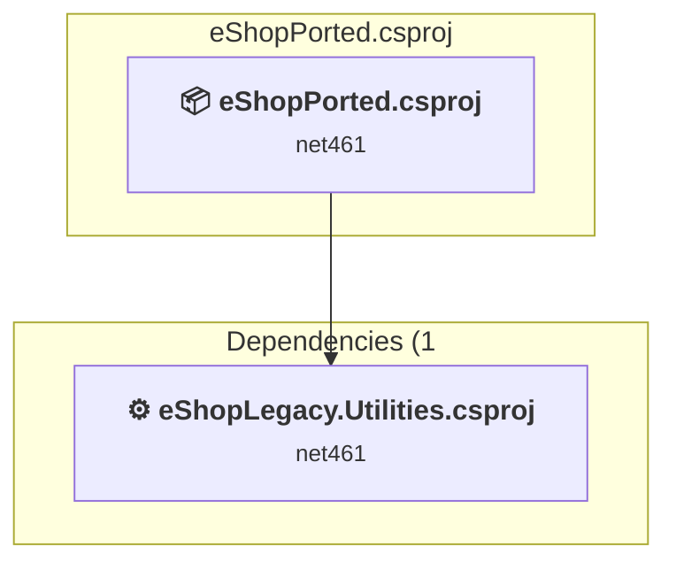
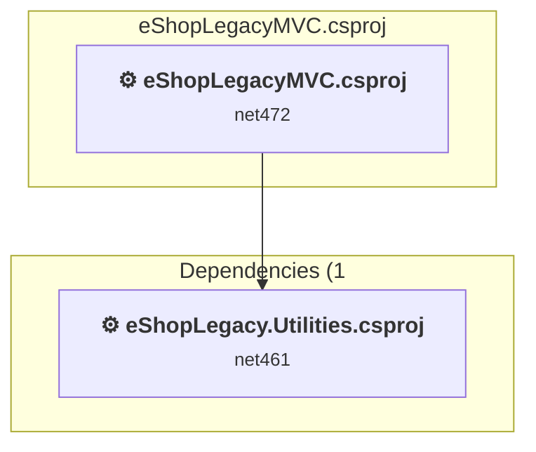

# Projects and dependencies analysis

This document provides a comprehensive overview of the projects and their dependencies in the context of upgrading to .NETCoreApp,Version=v10.0.

## Table of Contents

- [Executive Summary](#executive-Summary)
  - [Highlevel Metrics](#highlevel-metrics)
  - [Projects Compatibility](#projects-compatibility)
  - [Package Compatibility](#package-compatibility)
  - [API Compatibility](#api-compatibility)
  - [Binding Redirect Configuration](#binding-redirect-configuration)
- [Aggregate NuGet packages details](#aggregate-nuget-packages-details)
- [Top API Migration Challenges](#top-api-migration-challenges)
  - [Technologies and Features](#technologies-and-features)
  - [Most Frequent API Issues](#most-frequent-api-issues)
- [Projects Relationship Graph](#projects-relationship-graph)
- [Project Details](#project-details)

  - [eShopLegacy.Utilities\eShopLegacy.Utilities.csproj](#eshoplegacyutilitieseshoplegacyutilitiescsproj)
  - [eShopPorted\eShopPorted.csproj](#eshopportedeshopportedcsproj)
  - [src\eShopLegacyMVC\eShopLegacyMVC.csproj](#srceshoplegacymvceshoplegacymvccsproj)

## Executive Summary

### Highlevel Metrics

| Metric | Count | Status |
| :--- | :---: | :--- |
| Total Projects | 3 | All require upgrade |
| Total NuGet Packages | 52 | 25 need upgrade |
| Total Code Files | 65 |  |
| Total Code Files with Incidents | 24 |  |
| Total Lines of Code | 4408 |  |
| Total Number of Issues | 360 |  |
| Estimated LOC to modify | 279+ | at least 6.3% of codebase |

### Projects Compatibility

| Project | Target Framework | Difficulty | Package Issues | API Issues | Binding Issues | Est. LOC Impact | Description |
| :--- | :---: | :---: | :---: | :---: | :---: | :---: | :--- |
| [eShopLegacy.Utilities\eShopLegacy.Utilities.csproj](#eshoplegacyutilitieseshoplegacyutilitiescsproj) | net461 | 🟢 Low | 0 | 2 | 1 | 2+ | ClassicClassLibrary, Sdk Style = False |
| [eShopPorted\eShopPorted.csproj](#eshopportedeshopportedcsproj) | net461 | 🟢 Low | 18 | 19 | 0 | 19+ | AspNetCore, Sdk Style = True |
| [src\eShopLegacyMVC\eShopLegacyMVC.csproj](#srceshoplegacymvceshoplegacymvccsproj) | net472 | 🔴 High | 38 | 258 | 6 | 258+ | Wap, Sdk Style = False |

### Package Compatibility

| Status | Count | Percentage |
| :--- | :---: | :---: |
| ✅ Compatible | 27 | 51.9% |
| ⚠️ Incompatible | 12 | 23.1% |
| 🔄 Upgrade Recommended | 13 | 25.0% |
| ***Total NuGet Packages*** | ***52*** | ***100%*** |

### API Compatibility

| Category | Count | Impact |
| :--- | :---: | :--- |
| 🔴 Binary Incompatible | 225 | High - Require code changes |
| 🟡 Source Incompatible | 51 | Medium - Needs re-compilation and potential conflicting API error fixing |
| 🔵 Behavioral change | 3 | Low - Behavioral changes that may require testing at runtime |
| ✅ Compatible | 3050 |  |
| ***Total APIs Analyzed*** | ***3329*** |  |

### Binding Redirect Configuration

| Severity | Count | Description |
| :--- | :---: | :--- |
| 🔴Mandatory | 4 | Must be fixed to avoid runtime failures |
| 🟡Potential | 3 | May cause issues in certain scenarios |
| ***Total Binding Issues*** | ***7*** | ***Across 2 project(s)*** |

## Aggregate NuGet packages details

| Package | Current Version | Suggested Version | Projects | Description |
| :--- | :---: | :---: | :--- | :--- |
| Antlr | 3.5.0.2 |  | [eShopLegacyMVC.csproj](#srceshoplegacymvceshoplegacymvccsproj) [eShopPorted.csproj](#eshopportedeshopportedcsproj) | Needs to be replaced with Replace with new package Antlr4=4.6.6 |
| Autofac | 4.9.1 |  | [eShopLegacyMVC.csproj](#srceshoplegacymvceshoplegacymvccsproj) [eShopPorted.csproj](#eshopportedeshopportedcsproj) | ✅Compatible |
| Autofac.Extensions.DependencyInjection | 4.4.0 |  | [eShopPorted.csproj](#eshopportedeshopportedcsproj) | ✅Compatible |
| Autofac.Mvc5 | 4.0.2 |  | [eShopLegacyMVC.csproj](#srceshoplegacymvceshoplegacymvccsproj) [eShopPorted.csproj](#eshopportedeshopportedcsproj) | ⚠️NuGet package is incompatible |
| bootstrap | 4.3.1 |  | [eShopLegacyMVC.csproj](#srceshoplegacymvceshoplegacymvccsproj) | ✅Compatible |
| EntityFramework | 6.2.0 | 6.5.2 | [eShopLegacyMVC.csproj](#srceshoplegacymvceshoplegacymvccsproj) | NuGet package upgrade is recommended |
| jQuery | 3.5.0 |  | [eShopLegacyMVC.csproj](#srceshoplegacymvceshoplegacymvccsproj) | ⚠️NuGet package is deprecated |
| jQuery.Validation | 1.19.4 |  | [eShopLegacyMVC.csproj](#srceshoplegacymvceshoplegacymvccsproj) | ✅Compatible |
| log4net | 2.0.10 | 3.5.0 | [eShopLegacyMVC.csproj](#srceshoplegacymvceshoplegacymvccsproj) [eShopPorted.csproj](#eshopportedeshopportedcsproj) | NuGet package contains security vulnerability |
| Microsoft.ApplicationInsights | 2.9.1 |  | [eShopLegacyMVC.csproj](#srceshoplegacymvceshoplegacymvccsproj) | ⚠️NuGet package is deprecated |
| Microsoft.ApplicationInsights.Agent.Intercept | 2.4.0 |  | [eShopLegacyMVC.csproj](#srceshoplegacymvceshoplegacymvccsproj) | ⚠️NuGet package is incompatible |
| Microsoft.ApplicationInsights.DependencyCollector | 2.9.1 |  | [eShopLegacyMVC.csproj](#srceshoplegacymvceshoplegacymvccsproj) | ⚠️NuGet package is deprecated |
| Microsoft.ApplicationInsights.PerfCounterCollector | 2.9.1 |  | [eShopLegacyMVC.csproj](#srceshoplegacymvceshoplegacymvccsproj) | ⚠️NuGet package is deprecated |
| Microsoft.ApplicationInsights.Web | 2.9.1 |  | [eShopLegacyMVC.csproj](#srceshoplegacymvceshoplegacymvccsproj) | ⚠️NuGet package is incompatible |
| Microsoft.ApplicationInsights.WindowsServer | 2.9.1 |  | [eShopLegacyMVC.csproj](#srceshoplegacymvceshoplegacymvccsproj) | ⚠️NuGet package is deprecated |
| Microsoft.ApplicationInsights.WindowsServer.TelemetryChannel | 2.9.1 |  | [eShopLegacyMVC.csproj](#srceshoplegacymvceshoplegacymvccsproj) | ⚠️NuGet package is deprecated |
| Microsoft.AspNet.Mvc | 5.2.7 |  | [eShopLegacyMVC.csproj](#srceshoplegacymvceshoplegacymvccsproj) | NuGet package functionality is included with framework reference |
| Microsoft.AspNet.Razor | 3.2.7 |  | [eShopLegacyMVC.csproj](#srceshoplegacymvceshoplegacymvccsproj) | NuGet package functionality is included with framework reference |
| Microsoft.AspNet.SessionState.SessionStateModule | 1.1.0 |  | [eShopLegacyMVC.csproj](#srceshoplegacymvceshoplegacymvccsproj) | NuGet package functionality is included with framework reference |
| Microsoft.AspNet.TelemetryCorrelation | 1.0.5 | 1.0.3 | [eShopLegacyMVC.csproj](#srceshoplegacymvceshoplegacymvccsproj) | ⚠️NuGet package is incompatible |
| Microsoft.AspNet.Web.Optimization | 1.1.3 |  | [eShopLegacyMVC.csproj](#srceshoplegacymvceshoplegacymvccsproj) | ⚠️NuGet package is incompatible |
| Microsoft.AspNet.WebPages | 3.2.7 |  | [eShopLegacyMVC.csproj](#srceshoplegacymvceshoplegacymvccsproj) | NuGet package functionality is included with framework reference |
| Microsoft.AspNetCore | 2.2.0 |  | [eShopPorted.csproj](#eshopportedeshopportedcsproj) | NuGet package functionality is included with framework reference |
| Microsoft.AspNetCore.Mvc | 2.2.0 |  | [eShopPorted.csproj](#eshopportedeshopportedcsproj) | NuGet package functionality is included with framework reference |
| Microsoft.AspNetCore.StaticFiles | 2.2.0 |  | [eShopPorted.csproj](#eshopportedeshopportedcsproj) | NuGet package functionality is included with framework reference |
| Microsoft.CodeDom.Providers.DotNetCompilerPlatform | 2.0.1 |  | [eShopLegacyMVC.csproj](#srceshoplegacymvceshoplegacymvccsproj) | NuGet package functionality is included with framework reference |
| Microsoft.CSharp | 4.7.0 |  | [eShopPorted.csproj](#eshopportedeshopportedcsproj) | ✅Compatible |
| Microsoft.EntityFrameworkCore | 2.2.6 | 10.0.14 | [eShopPorted.csproj](#eshopportedeshopportedcsproj) | NuGet package upgrade is recommended |
| Microsoft.EntityFrameworkCore.Design | 2.2.6 | 10.0.14 | [eShopPorted.csproj](#eshopportedeshopportedcsproj) | NuGet package upgrade is recommended |
| Microsoft.EntityFrameworkCore.Relational | 2.2.6 | 10.0.14 | [eShopPorted.csproj](#eshopportedeshopportedcsproj) | NuGet package upgrade is recommended |
| Microsoft.EntityFrameworkCore.SqlServer | 2.2.6 | 10.0.14 | [eShopPorted.csproj](#eshopportedeshopportedcsproj) | NuGet package upgrade is recommended |
| Microsoft.jQuery.Unobtrusive.Validation | 3.2.11 |  | [eShopLegacyMVC.csproj](#srceshoplegacymvceshoplegacymvccsproj) | ⚠️NuGet package is deprecated |
| Microsoft.Net.Compilers | 2.10.0 |  | [eShopLegacyMVC.csproj](#srceshoplegacymvceshoplegacymvccsproj) | NuGet package functionality is included with framework reference |
| Microsoft.Web.Infrastructure | 1.0.0.0 |  | [eShopLegacyMVC.csproj](#srceshoplegacymvceshoplegacymvccsproj) | NuGet package functionality is included with framework reference |
| Modernizr | 2.8.3 |  | [eShopLegacyMVC.csproj](#srceshoplegacymvceshoplegacymvccsproj) | ✅Compatible |
| Newtonsoft.Json | 12.0.1 | 13.0.4 | [eShopLegacyMVC.csproj](#srceshoplegacymvceshoplegacymvccsproj) | NuGet package upgrade is recommended |
| Newtonsoft.Json | 13.0.2 | 13.0.4 | [eShopPorted.csproj](#eshopportedeshopportedcsproj) | NuGet package upgrade is recommended |
| Pipelines.Sockets.Unofficial | 1.0.7 |  | [eShopLegacyMVC.csproj](#srceshoplegacymvceshoplegacymvccsproj) | ✅Compatible |
| popper.js | 1.14.3 |  | [eShopLegacyMVC.csproj](#srceshoplegacymvceshoplegacymvccsproj) | ✅Compatible |
| Respond | 1.4.2 |  | [eShopLegacyMVC.csproj](#srceshoplegacymvceshoplegacymvccsproj) | ✅Compatible |
| System.Buffers | 4.4.0 |  | [eShopLegacyMVC.csproj](#srceshoplegacymvceshoplegacymvccsproj) | NuGet package functionality is included with framework reference |
| System.Diagnostics.DiagnosticSource | 4.5.1 | 10.0.14 | [eShopLegacyMVC.csproj](#srceshoplegacymvceshoplegacymvccsproj) | NuGet package upgrade is recommended |
| System.Diagnostics.PerformanceCounter | 4.5.0 | 10.0.14 | [eShopLegacyMVC.csproj](#srceshoplegacymvceshoplegacymvccsproj) | NuGet package upgrade is recommended |
| System.IO.Compression | 4.3.0 |  | [eShopLegacyMVC.csproj](#srceshoplegacymvceshoplegacymvccsproj) | NuGet package functionality is included with framework reference |
| System.IO.Compression.ZipFile | 4.3.0 |  | [eShopLegacyMVC.csproj](#srceshoplegacymvceshoplegacymvccsproj) | NuGet package functionality is included with framework reference |
| System.IO.Pipelines | 4.5.1 | 10.0.14 | [eShopLegacyMVC.csproj](#srceshoplegacymvceshoplegacymvccsproj) | NuGet package upgrade is recommended |
| System.Memory | 4.5.1 |  | [eShopLegacyMVC.csproj](#srceshoplegacymvceshoplegacymvccsproj) | NuGet package functionality is included with framework reference |
| System.Numerics.Vectors | 4.4.0 |  | [eShopLegacyMVC.csproj](#srceshoplegacymvceshoplegacymvccsproj) | NuGet package functionality is included with framework reference |
| System.Runtime.CompilerServices.Unsafe | 4.5.0 | 6.1.2 | [eShopLegacyMVC.csproj](#srceshoplegacymvceshoplegacymvccsproj) | NuGet package upgrade is recommended |
| System.Threading.Channels | 4.5.0 | 10.0.14 | [eShopLegacyMVC.csproj](#srceshoplegacymvceshoplegacymvccsproj) | NuGet package upgrade is recommended |
| System.Threading.Tasks.Extensions | 4.5.1 |  | [eShopLegacyMVC.csproj](#srceshoplegacymvceshoplegacymvccsproj) | NuGet package functionality is included with framework reference |
| WebGrease | 1.6.0 |  | [eShopLegacyMVC.csproj](#srceshoplegacymvceshoplegacymvccsproj) [eShopPorted.csproj](#eshopportedeshopportedcsproj) | ✅Compatible |

## Top API Migration Challenges

### Technologies and Features

| Technology | Issues | Percentage | Migration Path |
| :--- | :---: | :---: | :--- |
| ASP.NET Framework (System.Web) | 262 | 93.9% | Legacy ASP.NET Framework APIs for web applications (System.Web.*) that don't exist in ASP.NET Core due to architectural differences. ASP.NET Core represents a complete redesign of the web framework. Migrate to ASP.NET Core equivalents or consider System.Web.Adapters package for compatibility. |
| Legacy Configuration System | 8 | 2.9% | Legacy XML-based configuration system (app.config/web.config) that has been replaced by a more flexible configuration model in .NET Core. The old system was rigid and XML-based. Migrate to Microsoft.Extensions.Configuration with JSON/environment variables; use System.Configuration.ConfigurationManager NuGet package as interim bridge if needed. |
| Deprecated Remoting & Serialization | 2 | 0.7% | Legacy .NET Remoting, BinaryFormatter, and related serialization APIs that are deprecated and removed for security reasons. Remoting provided distributed object communication but had significant security vulnerabilities. Migrate to gRPC, HTTP APIs, or modern serialization (System.Text.Json, protobuf). |

### Most Frequent API Issues

| API | Count | Percentage | Category |
| :--- | :---: | :---: | :--- |
| T:System.Web.Mvc.ActionResult | 11 | 3.9% | Binary Incompatible |
| T:System.Web.Mvc.SelectList | 8 | 2.9% | Binary Incompatible |
| P:System.Web.Mvc.ControllerBase.ViewBag | 8 | 2.9% | Binary Incompatible |
| T:System.Web.HttpContext | 8 | 2.9% | Source Incompatible |
| M:System.Web.Mvc.Controller.#ctor | 7 | 2.5% | Binary Incompatible |
| T:System.Web.Mvc.ViewResult | 7 | 2.5% | Binary Incompatible |
| M:System.Web.Mvc.Controller.View(System.Object) | 7 | 2.5% | Binary Incompatible |
| M:System.Web.Mvc.SelectList.#ctor(System.Collections.IEnumerable,System.String,System.String,System.Object) | 6 | 2.2% | Binary Incompatible |
| T:System.Web.Mvc.HttpNotFoundResult | 5 | 1.8% | Binary Incompatible |
| M:System.Web.Mvc.Controller.HttpNotFound | 5 | 1.8% | Binary Incompatible |
| T:System.Web.Mvc.HttpStatusCodeResult | 5 | 1.8% | Binary Incompatible |
| M:System.Web.Mvc.HttpStatusCodeResult.#ctor(System.Net.HttpStatusCode) | 5 | 1.8% | Binary Incompatible |
| T:System.Web.Optimization.Bundle | 5 | 1.8% | Binary Incompatible |
| M:System.Web.Optimization.BundleCollection.Add(System.Web.Optimization.Bundle) | 5 | 1.8% | Binary Incompatible |
| T:System.Web.Hosting.HostingEnvironment | 4 | 1.4% | Source Incompatible |
| P:System.Web.Hosting.HostingEnvironment.ApplicationPhysicalPath | 4 | 1.4% | Source Incompatible |
| T:System.Configuration.ConfigurationManager | 4 | 1.4% | Source Incompatible |
| P:System.Configuration.ConfigurationManager.AppSettings | 4 | 1.4% | Source Incompatible |
| M:System.Web.Http.ApiController.#ctor | 4 | 1.4% | Binary Incompatible |
| T:System.Web.Mvc.Controller | 4 | 1.4% | Binary Incompatible |
| P:System.Web.HttpContext.Current | 4 | 1.4% | Source Incompatible |
| T:System.Web.Optimization.ScriptBundle | 4 | 1.4% | Binary Incompatible |
| M:System.Web.Optimization.ScriptBundle.#ctor(System.String) | 4 | 1.4% | Binary Incompatible |
| M:System.Web.Mvc.RouteAttribute.#ctor(System.String) | 3 | 1.1% | Binary Incompatible |
| T:System.Web.Mvc.RouteAttribute | 3 | 1.1% | Binary Incompatible |
| M:System.Web.Mvc.HttpGetAttribute.#ctor | 3 | 1.1% | Binary Incompatible |
| T:System.Web.Mvc.HttpGetAttribute | 3 | 1.1% | Binary Incompatible |
| M:System.Web.Mvc.ValidateAntiForgeryTokenAttribute.#ctor | 3 | 1.1% | Binary Incompatible |
| T:System.Web.Mvc.ValidateAntiForgeryTokenAttribute | 3 | 1.1% | Binary Incompatible |
| M:System.Web.Mvc.HttpPostAttribute.#ctor | 3 | 1.1% | Binary Incompatible |
| T:System.Web.Mvc.HttpPostAttribute | 3 | 1.1% | Binary Incompatible |
| T:System.Web.Mvc.RedirectToRouteResult | 3 | 1.1% | Binary Incompatible |
| M:System.Web.Mvc.Controller.RedirectToAction(System.String) | 3 | 1.1% | Binary Incompatible |
| T:System.Web.Http.RouteParameter | 3 | 1.1% | Binary Incompatible |
| T:System.Web.Mvc.UrlParameter | 3 | 1.1% | Binary Incompatible |
| M:System.Web.Optimization.Bundle.Include(System.String,System.Web.Optimization.IItemTransform[]) | 3 | 1.1% | Binary Incompatible |
| T:System.Runtime.Serialization.Formatters.Binary.BinaryFormatter | 2 | 0.7% | Source Incompatible |
| T:System.Web.Http.IHttpActionResult | 2 | 0.7% | Binary Incompatible |
| T:System.Web.Http.Results.ResponseMessageResult | 2 | 0.7% | Binary Incompatible |
| M:System.Web.Http.ApiController.ResponseMessage(System.Net.Http.HttpResponseMessage) | 2 | 0.7% | Binary Incompatible |
| T:System.Web.Http.ApiController | 2 | 0.7% | Binary Incompatible |
| M:System.Web.Mvc.BindAttribute.#ctor | 2 | 0.7% | Binary Incompatible |
| T:System.Web.Mvc.BindAttribute | 2 | 0.7% | Binary Incompatible |
| T:System.Web.Mvc.ModelStateDictionary | 2 | 0.7% | Binary Incompatible |
| P:System.Web.Mvc.Controller.ModelState | 2 | 0.7% | Binary Incompatible |
| P:System.Web.Mvc.ModelStateDictionary.IsValid | 2 | 0.7% | Binary Incompatible |
| M:System.Web.Mvc.SelectList.#ctor(System.Collections.IEnumerable,System.String,System.String) | 2 | 0.7% | Binary Incompatible |
| T:System.Web.Mvc.FileContentResult | 2 | 0.7% | Binary Incompatible |
| M:System.Web.Mvc.Controller.File(System.Byte[],System.String) | 2 | 0.7% | Binary Incompatible |
| T:System.Web.HttpRequest | 2 | 0.7% | Source Incompatible |

## Projects Relationship Graph

Legend:
📦 SDK-style project
⚙️ Classic project

## Project Details

### eShopLegacy.Utilities\eShopLegacy.Utilities.csproj

#### Project Info

- **Current Target Framework:** net461
- **Proposed Target Framework:** net10.0
- **SDK-style**: False
- **Project Kind:** ClassicClassLibrary
- **Dependencies**: 0
- **Dependants**: 2
- **Number of Files**: 2
- **Number of Files with Incidents**: 2
- **Lines of Code**: 60
- **Estimated LOC to modify**: 2+ (at least 3.3% of the project)

#### Dependency Graph

Legend:
📦 SDK-style project
⚙️ Classic project

### API Compatibility

| Category | Count | Impact |
| :--- | :---: | :--- |
| 🔴 Binary Incompatible | 0 | High - Require code changes |
| 🟡 Source Incompatible | 2 | Medium - Needs re-compilation and potential conflicting API error fixing |
| 🔵 Behavioral change | 0 | Low - Behavioral changes that may require testing at runtime |
| ✅ Compatible | 22 |  |
| ***Total APIs Analyzed*** | ***24*** |  |

#### Binding Redirect Configuration

| Rule | Severity | Details | Recommendation |
| :--- | :---: | :--- | :--- |
| AutoGenerateBindingRedirects not set and no manual redirects | 🟡Potential | AutoGenerateBindingRedirects is not set in eShopLegacy.Utilities.csproj, no manual redirects found | Explicitly enable <AutoGenerateBindingRedirects>true</AutoGenerateBindingRedirects> or add manual binding redirects. |

#### Project Technologies and Features

| Technology | Issues | Percentage | Migration Path |
| :--- | :---: | :---: | :--- |
| Deprecated Remoting & Serialization | 2 | 100.0% | Legacy .NET Remoting, BinaryFormatter, and related serialization APIs that are deprecated and removed for security reasons. Remoting provided distributed object communication but had significant security vulnerabilities. Migrate to gRPC, HTTP APIs, or modern serialization (System.Text.Json, protobuf). |

### eShopPorted\eShopPorted.csproj

#### Project Info

- **Current Target Framework:** net461
- **Proposed Target Framework:** net10.0
- **SDK-style**: True
- **Project Kind:** AspNetCore
- **Dependencies**: 1
- **Dependants**: 0
- **Number of Files**: 131
- **Number of Files with Incidents**: 4
- **Lines of Code**: 2288
- **Estimated LOC to modify**: 19+ (at least 0.8% of the project)

#### Dependency Graph

Legend:
📦 SDK-style project
⚙️ Classic project

### API Compatibility

| Category | Count | Impact |
| :--- | :---: | :--- |
| 🔴 Binary Incompatible | 15 | High - Require code changes |
| 🟡 Source Incompatible | 3 | Medium - Needs re-compilation and potential conflicting API error fixing |
| 🔵 Behavioral change | 1 | Low - Behavioral changes that may require testing at runtime |
| ✅ Compatible | 1647 |  |
| ***Total APIs Analyzed*** | ***1666*** |  |

#### Project Technologies and Features

| Technology | Issues | Percentage | Migration Path |
| :--- | :---: | :---: | :--- |
| ASP.NET Framework (System.Web) | 14 | 73.7% | Legacy ASP.NET Framework APIs for web applications (System.Web.*) that don't exist in ASP.NET Core due to architectural differences. ASP.NET Core represents a complete redesign of the web framework. Migrate to ASP.NET Core equivalents or consider System.Web.Adapters package for compatibility. |

### src\eShopLegacyMVC\eShopLegacyMVC.csproj

#### Project Info

- **Current Target Framework:** net472
- **Proposed Target Framework:** net10.0
- **SDK-style**: False
- **Project Kind:** Wap
- **Dependencies**: 1
- **Dependants**: 0
- **Number of Files**: 138
- **Number of Files with Incidents**: 18
- **Lines of Code**: 2060
- **Estimated LOC to modify**: 258+ (at least 12.5% of the project)

#### Dependency Graph

Legend:
📦 SDK-style project
⚙️ Classic project

### API Compatibility

| Category | Count | Impact |
| :--- | :---: | :--- |
| 🔴 Binary Incompatible | 210 | High - Require code changes |
| 🟡 Source Incompatible | 46 | Medium - Needs re-compilation and potential conflicting API error fixing |
| 🔵 Behavioral change | 2 | Low - Behavioral changes that may require testing at runtime |
| ✅ Compatible | 1381 |  |
| ***Total APIs Analyzed*** | ***1639*** |  |

#### Binding Redirect Configuration

| Rule | Severity | Details | Recommendation |
| :--- | :---: | :--- | :--- |
| Manual redirect conflicts with auto-generated version | 🔴Mandatory | Manual redirect for Newtonsoft.Json targets 12.0.0.0 but auto-generation would target 12.0.1 (MSB3836 conflict) | Remove the conflicting manual binding redirect or disable auto-generation. |
| Manual redirect conflicts with auto-generated version | 🔴Mandatory | Manual redirect for WebGrease targets 1.6.5135.21930 but auto-generation would target 1.6.0 (MSB3836 conflict) | Remove the conflicting manual binding redirect or disable auto-generation. |
| Manual redirect conflicts with auto-generated version | 🔴Mandatory | Manual redirect for Autofac targets 6.1.0.0 but auto-generation would target 4.9.1 (MSB3836 conflict) | Remove the conflicting manual binding redirect or disable auto-generation. |
| Manual redirect conflicts with auto-generated version | 🔴Mandatory | Manual redirect for System.Diagnostics.DiagnosticSource targets 4.0.3.1 but auto-generation would target 4.5.1 (MSB3836 conflict) | Remove the conflicting manual binding redirect or disable auto-generation. |
| Binding redirect forces version downgrade | 🟡Potential | Binding redirect for Newtonsoft.Json targets 12.0.0.0 but package provides 12.0.1 | Update the binding redirect newVersion to match the version provided by the NuGet package. |
| Binding redirect forces version downgrade | 🟡Potential | Binding redirect for System.Diagnostics.DiagnosticSource targets 4.0.3.1 but package provides 4.5.1 | Update the binding redirect newVersion to match the version provided by the NuGet package. |

#### Project Technologies and Features

| Technology | Issues | Percentage | Migration Path |
| :--- | :---: | :---: | :--- |
| Legacy Configuration System | 8 | 3.1% | Legacy XML-based configuration system (app.config/web.config) that has been replaced by a more flexible configuration model in .NET Core. The old system was rigid and XML-based. Migrate to Microsoft.Extensions.Configuration with JSON/environment variables; use System.Configuration.ConfigurationManager NuGet package as interim bridge if needed. |
| ASP.NET Framework (System.Web) | 248 | 96.1% | Legacy ASP.NET Framework APIs for web applications (System.Web.*) that don't exist in ASP.NET Core due to architectural differences. ASP.NET Core represents a complete redesign of the web framework. Migrate to ASP.NET Core equivalents or consider System.Web.Adapters package for compatibility. |

