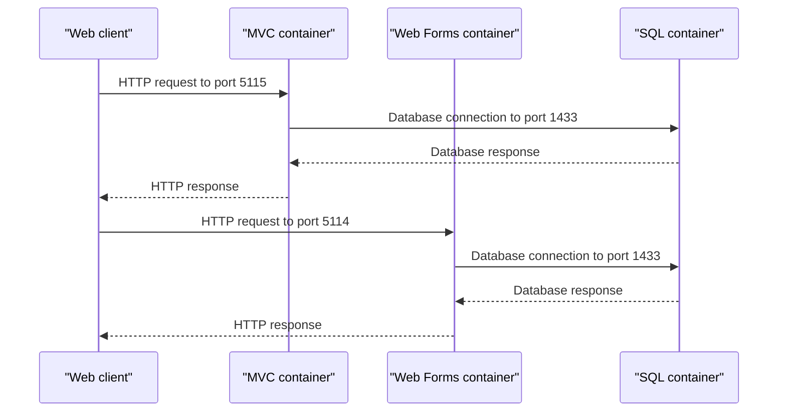

# API & Service Communication Contracts

The manifests expose two HTTP container endpoints and one TCP database endpoint. Application-level route definitions, request/response contracts, and resilience policies are not included in the ServiceFabric workspace.

## Service Catalog

| Service | Port | Category | Purpose |
|---|---:|---|---|
| MVC container | 5115 HTTP | API Layer | Runs the MVC image |
| Web Forms container | 5114 HTTP | API Layer | Runs the Web Forms image |
| SQL container | 1433 TCP | Infrastructure | Hosts the configured catalog database |

## API Endpoints Inventory

No application-level HTTP routes are present in the scoped files. The manifests declare HTTP service endpoints on ports 5115 and 5114, but route paths and controller contracts are inside the container images and cannot be identified here.

## Management & Observability Endpoints

No health, management, or custom metrics endpoints are declared in the scoped manifests.

## DTOs & Contracts

No DTO classes, OpenAPI specifications, protobuf schemas, or GraphQL schemas are included. Serialization behavior and request/response types are not discoverable from deployment manifests.

## Communication Patterns

The manifests configure HTTP endpoints for the two web containers and a TCP endpoint for SQL Server. Both web service configurations reference the SQL container by its Service Fabric DNS name. No message broker, service discovery client, retry policy, circuit breaker, or API gateway configuration is declared in scope. Authentication and transport TLS configuration for the application endpoints cannot be determined from the manifests.

## Service Technology Matrix

| Service | Web | Data Access | Discovery | Gateway | Health | Cache | Metrics |
|---|---|---|---|---|---|---|---|
| MVC container | HTTP endpoint | SQL connection configured | Service Fabric DNS | Not identified | Not identified | Not identified | Not identified |
| Web Forms container | HTTP endpoint | SQL connection configured | Service Fabric DNS | Not identified | Not identified | Not identified | Not identified |
| SQL container | — | SQL Server | Service Fabric DNS | — | Not identified | — | Not identified |

## Service Communication Sequence

