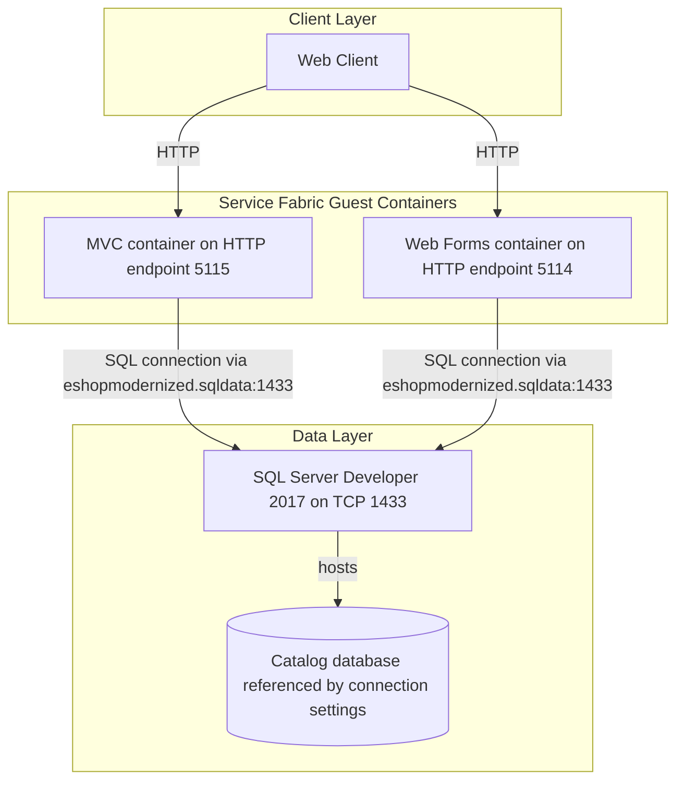
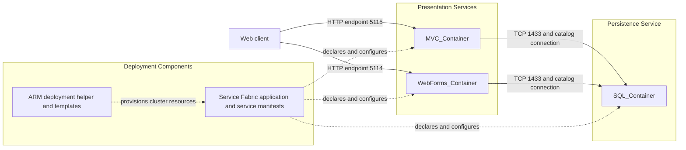

# Architecture Diagram

This deployment-focused view covers the three Service Fabric guest containers and their declared network and configuration relationships. The MVC and Web Forms application internals are packaged in external container images and are not present in this workspace.

## Application Architecture

### Technology Stack Summary

| Layer | Technology | Version | Purpose |
|---|---|---|---|
| Presentation | MVC guest container | Image tag not declared | Web application deployment; application framework/version is inside the image |
| Presentation | Web Forms guest container | Image tag not declared | Web application deployment; application framework/version is inside the image |
| Data | SQL Server Windows Developer container | 2017 | Shared catalog database endpoint |
| Deployment | Azure Service Fabric application projects | Project package version 1.7; MSBuild package 1.6.1 | Package and deploy guest containers |
| Deployment | Azure Service Fabric | Cluster/runtime version not specified by these application manifests | Service discovery, container hosting, and deployment |

### Data Storage & External Services

The MVC and Web Forms service manifests configure a connection to the SQL service DNS name on port 1433 and identify the same catalog database. Azure Storage, Application Insights, and Azure Active Directory are represented by environment parameters, but their defaults are disabled or empty in the manifests. No application schema or external API client implementation is present in this subtree.

### Key Architectural Decisions

- MVC, Web Forms, and SQL are packaged as three separate stateless Service Fabric guest-container applications.
- Both web containers use a Service Fabric DNS name to reach one shared SQL container; the manifests do not define a database readiness gate.
- Container images for the two application services are referenced rather than built from source in this workspace.

## Component Relationships

### Component Inventory

| Component | Layer | Type | Responsibility |
|---|---|---|---|
| MVC_Container | Presentation | Stateless guest container | Hosts the prebuilt MVC image and exposes the declared HTTP endpoint |
| WebForms_Container | Presentation | Stateless guest container | Hosts the prebuilt Web Forms image and exposes the declared HTTP endpoint |
| SQL_Container | Persistence | Stateless guest container | Hosts the SQL Server Developer 2017 image on TCP 1433 |
| Service Fabric manifests | Deployment | Application/service descriptors | Define images, DNS names, port bindings, environment values, and instance counts |
| ARM deployment helper | Operations | C# deployment helper | Reads ARM template and parameter JSON and submits cluster deployment operations |

> The two `DeploymentHelper.cs` files are cluster-deployment utilities, not the MVC or Web Forms application source.
