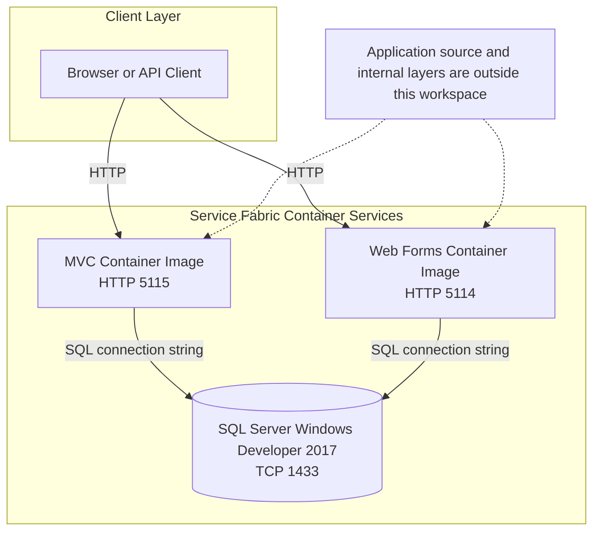
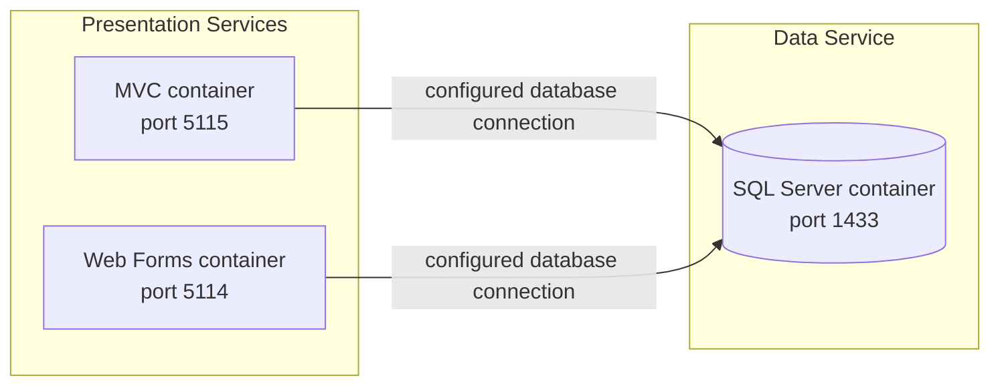

# Architecture Diagram

The ServiceFabric subtree contains deployment definitions for two web container services and one SQL Server container. Application implementation details are not present in this workspace, so the diagrams describe only the deployment topology.

## Application Architecture

### Technology Stack Summary

| Layer | Technology | Version | Purpose |
|---|---|---|---|
| Deployment | Azure Service Fabric | Not specified | Hosts the container services |
| Presentation | MVC container image `eshop/modernizedmvc` | Not specified in this workspace | Web entry point on port 5115 |
| Presentation | Web Forms container image `eshop/modernizedwebforms` | Not specified in this workspace | Web entry point on port 5114 |
| Data | SQL Server Windows Developer image | 2017 | Database container exposed on TCP 1433 |

### Data Storage & External Services

The SQL Service Fabric application deploys a SQL Server 2017 Windows Developer container. The MVC and Web Forms service manifests expose connection-string environment variables, while the SQL service publishes TCP port 1433. No cache, message broker, or external API integration is established by the available deployment files.

### Key Architectural Decisions

- Web and SQL containers are deployed as separate Service Fabric applications.
- The manifests describe stateless guest-container services; application code and its internal component layers are not included.
- MVC and Web Forms HTTP ports are configured in deployment manifests, not as documented application routes.

## Component Relationships

### Component Inventory

| Component | Layer | Type | Responsibility |
|---|---|---|---|
| MVC container service | Presentation | Service Fabric guest container | Hosts the MVC image; internal components are unavailable |
| Web Forms container service | Presentation | Service Fabric guest container | Hosts the Web Forms image; internal components are unavailable |
| SQL container service | Data | Service Fabric guest container | Hosts SQL Server Developer 2017 |
