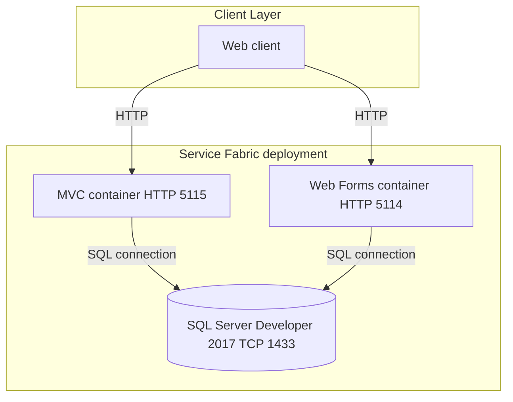
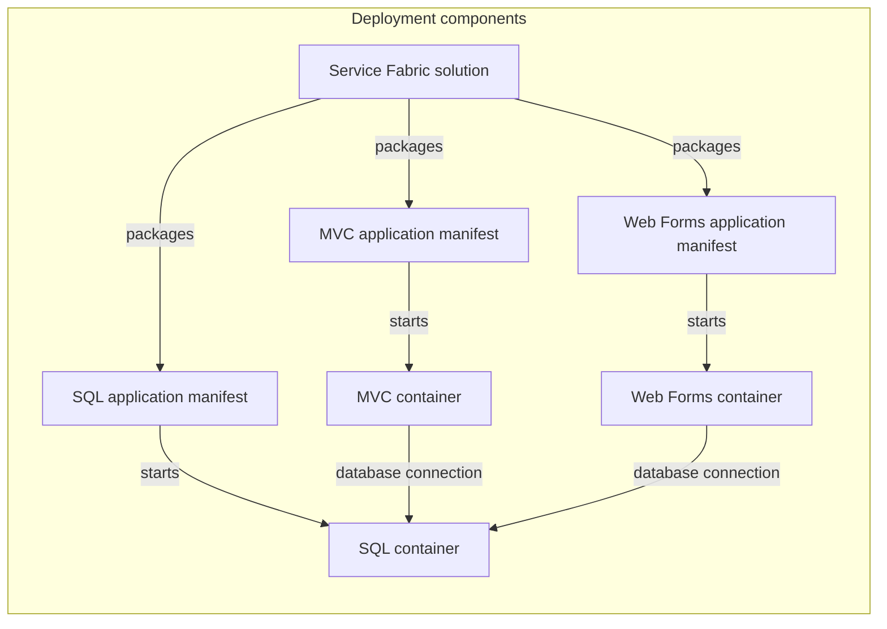

# Architecture Diagram

The scoped solution deploys three containerized services to Service Fabric. Application internals are not included; the diagrams describe only the deployment topology and manifest-defined connections.

## Application Architecture

### Technology Stack Summary

| Layer | Technology | Version | Purpose |
|---|---|---|---|
| Deployment | Azure Service Fabric application projects | Project version 1.7 | Package and deploy container services |
| Web runtime | MVC container image | Image contents not in scope | Web application deployment |
| Web runtime | Web Forms container image | Image contents not in scope | Web application deployment |
| Data | SQL Server Developer container | 2017 | Shared catalog database deployment |

### Data Storage & External Services

The SQL container exposes TCP port 1433 and is referenced by both web service manifests using the Service Fabric DNS name `eshopmodernized.sqldata`. No cache, message broker, or external API configuration is visible in the scoped project.

### Key Architectural Decisions

- MVC and Web Forms applications are deployed as separate container services.
- Both web services are configured to connect to the SQL Server service.
- The application source and runtime dependencies inside the web images are outside this workspace.

## Component Relationships

### Component Inventory

| Component | Layer | Type | Responsibility |
|---|---|---|---|
| Service Fabric solution | Deployment | Solution | Groups the three deployment projects |
| MVC application manifest | Deployment | Manifest | Configures the MVC container package and service |
| Web Forms application manifest | Deployment | Manifest | Configures the Web Forms container package and service |
| SQL application manifest | Deployment | Manifest | Configures the SQL container package and service |
| MVC, Web Forms, and SQL containers | Runtime | Containers | Execute the images referenced by the manifests |

The scoped files do not include application controllers, services, repositories, or other internal components.
