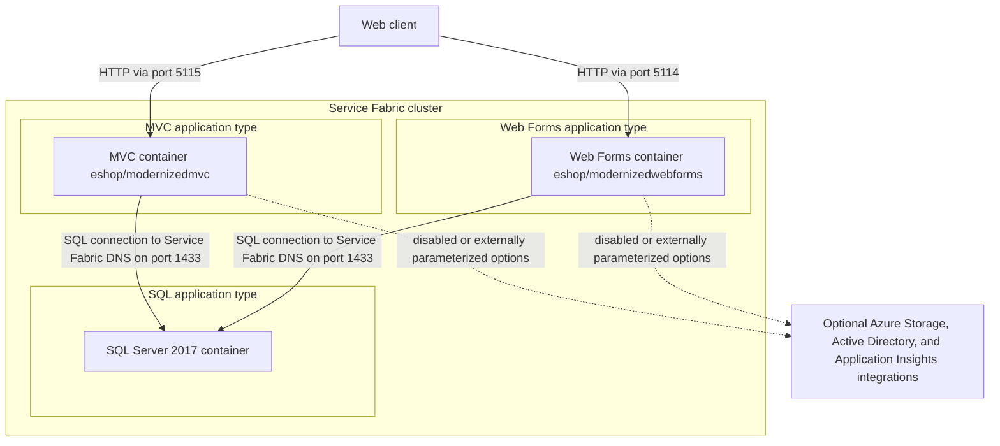
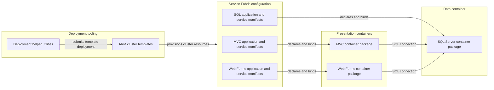

# Architecture Diagram

The ServiceFabric scope deploys two web application containers and a SQL Server container as separate Service Fabric application types. Application source code is not included in this subdirectory, so the diagrams describe deployment boundaries and manifest-declared communication only.

## Application Architecture

### Technology Stack Summary

| Layer | Technology | Version | Purpose |
|---|---|---|---|
| Presentation | MVC container image | Tag not specified | Serves the modernized MVC application on container port 80 |
| Presentation | Web Forms container image | Tag not specified | Serves the modernized Web Forms application on container port 80 |
| Data | Microsoft SQL Server Windows Developer image | 2017 | Database container, exposed through TCP port 1433 |
| Orchestration | Service Fabric application packages | Project schema 1.7 | Declares services, container bindings, and application parameters |
| Deployment | .NET Framework project metadata | 4.6.1 and 4.6.2 | Legacy Service Fabric deployment projects and helper utilities |

### Data Storage & External Services

The two web service manifests configure their SQL connection to the separately deployed `eshopmodernized.sqldata` service at port 1433. Azure Storage, Azure Active Directory, and Application Insights are represented by configurable environment settings; the checked-in service defaults disable these options or leave their values empty. The application containers’ internal implementation is outside this directory.

### Key Architectural Decisions

- Each web application and the SQL container are independently packaged as a Service Fabric application type with a singleton partition.
- The front ends connect to SQL using a Service Fabric DNS name rather than a container IP address.
- Service Fabric manifests bind container port 80 to front-end ports 5115 and 5114, and port 1433 to SQL.

## Component Relationships

### Component Inventory

| Component | Layer | Type | Responsibility |
|---|---|---|---|
| MVC container package | Presentation | Guest container | Hosts the MVC image and exposes its HTTP service endpoint |
| Web Forms container package | Presentation | Guest container | Hosts the Web Forms image and exposes its HTTP service endpoint |
| SQL container package | Data | Guest container | Hosts SQL Server and exposes TCP port 1433 |
| Application and service manifests | Infrastructure | Service Fabric configuration | Declare application types, container images, service DNS, ports, and environment settings |
| ARM templates | Deployment | Infrastructure as code | Define Azure Service Fabric cluster and supporting resources |
| DeploymentHelper | Deployment | C# utility | Reads local ARM JSON and submits a deployment through Azure Resource Manager |
