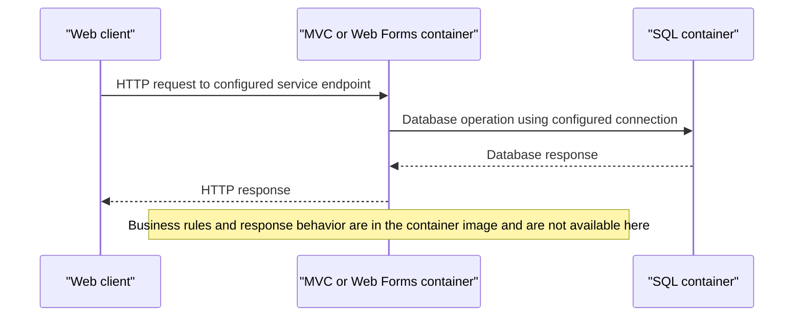

# Core Business Workflows

The ServiceFabric workspace contains deployment definitions for an eShop MVC application, a Web Forms application, and a SQL Server container. Business logic and domain source are inside container images and are not available for inspection here.

## Domain Entities

| Entity | Service / Bounded Context | Description | Key Relationships |
|---|---|---|---|
| Not available | Application containers | No domain model is included in the scoped workspace | Not discoverable |

## Service-to-Domain Mapping

| Service | Domain Context | Owned Entities | External Dependencies |
|---|---|---|---|
| MVC container | eShop web application; internal context unavailable | Not discoverable | SQL container |
| Web Forms container | eShop web application; internal context unavailable | Not discoverable | SQL container |
| SQL container | Persistence infrastructure | Schema not discoverable | None declared |

## Primary Workflows

### Workflow 1: Web request to the deployed application

The manifests expose the MVC and Web Forms containers over HTTP. Each application container is configured with a connection to the SQL service. Route handling, validations, and business decisions cannot be traced because the application code is not part of the ServiceFabric workspace.

### Workflow 2: Service deployment

An operator selects a Service Fabric publish profile and application parameter file. The deployment script resolves the package and profile, connects to the configured cluster, and publishes the selected application package. This workflow is deployment behavior, not an application business process.

## Cross-Service Data Flows

Both web containers reference the shared SQL service by its Service Fabric DNS name. The scoped files do not expose the database schema, which service owns individual records, or any response aggregation or fallback behavior.

## Business Workflow Sequence

## Business Rules & Decision Logic

No application business rules, validation logic, state transitions, or audit behavior are available in the scoped deployment files. The only visible runtime toggles configure mock data, customization data, Azure Storage, and Azure Active Directory; all are disabled by default in the service manifests.
