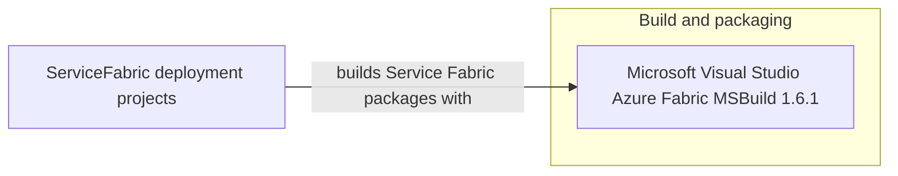

# Dependency Map

The ServiceFabric deployment solution declares one unique NuGet build dependency, shared by three application projects. Container images are declared in service manifests and are deployment artifacts, not package references.

## Dependencies

### Dependency Summary

| Category | Count | Key Libraries | Notes |
|---|---:|---|---|
| Utilities | 1 unique package, 3 declarations | Microsoft.VisualStudio.Azure.Fabric.MSBuild 1.6.1 | Shared by MVC, SQL, and Web Forms deployment projects |

### Version & Compatibility Risks

The deployment projects target .NET Framework 4.6.1 or 4.6.2 and use the legacy Service Fabric MSBuild package 1.6.1. These are older deployment technologies; validate compatibility with the installed Service Fabric tooling and supported Windows container images before changing the build environment.

### Notable Observations

- The repository scope contains deployment projects and manifests, not application `.csproj` files or application source dependency manifests.
- The three projects repeat the same Service Fabric MSBuild package declaration; no central package management is present.
- The service manifests reference SQL Server 2017 and untagged web container images; these are image dependencies rather than NuGet dependencies.

## Test Dependencies

| Framework | Version | Notes |
|---|---|---|
| None detected | — | No test-scoped packages or test projects are declared in this scope. |

Total test-scope dependencies: 0

No test dependencies detected.
