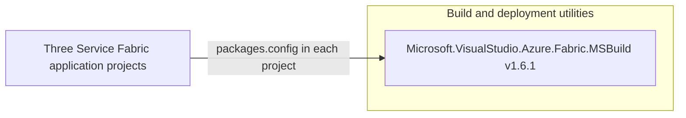

# Dependency Map

The ServiceFabric subtree declares one unique NuGet package dependency across its three legacy Service Fabric application projects. The containerized application dependencies are not available as build declarations because their images are referenced externally.

## Dependencies

### Dependency Summary

| Category | Count | Key Libraries | Notes |
|---|---:|---|---|
| Utilities | 1 unique package | Microsoft.VisualStudio.Azure.Fabric.MSBuild 1.6.1 | Repeated by all three `.sfproj` packages.config files; supplies Service Fabric packaging targets |

### Version & Compatibility Risks

The projects use legacy Service Fabric project format and declare .NET Framework target versions 4.6.1 or 4.6.2. The application container image tags for MVC and Web Forms are not pinned in the manifests, so their framework and transitive runtime dependencies cannot be determined here. The SQL image explicitly references the 2017 Developer tag.

### Notable Observations

- The NuGet package dependency is a Service Fabric build integration package, not an application runtime library.
- ARM helper source files list additional Azure SDK and Newtonsoft.Json requirements in comments, but those versions are not declared in the scoped project package files and are not counted as build dependencies.
- No lock files or resolved transitive dependency graph are present; NuGet package listing could not restore the legacy `.sfproj` solution.

## Test Dependencies

No test-scoped NuGet dependencies are declared in the three `packages.config` files.

Total test-scope dependencies: 0

No test project or test dependency declaration was found in the ServiceFabric subtree.
