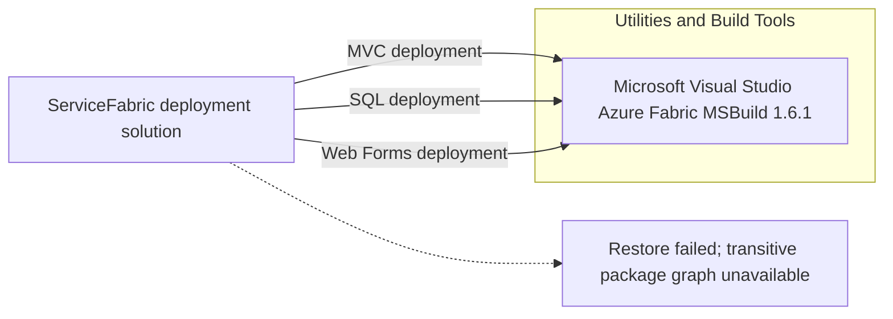

# Dependency Map

The ServiceFabric solution declares three deployments of the same Service Fabric MSBuild package. Package restore could not complete for this legacy `.sfproj` solution, so transitive dependencies could not be resolved.

## Dependencies

### Dependency Summary

| Category | Count | Key Libraries | Notes |
|---|---:|---|---|
| Utilities | 3 declarations, 1 unique package | Microsoft.VisualStudio.Azure.Fabric.MSBuild 1.6.1 | Declared once in each Service Fabric application's `packages.config`; deployment tooling, not runtime application code |

### Version & Compatibility Risks

The available package declarations target legacy .NET Framework project settings (4.6.1 and 4.6.2). The NuGet dependency listing could not restore the `.sfproj` solution, so package compatibility and transitive vulnerabilities could not be determined from a resolved graph.

### Notable Observations

- All three `packages.config` files declare the same Service Fabric MSBuild package version.
- The solution contains deployment projects only; application runtime dependencies are not included.
- No test-scoped package dependencies were found in the Service Fabric deployment package manifests.

## Test Dependencies

| Framework | Version | Notes |
|---|---|---|
| None detected | — | No test package dependencies declared in the deployment projects |

Total test-scope dependencies: 0

No test dependencies detected.
