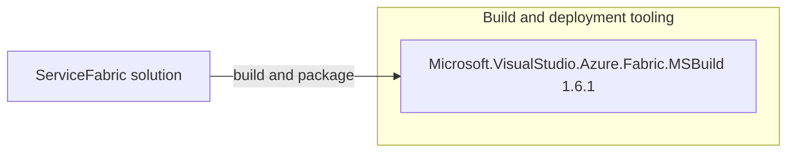

# Dependency Map

The ServiceFabric workspace contains three legacy deployment projects. Each declares the same Service Fabric MSBuild package; container application dependencies are not available in this scope.

## Dependencies

### Dependency Summary

| Category | Count | Key Libraries | Notes |
|---|---:|---|---|
| Build and deployment tooling | 1 | Microsoft.VisualStudio.Azure.Fabric.MSBuild 1.6.1 | Declared by each of the three `.sfproj` projects |
| Container images | 3 | MVC, Web Forms, SQL Server Developer | Images are runtime artifacts, not package references |

### Version & Compatibility Risks

The deployment projects use the legacy Service Fabric project format and target .NET Framework 4.6.1 or 4.6.2 in project metadata. The scoped workspace does not contain application project files or image build definitions, so runtime dependency compatibility cannot be assessed here.

### Notable Observations

- Each project declares `Microsoft.VisualStudio.Azure.Fabric.MSBuild` version 1.6.1 in `packages.config`.
- No application package manifest or lock file is present in this workspace.
- The container images are identified in service manifests; their contents and build provenance are out of scope.

## Test Dependencies

| Framework | Version | Notes |
|---|---|---|
| None detected | — | No test-scoped package references were found in the Service Fabric deployment projects. |

Total test-scope dependencies: 0

No test dependencies are declared by these deployment projects.
