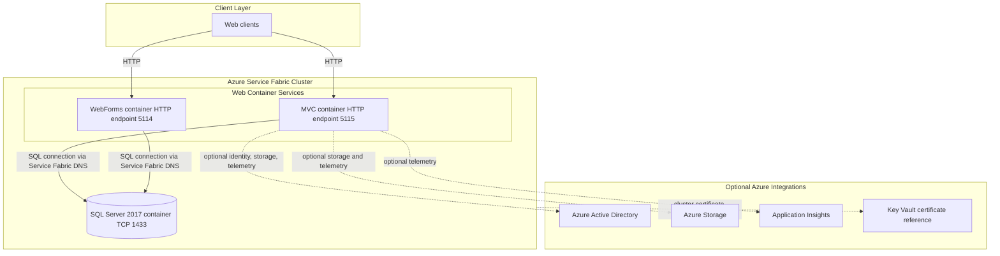
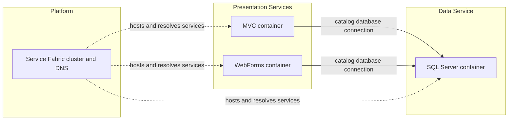

# Architecture Diagram

This assessment describes the Service Fabric deployment assets in this workspace. The application containers' implementation source is not included, so internal application components are shown only at the service boundary.

## Application Architecture

### Technology Stack Summary

| Layer | Technology | Version | Purpose |
|---|---|---|---|
| Orchestration | Azure Service Fabric application projects | Not specified | Deploys and configures the container services |
| Web services | MVC and WebForms containers | Image tags not specified | Exposes HTTP endpoints to clients |
| Data | SQL Server Windows container | 2017 | Hosts the catalog database |
| Infrastructure | Azure Resource Manager templates | Not specified | Defines cluster infrastructure and certificate references |

### Data Storage & External Services

The MVC and WebForms container manifests configure SQL connections to a shared catalog database hosted by the SQL container and addressed through Service Fabric DNS. Application Insights, Azure Storage, Azure Active Directory, and Key Vault certificate references are represented in deployment configuration; their use is optional or parameterized.

### Key Architectural Decisions

- Web and database workloads are packaged as separate Service Fabric container services.
- The SQL service has a fixed instance count, while the web service instance counts are configured for dynamic placement.
- Container services use Service Fabric DNS names rather than hard-coded cluster node addresses for internal database connectivity.

## Component Relationships

### Component Inventory

| Component | Layer | Type | Responsibility |
|---|---|---|---|
| MVC container service | Presentation | Stateless container service | Hosts the MVC web application; its implementation is not present in this workspace |
| WebForms container service | Presentation | Stateless container service | Hosts the WebForms application; its implementation is not present in this workspace |
| SQL container service | Data | Stateless container service | Hosts SQL Server and the configured catalog database |
| Service Fabric cluster | Infrastructure | Container orchestrator | Hosts services and provides service naming and deployment management |
