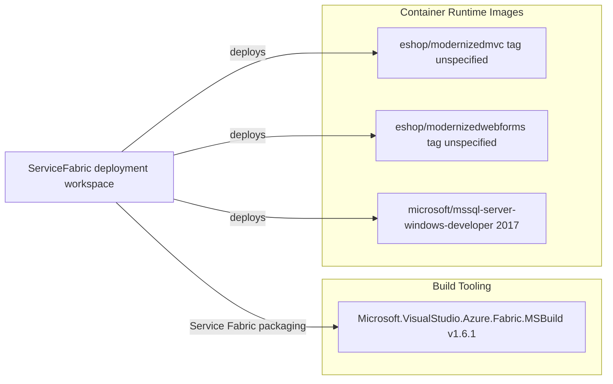

# Dependency Map

The ServiceFabric workspace declares one unique NuGet build dependency across three Service Fabric application projects. Container images are also specified as runtime dependencies.

## Dependencies

### Dependency Summary

| Category | Count | Key Libraries | Notes |
|---|---:|---|---|
| Build Tooling | 1 unique package, 3 declarations | Microsoft.VisualStudio.Azure.Fabric.MSBuild 1.6.1 | Declared by each Service Fabric application project |
| Runtime Containers | 3 images | MVC, WebForms, SQL Server 2017 | The two eShop image tags are not pinned in the manifests |

### Version & Compatibility Risks

The three projects target legacy Service Fabric packaging and include .NET Framework package target metadata for 4.6.1 or 4.6.2. The web container image tags are not version-pinned in the service manifests; the SQL image is tagged 2017.

### Notable Observations

- No application-level package manifests or resolved dependency lock files are present in this workspace.
- The only declared NuGet package is build tooling, repeated in all three `packages.config` files.
- The web container images do not declare immutable version tags in the manifests.

## Test Dependencies

| Framework | Version | Notes |
|---|---|---|
| None detected | — | No test-scoped package dependencies are declared in the Service Fabric projects |

Total test-scope dependencies: 0

No test dependencies were detected in the deployment projects.
