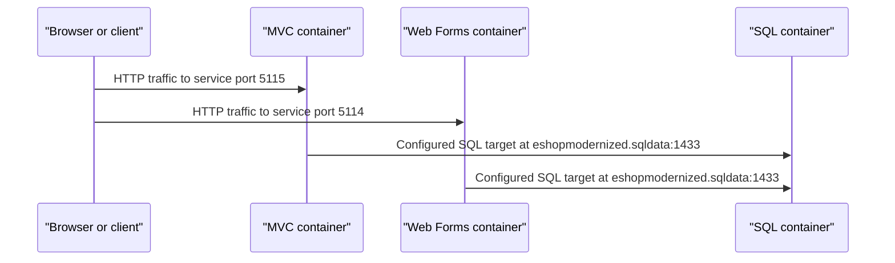

# API & Service Communication Contracts

The scoped deployment declares two HTTP-facing container services and one SQL service. Application source code is not present in this workspace, so application routes, DTOs, authentication behavior, and error contracts cannot be inventoried.

## Service Catalog

| Service | Port | Category | Purpose |
|---|---:|---|---|
| MVC container | 5115 (container port 80) | API / presentation | Hosts the declared MVC workload; application routes are not available in scope |
| Web Forms container | 5114 (container port 80) | API / presentation | Hosts the declared Web Forms workload; application routes are not available in scope |
| SQL container | 1433/TCP | Infrastructure | SQL Server database target for the web workloads |

## API Endpoints Inventory

No application endpoint declarations could be found in the Service Fabric deployment files. The manifests declare HTTP service ports, but do not disclose URL paths, methods, request types, or response types.

## Management & Observability Endpoints

| Service | Endpoint | Custom Metrics |
|---|---|---|
| MVC container | Not specified in deployment manifests | Not specified |
| Web Forms container | Not specified in deployment manifests | Not specified |
| SQL container | TCP 1433 database endpoint | Not specified |

## DTOs & Contracts

No DTO definitions, OpenAPI/Swagger specifications, protobuf schemas, or GraphQL schemas are present in the deployment scope. Serialization and application-level contract types cannot be established from the manifests.

## Communication Patterns

The Service Fabric application manifests configure client-facing HTTP ports 5115 (MVC) and 5114 (Web Forms), each mapped to container port 80. Both web service manifests configure an SQL connection to the `eshopmodernized.sqldata` DNS name on port 1433. The application code is not present, so the actual call pattern, retry/timeout behavior, service discovery implementation, response composition, and API authorization cannot be verified. TLS and authentication are not declared in the inspected service manifests.

## Service Technology Matrix

| Service | Web | Data Access | Discovery | Gateway | Health | Cache | Metrics |
|---|---|---|---|---|---|---|---|
| MVC container | MVC workload (version unknown) | SQL connection configured | Service Fabric DNS target | Not established | Not specified | Not specified | Not specified |
| Web Forms container | Web Forms workload (version unknown) | SQL connection configured | Service Fabric DNS target | Not established | Not specified | Not specified | Not specified |
| SQL container | SQL Server Developer 2017 | SQL Server | Service Fabric DNS target | No | Not specified | Not specified | Not specified |

## Service Communication Sequence

