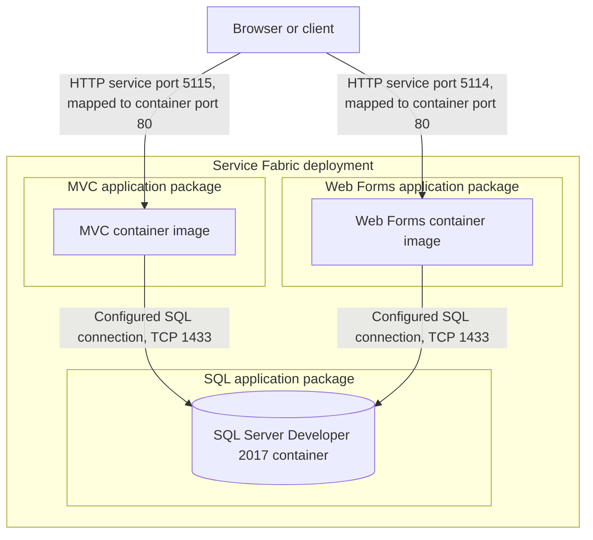
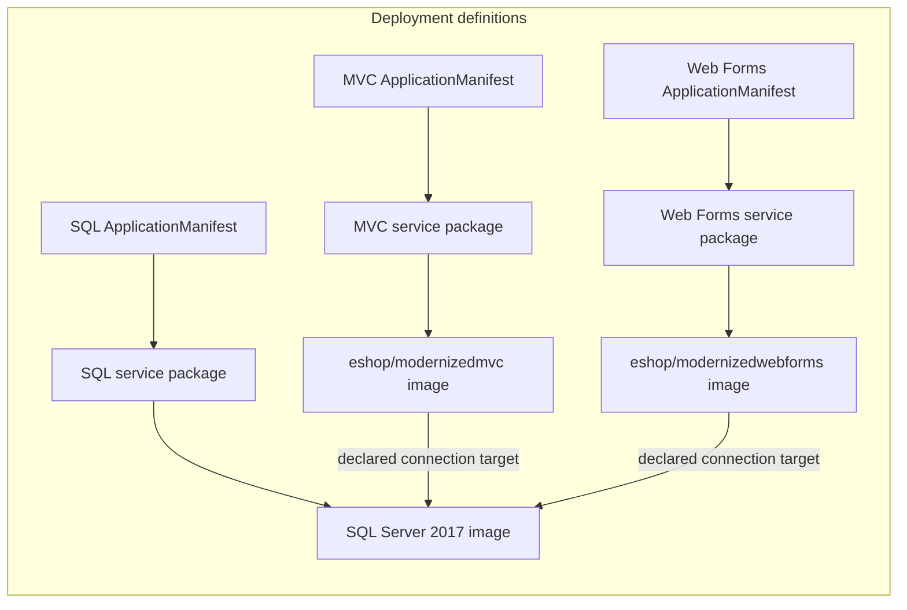

# Architecture Diagram

This view describes the Service Fabric deployment surface under `ServiceFabric`; application source code is outside this assessment scope. The diagrams therefore show declared container and network relationships, not internal application components.

## Application Architecture

### Technology Stack Summary

| Layer | Technology | Version | Purpose |
|---|---|---|---|
| Deployment | Azure Service Fabric application projects | Not specified | Packages stateless container services |
| Presentation | MVC container image `eshop/modernizedmvc` | Image tag not specified | MVC storefront workload; application framework version is not available in scope |
| Presentation | Web Forms container image `eshop/modernizedwebforms` | Image tag not specified | Web Forms storefront workload; application framework version is not available in scope |
| Data | `microsoft/mssql-server-windows-developer` | 2017 | SQL database container |

### Data Storage & External Services

Both web workload manifests configure a connection to the Service Fabric DNS name `eshopmodernized.sqldata` on TCP 1433 and name the `Microsoft.eShopOnContainers.Services.CatalogDb` database. A separate SQL application package declares the SQL Server container. No other external service integration is established by the scoped deployment files.

### Key Architectural Decisions

- The MVC and Web Forms workloads are separate stateless Service Fabric applications and container packages.
- Both workloads are configured to target the SQL container by Service Fabric DNS; actual application-level database behavior is not visible here.
- The web application manifests declare singleton partitions and default instance counts of `-1`; the SQL application parameters set one instance.

## Component Relationships

### Component Inventory

| Component | Layer | Type | Responsibility |
|---|---|---|---|
| MVC ApplicationManifest | Deployment | Service Fabric application manifest | Defines MVC service parameters, environment overrides, and container port binding |
| Web Forms ApplicationManifest | Deployment | Service Fabric application manifest | Defines Web Forms service parameters, environment overrides, and container port binding |
| SQL ApplicationManifest | Deployment | Service Fabric application manifest | Defines SQL service deployment and instance count |
| MVC / Web Forms / SQL ServiceManifest | Deployment | Service Fabric service manifest | Declares the container image, environment variables, and endpoint |
| DeploymentHelper | Deployment tooling | C# helper | Loads local ARM template and parameter JSON and starts an Azure resource deployment |

> Note: Application controllers, business services, and data-access components could not be enumerated because application source code is not part of this workspace scope.