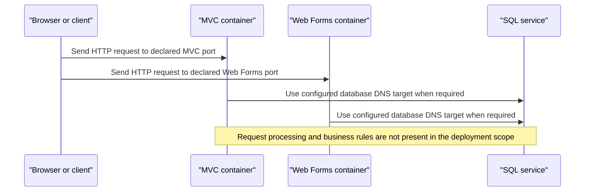

# Core Business Workflows

The Service Fabric workspace contains deployment definitions for eShop MVC, Web Forms, and SQL workloads, but not their application business logic. The only traceable flow is the declared deployment connectivity between the web containers and the SQL service.

## Domain Entities

No domain entities are represented in the scoped Service Fabric manifests.

## Service-to-Domain Mapping

| Service | Domain Context | Owned Entities | External Dependencies |
|---|---|---|---|
| MVC container | Not determinable from deployment files | Not available | SQL service DNS target |
| Web Forms container | Not determinable from deployment files | Not available | SQL service DNS target |
| SQL container | Data hosting only; domain ownership unknown | Schema not included | None declared |

## Primary Workflows

### Deployment connectivity

The application manifests declare independent stateless MVC and Web Forms services. Each service receives a database connection setting for the SQL service at `eshopmodernized.sqldata:1433`; the manifests do not show application queries, user actions, business rules, or readiness gating. No end-to-end business workflow can be reconstructed from these deployment assets.

## Cross-Service Data Flows

The only declared cross-service data path is from the MVC and Web Forms containers to the SQL DNS name and catalog database identified in their connection settings. The deployment descriptors do not reveal which entities or operations cross this boundary, nor do they specify fallback behavior if SQL is unavailable.

## Business Workflow Sequence

## Business Rules & Decision Logic

No domain validations, pricing/eligibility logic, lifecycle transitions, transaction boundaries, or business authorization rules are present in the scoped deployment files. Manifest feature parameters include toggles for mock/customization data, storage, and Active Directory; their effects inside the applications cannot be verified here.