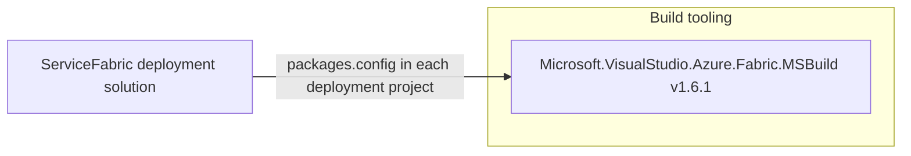

# Dependency Map

The scoped Service Fabric assets declare three instances of the same deployment build package. The project files are legacy `.sfproj` files and package metadata is incomplete, so this is not a complete transitive dependency inventory.

## Dependencies

### Dependency Summary

| Category | Count | Key Libraries | Notes |
|---|---:|---|---|
| Utilities / Build tooling | 3 declarations | Microsoft.VisualStudio.Azure.Fabric.MSBuild 1.6.1 | One declaration in each MVC, SQL, and Web Forms `packages.config` |

### Version & Compatibility Risks

The declared Service Fabric MSBuild package is 1.6.1 and targets .NET Framework 4.6.1 in the MVC and SQL package files and 4.6.2 in Web Forms. Application project files and lock/restore outputs are absent, so package compatibility and transitive dependency versions could not be assessed comprehensively.

### Notable Observations

- The Service Fabric solution contains three `.sfproj` deployment projects but no `.csproj` application projects.
- Container image references are deployment artifacts rather than package-manager dependencies and are not represented as library dependencies above.
- The two ARM helper source files mention additional NuGet libraries, but no project package manifest or resolved versions are available for them.

## Test Dependencies

| Framework | Version | Notes |
|---|---|---|
| None detected | — | No test-project dependency manifests are present in the scoped deployment solution. |

Total test-scope dependencies: 0

No test dependencies were detected in the Service Fabric project files.