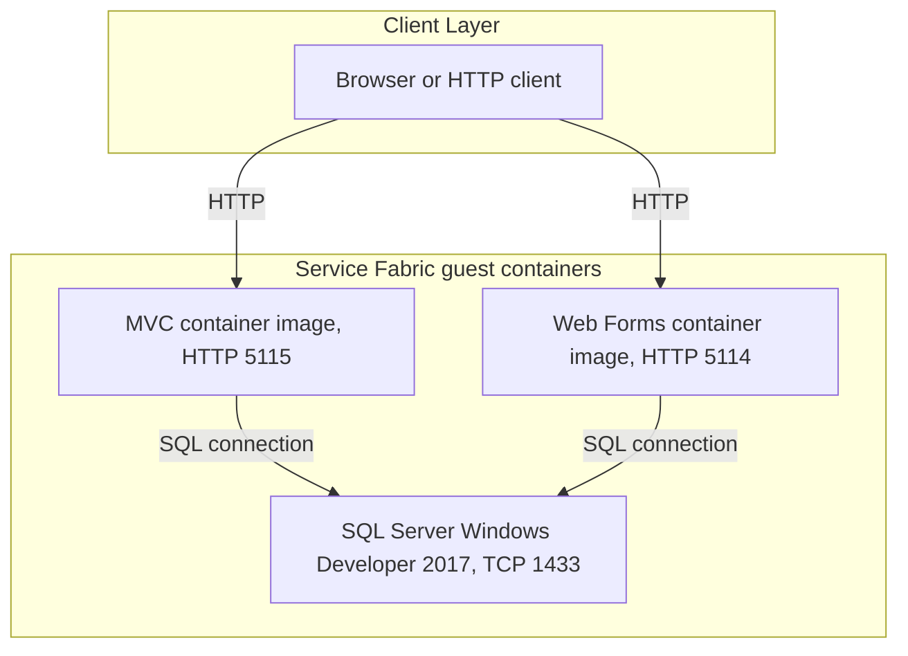
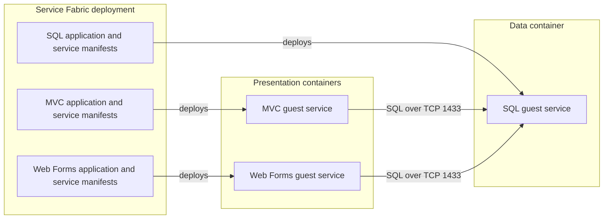

# Architecture Diagram

The ServiceFabric scope deploys MVC, Web Forms, and SQL Server containers through separate guest-service projects. Application source code is not included in this workspace, so the diagrams describe deployment components and the connections visible in their manifests.

## Application Architecture

### Technology Stack Summary

| Layer | Technology | Version | Purpose |
|---|---|---|---|
| Deployment | Azure Service Fabric guest containers | Not specified | Hosts stateless MVC, Web Forms, and SQL container services |
| Web presentation | MVC container image `eshop/modernizedmvc` | Not specified | Exposes the MVC site on port 5115 |
| Web presentation | Web Forms container image `eshop/modernizedwebforms` | Not specified | Exposes the Web Forms site on port 5114 |
| Data | SQL Server Windows Developer container | 2017 | Provides SQL endpoint on TCP 1433 |

### Data Storage & External Services

Both web manifests configure a connection to the Service Fabric DNS name `eshopmodernized.sqldata` on port 1433. The SQL container is a separate stateless guest service. Azure Storage, Application Insights, and Azure Active Directory options are present as disabled or empty configuration values; no active external API or broker is declared in this scope.

### Key Architectural Decisions

- Each workload is packaged as a Service Fabric guest container, with separate deployment projects and manifests.
- MVC and Web Forms services are stateless; the SQL service is configured as a singleton-partitioned service.
- Application code and the web image versions are outside this repository scope, so internal application layers cannot be verified.

## Component Relationships

### Component Inventory

| Component | Layer | Type | Responsibility |
|---|---|---|---|
| MVC guest service | Presentation | Container-hosted stateless service | Hosts the MVC image and exposes HTTP port 5115 |
| Web Forms guest service | Presentation | Container-hosted stateless service | Hosts the Web Forms image and exposes HTTP port 5114 |
| SQL guest service | Data | Container-hosted stateless service | Hosts SQL Server 2017 and exposes TCP port 1433 |
| Application manifests | Deployment | Service Fabric configuration | Declare DNS names, instances, port bindings, and environment overrides |
