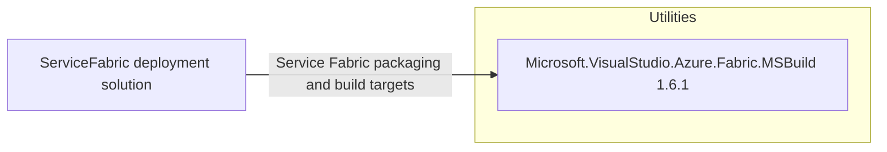

# Dependency Map

The ServiceFabric deployment solution declares one external NuGet build dependency across its three projects. Runtime application dependencies are delivered inside referenced container images and are not represented by these deployment project files.

## Dependencies

### Dependency Summary

| Category | Count | Key Libraries | Notes |
|---|---:|---|---|
| Utilities | 1 | Microsoft.VisualStudio.Azure.Fabric.MSBuild 1.6.1 | Declared by all three `packages.config` files for Service Fabric packaging |

### Version & Compatibility Risks

The deployment projects target .NET Framework 4.6.1 or 4.6.2 and use the legacy Service Fabric MSBuild package 1.6.1. These are legacy project/build dependencies; containerized application package dependencies cannot be assessed from this scope.

### Notable Observations

- The package is duplicated across three `packages.config` files but represents one unique dependency coordinate.
- The solution projects are `.sfproj` deployment projects rather than SDK-style application projects.
- No lock files or resolved transitive dependency graph were available; `dotnet list package --include-transitive` could not restore the `.sfproj` solution.

## Test Dependencies

| Framework | Version | Notes |
|---|---|---|
| None detected | — | No test-scoped NuGet packages are declared in the deployment scope. |

Total test-scope dependencies: 0

No test dependencies detected.
