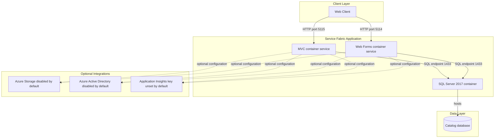
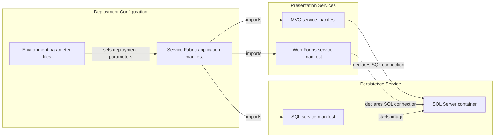

# Architecture Diagram

The scoped workspace contains Service Fabric deployment packages for the MVC and Web Forms front ends and a SQL Server container. Application implementation code is outside this workspace, so the diagrams describe the deployed topology and not internal application components.

## Application Architecture

### Technology Stack Summary

| Layer | Technology | Version | Purpose |
|---|---|---|---|
| Deployment | Azure Service Fabric application projects | Project version 1.7 | Packages and deploys container services |
| Presentation | MVC container image `eshop/modernizedmvc` | Not pinned in manifest | Customer-facing web application |
| Presentation | Web Forms container image `eshop/modernizedwebforms` | Not pinned in manifest | Customer-facing web application |
| Data | SQL Server Windows Developer container | 2017 | Catalog database service |
| Project tooling | .NET Framework target | 4.6.1 / 4.6.2 | Service Fabric project build targets |

### Data Storage & External Services

Both front-end service manifests declare a SQL connection to the Service Fabric SQL service endpoint (`eshopmodernized.sqldata:1433`). Azure Storage and Azure Active Directory are configurable but disabled by default; the Application Insights instrumentation key is empty by default. The application source and database schema are not included in this scoped workspace.

### Key Architectural Decisions

- MVC, Web Forms, and SQL are deployed as separate Service Fabric container service packages.
- Service Fabric DNS names and manifest port bindings connect the front ends to the SQL container.
- Optional cloud integrations are externalized as application parameters and disabled or unset by default.

## Component Relationships

### Component Inventory

| Component | Layer | Type | Responsibility |
|---|---|---|---|
| Application manifests | Deployment | Service Fabric manifest | Defines service packages, parameters, DNS names, and instance counts |
| MVC service package | Presentation | Container service | Runs the MVC image on the declared HTTP endpoint |
| Web Forms service package | Presentation | Container service | Runs the Web Forms image on the declared HTTP endpoint |
| SQL service package | Persistence | Container service | Runs SQL Server and exposes TCP port 1433 |
| Application parameter files | Deployment | Environment configuration | Supplies Local and Cloud deployment values |
