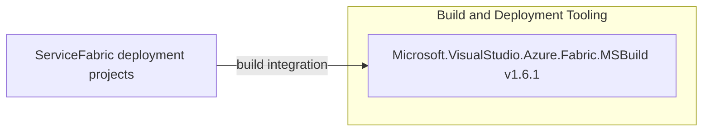

# Dependency Map

The ServiceFabric workspace declares one unique NuGet package across three Service Fabric projects (three package references total).

## Dependencies

### Dependency Summary

| Category | Count | Key Libraries | Notes |
|---|---:|---|---|
| Utilities | 1 | Microsoft.VisualStudio.Azure.Fabric.MSBuild 1.6.1 | Shared Service Fabric MSBuild package referenced by MVC, SQL, and Web Forms deployment projects |

### Version & Compatibility Risks

The projects target .NET Framework 4.6.1 or 4.6.2 and use Service Fabric MSBuild package 1.6.1. These are legacy deployment-project targets; application container dependencies are represented by image names rather than NuGet declarations in this workspace.

### Notable Observations

- All three deployment projects reference the same Service Fabric MSBuild package version.
- The package metadata targets .NET Framework 4.6.1 for the MVC and SQL projects and 4.6.2 for Web Forms.
- Container image versions for the MVC and Web Forms services are not pinned in their manifests.

## Test Dependencies

| Framework | Version | Notes |
|---|---|---|
| None detected | — | No test-scoped package references are declared in the scoped workspace. |

Total test-scope dependencies: 0

No test dependencies detected.
