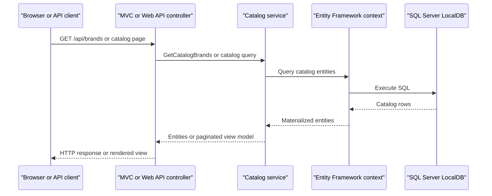

# API & Service Communication Contracts

The solution exposes browser-oriented catalog actions and small brand/file APIs from two separately hosted applications. Requests are handled synchronously through in-process service calls; no inter-service API calls or asynchronous messaging were found.

## Service Catalog

| Service | Port | Category | Purpose |
|---|---|---|---|
| eShopLegacyMVC | Not configured in project settings | API Layer | Legacy MVC site and Web API endpoints for catalog administration, brands, files, and pictures |
| eShopPorted | Not configured in project settings | API Layer | Ported MVC site with catalog pages and brand/file API endpoints |
| eShopLegacy.Utilities | — | Infrastructure | Shared utility library used for binary serialization; not independently deployed |

## API Endpoints Inventory

| Service | Method | Path | Request Type | Response Type |
|---|---|---|---|---|
| eShopLegacyMVC | GET | `/Catalog/Index?pageSize={pageSize}&pageIndex={pageIndex}` | Optional query parameters | Catalog view with `PaginatedItemsViewModel<CatalogItem>` |
| eShopLegacyMVC | GET | `/Catalog/Details/{id}` | Path parameter `id` | Catalog item view; 400 if missing, 404 if not found |
| eShopLegacyMVC | GET / POST | `/Catalog/Create` | POST form model `CatalogItem` | View or redirect to catalog list |
| eShopLegacyMVC | GET / POST | `/Catalog/Edit/{id}` | Path parameter and POST form model `CatalogItem` | View or redirect to catalog list |
| eShopLegacyMVC | GET / POST | `/Catalog/Delete/{id}` | Path parameter `id` | Confirmation view or redirect to catalog list |
| eShopLegacyMVC | GET | `/items/{catalogItemId}/pic` | Integer path parameter | Image file; 400 for invalid ID, 404 if item missing |
| eShopLegacyMVC | GET | `/api/brands` | None | Collection of `CatalogBrand` |
| eShopLegacyMVC | GET | `/api/brands/{id}` | Integer path parameter | `CatalogBrand`; 404 if not found |
| eShopLegacyMVC | DELETE | `/api/brands/{id}` | Integer path parameter | 200 if found (demo endpoint does not delete); 404 if missing |
| eShopLegacyMVC | GET | `/api/files` | None | Binary serialized brand DTO response |
| eShopLegacyMVC | GET | `/api` | None | JSON message response |
| eShopPorted | GET | `/Catalog/Index?pageSize={pageSize}&pageIndex={pageIndex}` | Optional query parameters | Catalog view with `PaginatedItemsViewModel<CatalogItem>` |
| eShopPorted | GET | `/Catalog/Details/{id}` | Path parameter `id` | Catalog item view; 400 if missing, 404 if not found |
| eShopPorted | GET / POST | `/Catalog/Create` | POST form model `CatalogItem` | View or redirect to catalog list |
| eShopPorted | GET / POST | `/Catalog/Edit/{id}` | Path parameter and POST form model `CatalogItem` | View or redirect to catalog list |
| eShopPorted | GET / POST | `/Catalog/Delete/{id}` | Path parameter `id` | Confirmation view or redirect to catalog list |
| eShopPorted | GET | `/items/{catalogItemId}/pic` | Integer path parameter | Image file |
| eShopPorted | GET | `/api/brands` | None | Collection of `CatalogBrand` |
| eShopPorted | DELETE | `/api/brands/{id}` | Integer path parameter | 200 if found (demo endpoint does not delete); 404 if missing |
| eShopPorted | Unspecified | `/api/files` | None | `BrandDTO` collection serialized as binary data |

API versioning is not configured. Standard MVC routes omit the optional `id` segment when not supplied; the legacy Web API route template is `api/{controller}/{id}`.

## Management & Observability Endpoints

| Service | Endpoint | Custom Metrics (if any) |
|---|---|---|
| eShopLegacyMVC | None identified | No custom metrics endpoint identified; Application Insights instrumentation is configured |
| eShopPorted | None identified | No custom metrics or health endpoint identified |

## DTOs & Contracts

`CatalogItem`, `CatalogBrand`, and `CatalogType` are domain entities used by catalog services and views. `PaginatedItemsViewModel<CatalogItem>` is the paginated view response contract. Both applications define a `BrandDTO` nested in `FilesController` to shape the binary file response; these are mutable classes, not immutable records. The legacy MVC application's `/api` action returns an anonymous JSON message. No OpenAPI/Swagger document, protobuf schema, GraphQL schema, or gateway-level aggregation DTO was found. JSON responses use framework defaults; the files endpoints use a custom binary serializer.

## Communication Patterns

All observed API and UI operations use synchronous HTTP request/response handling and direct in-process calls to `ICatalogService`; database operations are synchronous. No asynchronous messaging, service discovery, API gateway, client-side load balancing, retry policy, timeout policy, circuit breaker, or bulkhead configuration was found. The applications do not call one another or compose responses from downstream services. Startup initializes dependency injection and routing before handling requests.

No API-level authentication, authorization checks, or HTTPS/TLS enforcement were identified in the application code or route configuration. The APIs are therefore not protected by application-level identity or role checks in the inspected configuration.

## Service Technology Matrix

| Service | Web | Data Access | Discovery | Gateway | Actuator | Cache | Metrics |
|---|---|---|---|---|---|---|---|
| eShopLegacyMVC | ASP.NET MVC 5 and Web API 2 | Entity Framework 6 | None | None | None | None | Application Insights |
| eShopPorted | ASP.NET Core MVC | Entity Framework Core | None | None | None | None | None identified |

## Service Communication Sequence

