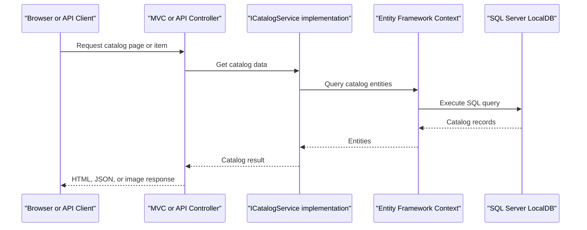

# API & Service Communication Contracts

The solution exposes catalog and brand operations through MVC pages and API controllers in two application implementations. Requests are handled synchronously in-process and persisted through the selected catalog service.

## Service Catalog

| Service | Port | Category | Purpose |
|---|---|---|---|
| eShopLegacyMVC | Not specified in project configuration | API Layer | ASP.NET MVC 5 site and Web API endpoints for the catalog |
| eShopPorted | Not specified in project configuration | API Layer | ASP.NET Core MVC site and API endpoints for the same catalog |
| eShopLegacy.Utilities | N/A | Infrastructure library | Shared binary serialization helper; not independently deployed |

## API Endpoints Inventory

| Service | Method | Path | Request Type | Response Type |
|---|---|---|---|---|
| eShopLegacyMVC | GET | `/api` | None | JSON greeting |
| eShopLegacyMVC | GET | `/api/brands` | None | `CatalogBrand` collection |
| eShopLegacyMVC | GET | `/api/brands/{id}` | Route ID | `CatalogBrand` or 404 |
| eShopLegacyMVC | DELETE | `/api/brands/{id}` | Route ID | 200 or 404; demo action does not delete |
| eShopLegacyMVC | GET | `/api/files` | None | Binary-serialized brand DTO collection |
| eShopLegacyMVC | GET | `/items/{catalogItemId}/pic` | Route ID | Image file or 404 |
| eShopLegacyMVC | GET/POST | `/Catalog/Create` | MVC form / `CatalogItem` | MVC view or redirect |
| eShopLegacyMVC | GET/POST | `/Catalog/Edit/{id}` | Route ID / `CatalogItem` | MVC view or redirect |
| eShopLegacyMVC | GET/POST | `/Catalog/Delete/{id}` | Route ID | MVC confirmation or redirect |
| eShopPorted | GET | `/api/brands` | None | Brand collection |
| eShopPorted | DELETE | `/api/brands/{id}` | Route ID | 200 or 404; demo action does not delete |
| eShopPorted | GET | `/api/files` | None | Binary-serialized brand DTO collection |
| eShopPorted | GET | `/items/{catalogItemId}/pic` | Route ID | Image file |
| eShopPorted | GET/POST | `/Catalog/Create` | MVC form / `CatalogItem` | MVC view or redirect |
| eShopPorted | GET/POST | `/Catalog/Edit/{id}` | Route ID / `CatalogItem` | MVC view or redirect |
| eShopPorted | GET/POST | `/Catalog/Delete/{id}` | Route ID | MVC confirmation or redirect |

The MVC routes use conventional routing; the route table lists their action paths for orientation rather than a versioned API contract.

## Management & Observability Endpoints

| Service | Endpoint | Custom Metrics |
|---|---|---|
| eShopLegacyMVC | None identified | No custom metrics found |
| eShopPorted | None identified | No custom metrics found |

No dedicated health-check or Swagger endpoint was identified.

## DTOs & Contracts

`CatalogItem`, `CatalogBrand`, and `CatalogType` are mutable domain/entity classes used by the MVC and API layers. The files endpoint maps brands to a nested `BrandDTO` with `Id` and `Brand` properties, then serializes the collection using the shared `Serializing` utility. No OpenAPI, protobuf, GraphQL, or immutable record contracts were identified.

## Communication Patterns

Clients communicate with either web application over HTTP. Controllers call `ICatalogService` synchronously; the EF-backed implementation uses the application's SQL Server context, while mock mode uses an in-memory service. There are no outbound service calls, message brokers, service discovery, gateway aggregation, retries, or circuit breakers. The application does not configure authentication, authorization policies, or TLS termination; those may be supplied by an external hosting layer.

## Service Technology Matrix

| Service | Web | Data Access | Discovery | Gateway | Health | Cache | Metrics |
|---|---|---|---|---|---|---|---|
| eShopLegacyMVC | ASP.NET MVC 5 / Web API | EF6 / SQL Server | None | None | None found | None found | Application Insights |
| eShopPorted | ASP.NET Core MVC | EF Core / SQL Server | None | None | None found | None found | None found |

## Service Communication Sequence

