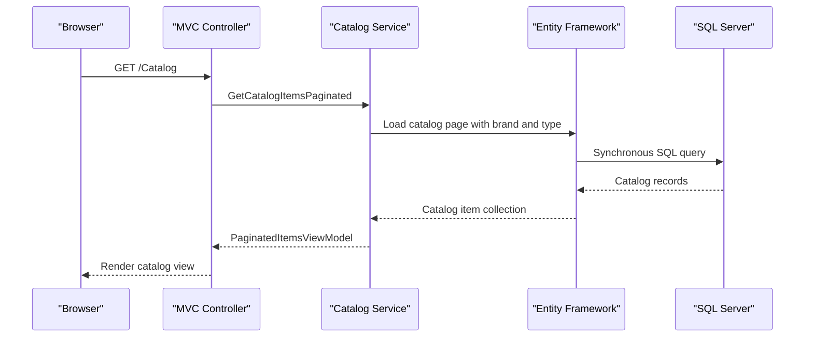

# API & Service Communication Contracts

The solution exposes server-rendered catalog pages and a small set of synchronous HTTP endpoints. No inter-service REST calls, message brokers, or asynchronous service communication were identified.

## Service Catalog

| Service | Port | Category | Purpose |
|---|---|---|---|
| eShopLegacyMVC | Host/IIS assigned | API Layer | Legacy MVC catalog UI, Web API controllers, and EF6 persistence |
| eShopPorted | Host assigned; no port declared in project configuration | API Layer | Ported MVC catalog UI and API controllers |
| eShopLegacy.Utilities | N/A | Infrastructure | Shared binary serialization utility library |

## API Endpoints Inventory

| Service | Method | Path | Request Type | Response Type |
|---|---|---|---|---|
| eShopLegacyMVC | GET | `/Catalog` | Optional `pageSize`, `pageIndex` query values | Catalog view with `PaginatedItemsViewModel<CatalogItem>` |
| eShopLegacyMVC | GET | `/Catalog/Details/{id}` | Path `id` | Catalog item view |
| eShopLegacyMVC | GET, POST | `/Catalog/Create` | POST form `CatalogItem` | View or redirect |
| eShopLegacyMVC | GET, POST | `/Catalog/Edit/{id}` | Path `id`; POST form `CatalogItem` | View or redirect |
| eShopLegacyMVC | GET, POST | `/Catalog/Delete/{id}` | Path/form `id` | View or redirect |
| eShopLegacyMVC | GET | `/items/{catalogItemId:int}/pic` | Path `catalogItemId` | Image bytes |
| eShopLegacyMVC | GET | `/api/brands` | None | Brand entity collection |
| eShopLegacyMVC | GET | `/api/brands/{id}` | Path `id` | Brand entity |
| eShopLegacyMVC | DELETE | `/api/brands/{id}` | Path `id` | Status response |
| eShopLegacyMVC | GET | `/api/files` | None | Binary serialized brand collection |
| eShopLegacyMVC | GET | `/api` | None | JSON message |
| eShopPorted | GET | `/Catalog` | Optional `pageSize`, `pageIndex` query values | Catalog view |
| eShopPorted | GET, POST | `/Catalog/Create`, `/Catalog/Edit/{id}`, `/Catalog/Delete/{id}` | Form data and path identifiers | Views or redirects |
| eShopPorted | GET | `/items/{catalogItemId:int}/pic` | Path `catalogItemId` | Image bytes |
| eShopPorted | GET, DELETE | `/api/brands`, `/api/brands/{id}` | Path `id` for delete | Brand collection or status response |
| eShopPorted | GET | `/api/files` | None | Serialized brand data |

The default MVC route is `/{controller}/{action}/{id?}`; Web API uses `api/{controller}/{id?}`. No URL/header/query API versioning scheme was found.

## Management & Observability Endpoints

| Service | Endpoint | Custom Metrics |
|---|---|---|
| eShopLegacyMVC | No health-check or management endpoint identified | Application Insights instrumentation is configured; no custom metric names identified |
| eShopPorted | No health-check or management endpoint identified | None identified |

## DTOs & Contracts

`CatalogItem`, `CatalogBrand`, and `CatalogType` are domain entities returned or used by the API controllers. `PaginatedItemsViewModel<CatalogItem>` carries paginated UI results. `FilesController.BrandDTO` is a small response contract for brand data. No immutable record DTOs, OpenAPI specifications, protobuf schemas, or GraphQL schemas were found. The legacy files endpoint uses a shared `Serializing` utility backed by `BinaryFormatter`; JSON serialization is also used for the `/api` message.

## Communication Patterns

All identified application calls are synchronous HTTP requests followed by in-process controller-to-service calls and synchronous ORM access. The legacy application uses Web API 2; the ported application maps MVC routes in its startup pipeline. No retries, circuit breakers, service discovery, API gateway, client-side load balancing, or asynchronous messaging were found. SQL Server is accessed directly through each application's Entity Framework context.

No authentication or authorization attributes/middleware were identified on the listed endpoints. Anti-forgery validation is applied to MVC form mutations. TLS termination is not configured in the project source and is deployment-host dependent.

## Service Technology Matrix

| Service | Web | Data Access | Discovery | Gateway | Health | Cache | Metrics |
|---|---|---|---|---|---|---|---|
| eShopLegacyMVC | MVC 5, Web API 2 | EF6 / SQL Server | None | None | None identified | In-memory mock data only | Application Insights |
| eShopPorted | ASP.NET Core MVC 2.2 | EF Core 2.2 / SQL Server | None | None | None identified | In-memory mock data only | None identified |

## Service Communication Sequence

