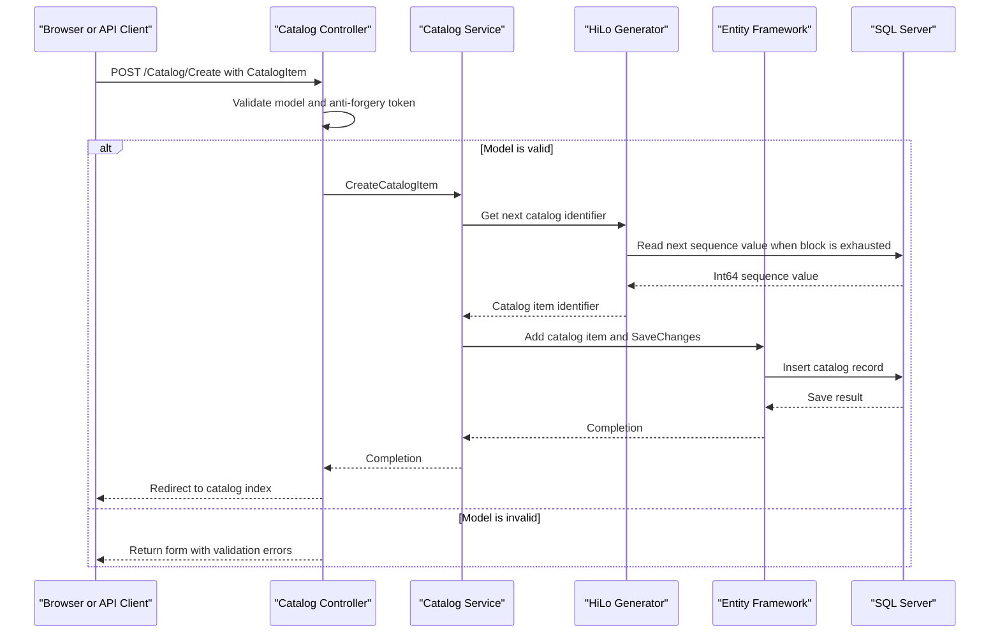

# API & Service Communication Contracts

The solution has two catalog web applications, each with MVC routes and HTTP endpoints. Communication is synchronous and in-process apart from clients connecting to the web applications; no asynchronous messaging or inter-service REST calls were identified.

## Service Catalog

| Service | Port | Category | Purpose |
|---|---|---|---|
| eShopLegacyMVC | Not specified in application configuration | API Layer | ASP.NET MVC and Web API catalog application |
| eShopPorted | 5000 HTTP; 5001 HTTPS in its Project launch profile | API Layer | Ported MVC application with API endpoints |
| eShopLegacy.Utilities | Not applicable | Infrastructure library | Shared binary serialization utility |

## API Endpoints Inventory

| Service | Method | Path | Request Type | Response Type |
|---|---|---|---|---|
| eShopLegacyMVC | GET | `/Catalog/Index` | Optional `pageSize`, `pageIndex` query values | Catalog page |
| eShopLegacyMVC | GET | `/Catalog/Details/{id}` | Path `id` | Catalog item view; 400 or 404 when invalid or absent |
| eShopLegacyMVC | GET | `/Catalog/Create` | None | Create form |
| eShopLegacyMVC | POST | `/Catalog/Create` | `CatalogItem` form; anti-forgery token | Redirect or validation form |
| eShopLegacyMVC | GET | `/Catalog/Edit/{id}` | Path `id` | Edit form |
| eShopLegacyMVC | POST | `/Catalog/Edit` | `CatalogItem` form; anti-forgery token | Redirect or validation form |
| eShopLegacyMVC | GET | `/Catalog/Delete/{id}` | Path `id` | Delete confirmation |
| eShopLegacyMVC | POST | `/Catalog/Delete/{id}` | Path `id`; anti-forgery token | Redirect |
| eShopLegacyMVC | GET | `/api` | None | Demonstration JSON message |
| eShopLegacyMVC | GET | `/api/brands` | None | Brand collection |
| eShopLegacyMVC | GET | `/api/brands/{id}` | Path `id` | Brand or 404 |
| eShopLegacyMVC | DELETE | `/api/brands/{id}` | Path `id` | 200 or 404; demonstration route does not delete |
| eShopLegacyMVC | GET | `/api/files` | None | Binary-serialized brand list |
| eShopLegacyMVC | GET | `/items/{catalogItemId}/pic` | Integer path `catalogItemId` | Image bytes or 404 |
| eShopPorted | GET | `/Catalog/Index` | Optional `pageSize`, `pageIndex` query values | Catalog page |
| eShopPorted | GET | `/Catalog/Details/{id}` | Path `id` | Catalog item view |
| eShopPorted | GET | `/Catalog/Create` | None | Create form |
| eShopPorted | POST | `/Catalog/Create` | `CatalogItem` form | Redirect or validation form |
| eShopPorted | GET | `/Catalog/Edit/{id}` | Path `id` | Edit form |
| eShopPorted | POST | `/Catalog/Edit` | `CatalogItem` form | Redirect or validation form |
| eShopPorted | GET | `/Catalog/Delete/{id}` | Path `id` | Delete confirmation |
| eShopPorted | POST | `/Catalog/Delete/{id}` | Path `id` | Redirect |
| eShopPorted | GET | `/api/brands` | None | Brand collection |
| eShopPorted | DELETE | `/api/brands/{id}` | Path `id` | 200 or 404; demonstration route does not delete |
| eShopPorted | GET | `/api/files` | None | Binary-serialized brand list |
| eShopPorted | GET | `/items/{catalogItemId}/pic` | Integer path `catalogItemId` | Image bytes or 404 |

The MVC route templates are conventional and resolve controller/action routes; the API routes use `api/{controller}/{id}` in the legacy application and `api/[controller]` in the ported application.

## Management & Observability Endpoints

| Service | Endpoint | Custom Metrics |
|---|---|---|
| eShopLegacyMVC | No application health or metrics endpoint identified | Application Insights package references are present; no custom metric registration found |
| eShopPorted | No health or metrics endpoint identified | None found |

## DTOs & Contracts

`CatalogItem`, `CatalogBrand`, and `CatalogType` are service-level domain entities used in MVC views and API responses. The legacy `/api/files` endpoint returns a binary-serialized list of `BrandDTO` values; the DTO contains `Id` and `Brand`. The utility exposes `BinaryFormatter` serialization and deserialization. No OpenAPI, protobuf, or GraphQL contract files were found. JSON contracts are framework defaults plus Newtonsoft.Json references; the source does not establish a custom serialization policy.

## Communication Patterns

Requests use synchronous HTTP between browser/API clients and the selected application. Controllers call `ICatalogService` directly; database-backed implementations call EF6 or EF Core, while mock mode uses an in-memory implementation. No queue, service discovery, gateway aggregation, retry policy, circuit breaker, or cross-service client was identified.

The legacy MVC create/edit/delete actions include anti-forgery validation. No authentication or role-based authorization configuration was identified. The ported launch profile supports local HTTPS, but the source does not demonstrate TLS enforcement for deployed traffic.

## Service Technology Matrix

| Service | Web | Data Access | Discovery | Gateway | Health | Cache | Metrics |
|---|---|---|---|---|---|---|---|
| eShopLegacyMVC | MVC 5 and Web API | EF6 / SQL Server | None | None | None identified | None identified | Application Insights packages |
| eShopPorted | ASP.NET Core MVC 2.2 | EF Core / SQL Server | None | None | None identified | None identified | None identified |
| eShopLegacy.Utilities | None | None | None | None | Not applicable | None | None |

## Service Communication Sequence

