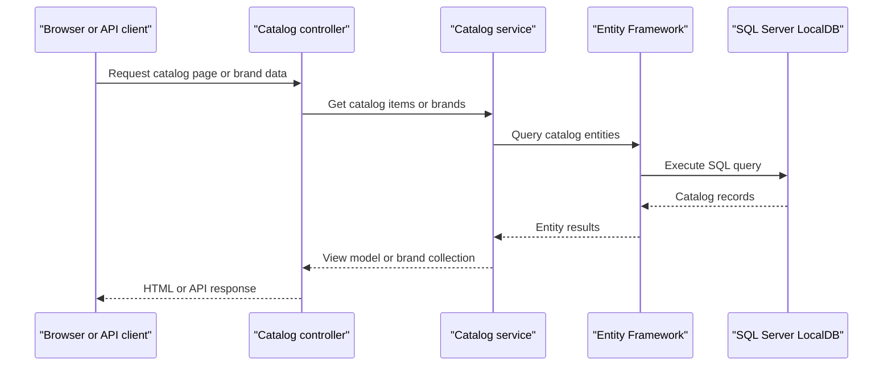

# API & Service Communication Contracts

The solution exposes conventional MVC routes and a small catalog-oriented API in each application. The applications make direct in-process service calls and database calls; no inter-service transport or asynchronous messaging was found.

## Service Catalog

| Service | Port | Category | Purpose |
|---|---|---|---|
| eShopLegacyMVC | Not specified | API and web application | Legacy catalog UI and Web API |
| eShopPorted | 5000 / 5001 in Development | API and web application | Ported catalog UI and API |
| eShopLegacy.Utilities | — | Shared library | Binary serialization helper; not independently deployable |

## API Endpoints Inventory

| Service | Method | Path | Request Type | Response Type |
|---|---|---|---|---|
| eShopLegacyMVC | GET | `/api` | None | JSON greeting object |
| eShopLegacyMVC | GET | `/api/brands` | None | Catalog brand collection |
| eShopLegacyMVC | GET | `/api/brands/{id}` | Integer route parameter | Catalog brand or 404 |
| eShopLegacyMVC | DELETE | `/api/brands/{id}` | Integer route parameter | 200 or 404; demo does not delete |
| eShopLegacyMVC | GET | `/api/files` | None | Binary-serialized list of `BrandDTO` |
| eShopLegacyMVC | GET | `/items/{catalogItemId}/pic` | Integer route parameter | Image bytes |
| eShopLegacyMVC | GET / POST | `/Catalog` and `/Catalog/{action}/{id?}` | Query or form-bound catalog fields | MVC view or redirect |
| eShopPorted | GET | `/api/brands` | None | Catalog brand collection |
| eShopPorted | DELETE | `/api/brands/{id}` | Integer route parameter | 200 or 404; demo does not delete |
| eShopPorted | GET | `/api/files` | None | Serialized brand data |
| eShopPorted | GET | `/items/{catalogItemId}/pic` | Integer route parameter | Image bytes |
| eShopPorted | GET / POST | `/Catalog` and `/Catalog/{action}/{id?}` | Query or form-bound catalog fields | MVC view or redirect |

## Management & Observability Endpoints

| Service | Endpoint | Custom Metrics |
|---|---|---|
| eShopLegacyMVC | None identified | Application Insights instrumentation is configured; no custom metrics identified |
| eShopPorted | None identified | No health-check or metrics endpoint identified |

## DTOs & Contracts

`BrandDTO` is a service-level response shape used by the files API. `CatalogItem`, `CatalogBrand`, and `CatalogType` are service-level domain entities also used by MVC views and API actions. `PaginatedItemsViewModel<CatalogItem>` is the catalog list response model. No gateway aggregation DTO, OpenAPI document, protobuf schema, or GraphQL schema was found. `BrandDTO` is a mutable class; JSON formatting is provided by the application frameworks, while the files endpoint uses the shared binary serializer.

## Communication Patterns

- MVC and API controllers call `ICatalogService` directly; the service uses EF6 or EF Core, depending on the application.
- The ported application can register mock catalog data with `UseMockData`; it does not communicate with another service.
- No message broker, service discovery, API gateway, retries, circuit breaker, or client-side load balancing was identified.
- No authentication or authorization middleware is configured. The startup pipeline does not enforce HTTPS; local launch settings advertise HTTP and HTTPS development URLs.
- The files endpoints return serialized catalog brand data. No client-facing service composition was observed.

## Service Technology Matrix

| Service | Web | Data Access | Discovery | Gateway | Health Checks | Cache | Metrics |
|---|---|---|---|---|---|---|---|
| eShopLegacyMVC | ASP.NET MVC 5 and Web API 2 | EF6 / SQL Server | None | None | None identified | None identified | Application Insights |
| eShopPorted | ASP.NET Core MVC 2.2 | EF Core 2.2 / SQL Server | None | None | None identified | None identified | None identified |

## Service Communication Sequence

