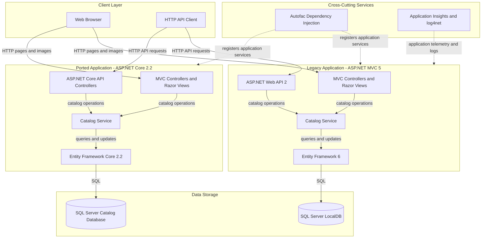
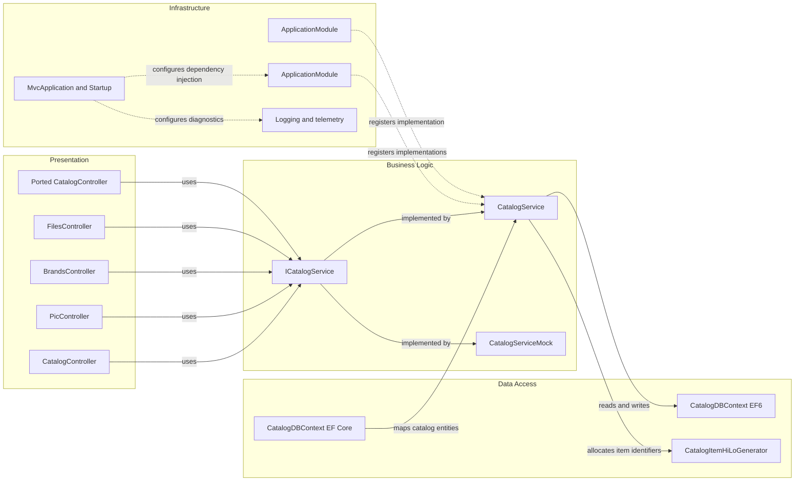

# Architecture Diagram

This solution contains a legacy ASP.NET MVC 5 application and an ASP.NET Core 2.2 ported application, both centered on a catalog service. The projects use Entity Framework against SQL Server and Autofac for dependency injection.

## Application Architecture

### Technology Stack Summary

| Layer | Technology | Version | Purpose |
|---|---|---|---|
| Presentation | ASP.NET MVC | 5.2.7 | Server-rendered catalog pages |
| API | ASP.NET Web API | 2 | HTTP endpoints for catalog brands and files |
| Ported application | ASP.NET Core MVC | 2.2 | ASP.NET Core version of the catalog application |
| Business logic | Catalog service and Autofac | Autofac 4.x | Catalog operations and dependency registration |
| Data access | Entity Framework | 6.2.0 | Catalog persistence in the legacy application |
| Data access | Entity Framework Core | 2.2.6 | Catalog persistence in the ported application |
| Data storage | SQL Server / LocalDB | Configured locally | Catalog and lookup data |
| Diagnostics | Application Insights and log4net | Package versions in project | Application telemetry and logging |

### Data Storage & External Services

The legacy MVC application configures a SQL Server LocalDB connection in `Web.config`; the ported application configures SQL Server through Entity Framework Core and `DefaultConnection` settings. Both persist catalog items, brands, and types. Application Insights and log4net provide diagnostics; no additional external APIs, caches, or message brokers were identified.

### Key Architectural Decisions

- The MVC 5 and ASP.NET Core projects use separate service and persistence implementations while modeling the same catalog domain.
- Autofac modules select either mock catalog data or database-backed services from application configuration.
- The legacy application combines MVC pages and Web API endpoints in one web application.

## Component Relationships

### Component Inventory

| Component | Layer | Type | Responsibility |
|---|---|---|---|
| CatalogController | Presentation | MVC controller | Displays and updates catalog items |
| PicController | Presentation | MVC controller | Serves catalog item pictures |
| BrandsController | Presentation | Web API controller | Exposes catalog brand data |
| FilesController | Presentation | Web API controller | Exposes catalog item files |
| CatalogService | Business Logic | Service | Retrieves and changes catalog records |
| CatalogServiceMock | Business Logic | Mock service | Provides in-memory catalog data when enabled |
| ICatalogService | Business Logic | Service interface | Defines catalog operations used by controllers |
| CatalogDBContext | Data Access | EF6 / EF Core context | Maps catalog items, brands, and types |
| CatalogItemHiLoGenerator | Data Access | Identifier generator | Allocates catalog item identifiers |
| ApplicationModule | Infrastructure | Autofac module | Registers catalog services and database components |
| MvcApplication / Startup | Infrastructure | Application startup | Configures routes, dependency injection, and request pipeline |
| Logging and telemetry | Infrastructure | Cross-cutting services | Captures application logs and telemetry |
