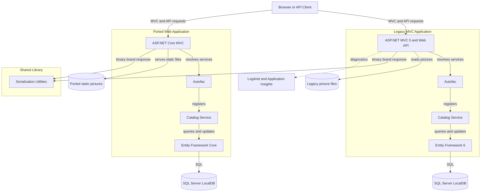
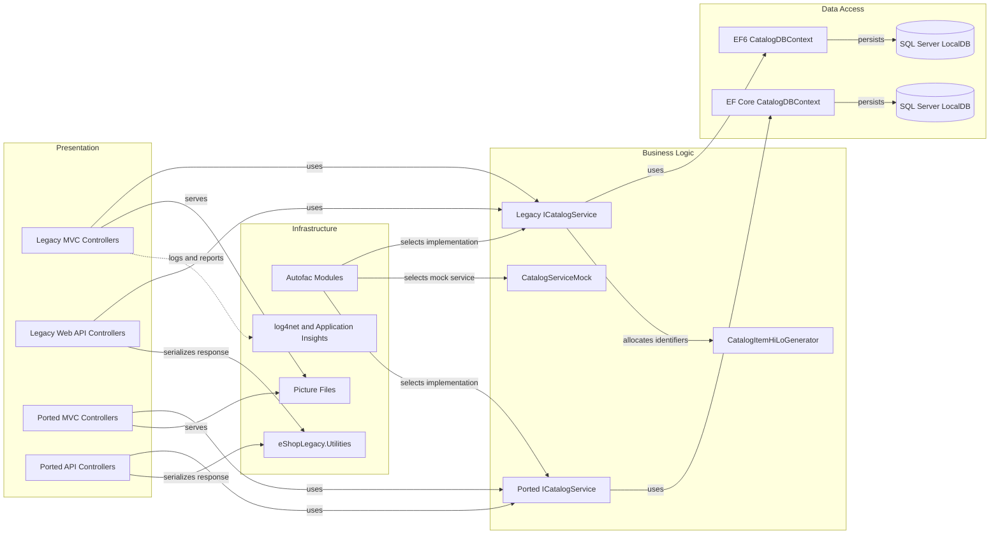

# Architecture Diagram

This solution contains two catalog web applications and a shared utility library. Each web application can use a SQL Server-backed catalog service or a mock implementation, depending on its configuration.

## Application Architecture

### Technology Stack Summary

| Layer | Technology | Version | Purpose |
|---|---|---|---|
| Legacy web | ASP.NET MVC and Web API | MVC 5.2.7; Web API 5.2.7 | Server-rendered catalog pages and HTTP API |
| Legacy runtime | .NET Framework | 4.7.2 | Hosts the legacy MVC application |
| Ported web | ASP.NET Core MVC | 2.2.0 packages | Server-rendered catalog pages and HTTP API |
| Ported runtime | .NET Framework | 4.6.1 | Target framework declared by the ported project |
| Dependency injection | Autofac | 4.9.1 and 6.1.0 | Registers catalog services and persistence |
| Legacy persistence | Entity Framework | 6.2.0 | SQL Server catalog access |
| Ported persistence | Entity Framework Core | 2.2.6 | SQL Server catalog access |
| Shared utilities | eShopLegacy.Utilities | Project reference | Binary serialization support |
| Logging and telemetry | log4net; Application Insights | 2.0.10; 2.9.1 | Application logging and telemetry |

### Data Storage & External Services

Both web applications are configured for SQL Server LocalDB and keep product pictures in application files. The legacy application uses EF6 and the ported application uses EF Core. No message broker, remote application API, or distributed cache was identified; Application Insights is the only external telemetry integration evidenced in the legacy project.

### Key Architectural Decisions

- The solution keeps the original MVC application and a separately packaged port side by side rather than splitting the catalog into independently deployed services.
- Autofac selects either a mock catalog service or a database-backed service from an application setting.
- The two web projects have independent persistence contexts and configuration; their deployment-time data sharing is not established by the source.

## Component Relationships

### Component Inventory

| Component | Layer | Type | Responsibility |
|---|---|---|---|
| CatalogController | Presentation | MVC controller | Displays, creates, edits, and deletes catalog items |
| PicController | Presentation | MVC controller | Returns the image associated with a catalog item |
| BrandsController | Presentation | Web API controller | Returns brands and exposes a demonstration delete route |
| FilesController | Presentation | Web API controller | Returns a binary-serialized brand list |
| ICatalogService | Business Logic | Service contract | Abstracts catalog reads and writes |
| CatalogService | Business Logic | Service | Implements database-backed catalog operations |
| CatalogServiceMock | Business Logic | Service | Implements catalog operations against in-memory items |
| CatalogItemHiLoGenerator | Business Logic | Identifier generator | Allocates catalog identifiers from SQL sequence values |
| CatalogDBContext | Data Access | EF6 context | Maps catalog entities and relationships |
| CatalogDBContext | Data Access | EF Core context | Maps the ported application's catalog entities |
| ApplicationModule | Infrastructure | Autofac module | Registers services, context, and initializer |
| Serializing | Infrastructure | Utility | Serializes and deserializes binary object streams |
