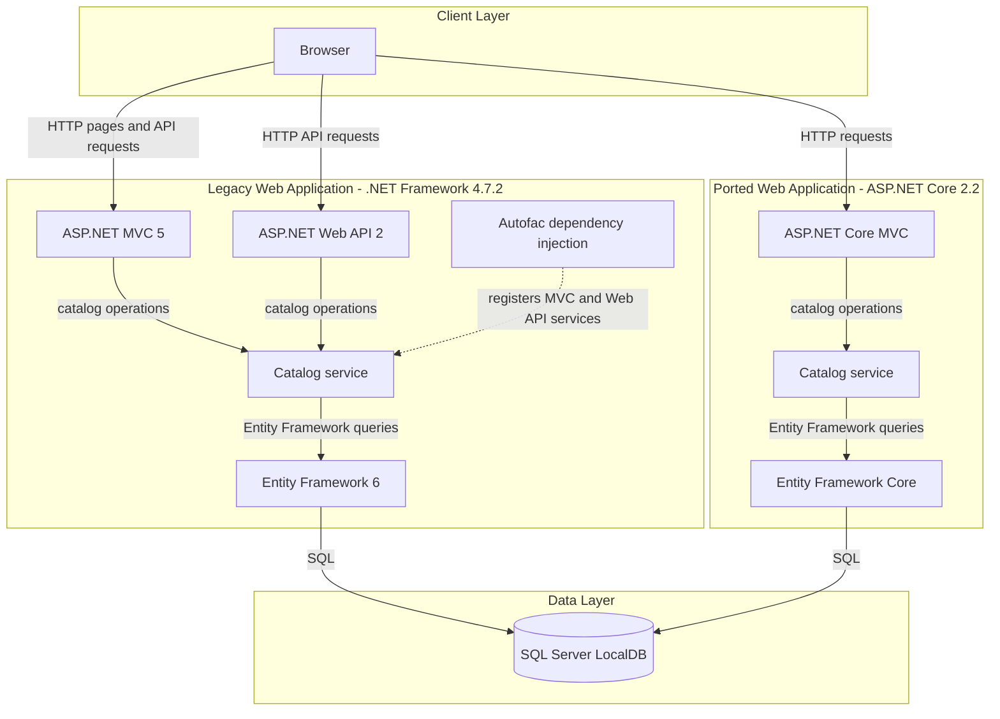
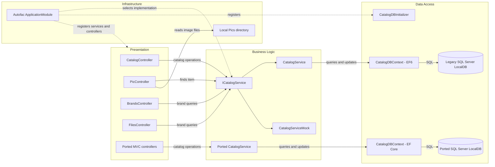

# Architecture Diagram

The solution contains a classic ASP.NET MVC application and a separate ASP.NET Core 2.2 port, both implementing catalog browsing and management with SQL Server-backed persistence.

## Application Architecture

### Technology Stack Summary

| Layer | Technology | Version | Purpose |
|---|---|---:|---|
| Legacy presentation | ASP.NET MVC | 5.2.7 | Server-rendered catalog pages |
| Legacy API | ASP.NET Web API | 5.2.7 | Brand and file API endpoints |
| Legacy runtime | .NET Framework | 4.7.2 | Hosts the classic MVC application |
| Ported presentation | ASP.NET Core MVC | 2.2.0 | Server-rendered catalog pages in the port |
| Dependency injection | Autofac | 4.9.1 | Registers controllers and catalog services |
| Legacy data access | Entity Framework | 6.2.0 | Maps catalog entities to SQL Server |
| Ported data access | Entity Framework Core | 2.2.6 | Maps catalog entities to SQL Server |
| Storage | SQL Server LocalDB | — | Stores catalog items, brands, and types |

### Data Storage & External Services

The legacy project configures `CatalogDBContext` to use SQL Server LocalDB. The ASP.NET Core port configures a separate `DefaultConnection` to SQL Server LocalDB and uses Entity Framework Core. No external APIs, caches, or message brokers are configured for these applications; catalog images are served from the legacy application's local `Pics` directory.

### Key Architectural Decisions

- Both applications separate MVC controllers from catalog operations behind `ICatalogService`.
- Autofac configures dependency injection in both applications, with mock-data implementations selectable from configuration.
- The port is a distinct application using ASP.NET Core MVC and EF Core rather than a shared runtime with the legacy MVC app.

## Component Relationships

### Component Inventory

| Component | Layer | Type | Responsibility |
|---|---|---|---|
| CatalogController | Presentation | MVC controller | Displays and manages catalog items |
| PicController | Presentation | MVC controller | Serves catalog images from the local image directory |
| BrandsController | Presentation | Web API controller | Returns brand data and handles the demo delete endpoint |
| FilesController | Presentation | Web API controller | Serializes brand data into a binary response |
| Ported MVC controllers | Presentation | ASP.NET Core MVC controllers | Expose catalog and image operations in the port |
| ICatalogService | Business Logic | Service contract | Defines catalog reads and writes |
| CatalogService | Business Logic | Service implementation | Queries and updates catalog data |
| CatalogServiceMock | Business Logic | Mock service | Supplies mock catalog data when configured |
| CatalogDBContext | Data Access | EF6 / EF Core context | Maps catalog entities to relational storage |
| CatalogDBInitializer | Data Access | Database initializer | Initializes the legacy catalog database |
| ApplicationModule | Infrastructure | Autofac module | Registers service implementations and data components |
