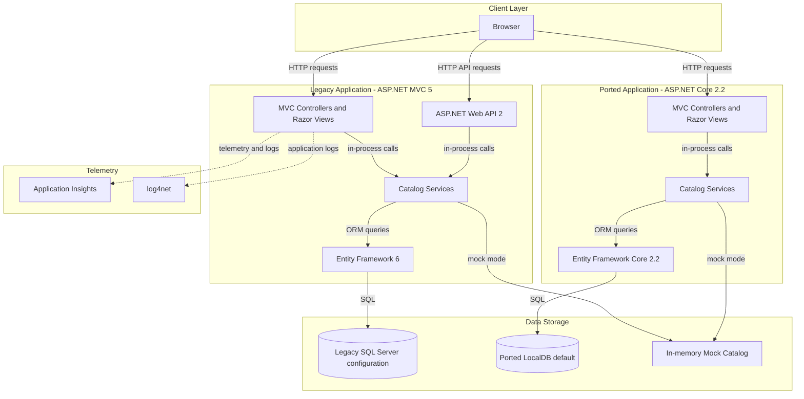
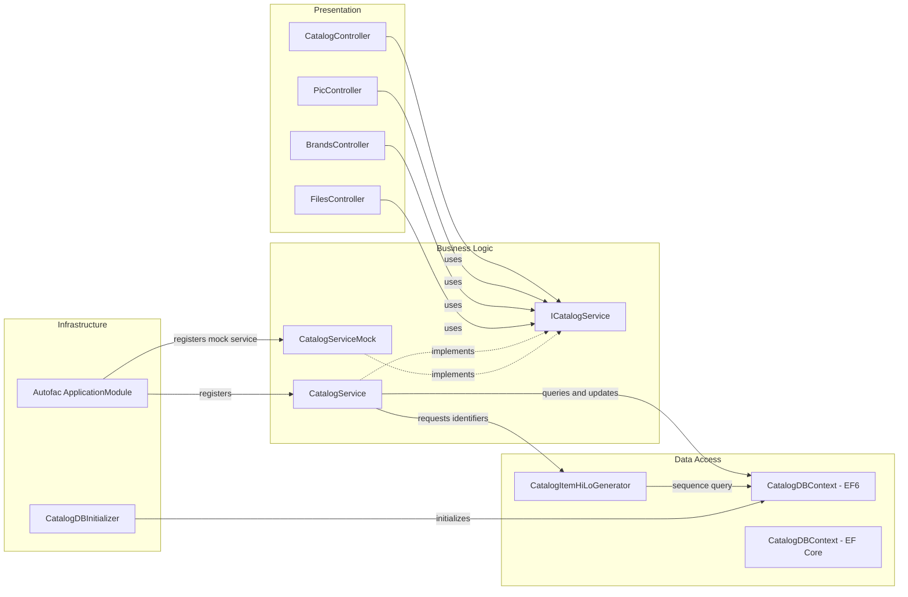

# Architecture Diagram

The solution contains a legacy ASP.NET MVC 5 catalog application and a separately packaged ported MVC application. Both expose catalog browsing and maintenance and use either SQL Server persistence or a mock-data implementation.

## Application Architecture

### Technology Stack Summary

| Layer | Technology | Version | Purpose |
|---|---|---:|---|
| Presentation | ASP.NET MVC 5 / Razor | 5.2.7 | Server-rendered catalog pages |
| API | ASP.NET Web API 2 | 5.2.7 | Brand and file endpoints |
| Ported presentation | ASP.NET Core MVC | 2.2.0 | Ported catalog web application |
| Business | C# catalog services | .NET Framework 4.7.2 / net461 | Catalog operations and mock-data mode |
| Data access | Entity Framework 6 | 6.2.0 | Legacy SQL Server persistence |
| Ported data access | Entity Framework Core | 2.2.6 | Ported SQL Server persistence |
| Dependency injection | Autofac | 6.1.0 / 4.9.1 | Component registration |
| Observability | Application Insights and log4net | 2.9.1 / 2.0.10 | Telemetry and application logging |

### Data Storage & External Services

When mock data is disabled, both applications use SQL Server through their respective Entity Framework contexts. Mock mode serves catalog items from an in-memory list. Application Insights is configured for the legacy application; no external business APIs, message brokers, or cache service were identified.

### Key Architectural Decisions

- Controllers delegate catalog operations to the `ICatalogService` abstraction.
- Autofac selects a database-backed or mock service at startup; the mock service is registered as a singleton.
- The legacy MVC and ported applications are separate projects in the same solution and maintain distinct ORM implementations.

## Component Relationships

### Component Inventory

| Component | Layer | Type | Responsibility |
|---|---|---|---|
| CatalogController | Presentation | MVC controller | Catalog browsing and item maintenance |
| PicController | Presentation | MVC controller | Reads and returns catalog pictures |
| BrandsController | Presentation | Web API controller | Reads and deletes catalog brands |
| FilesController | Presentation | Web API controller | Returns serialized brand data |
| ICatalogService | Business | Service contract | Defines catalog operations |
| CatalogService | Business | Service | Performs database-backed catalog operations |
| CatalogServiceMock | Business | Service | Serves and mutates in-memory catalog data |
| CatalogDBContext | Data access | EF6 DbContext | Persists catalog entities |
| CatalogItemHiLoGenerator | Data access | Identifier generator | Allocates catalog item identifiers |
| CatalogDBInitializer | Infrastructure | EF initializer | Creates sequences and seeds catalog data |
| ApplicationModule | Infrastructure | Autofac module | Configures service lifetimes and implementations |
