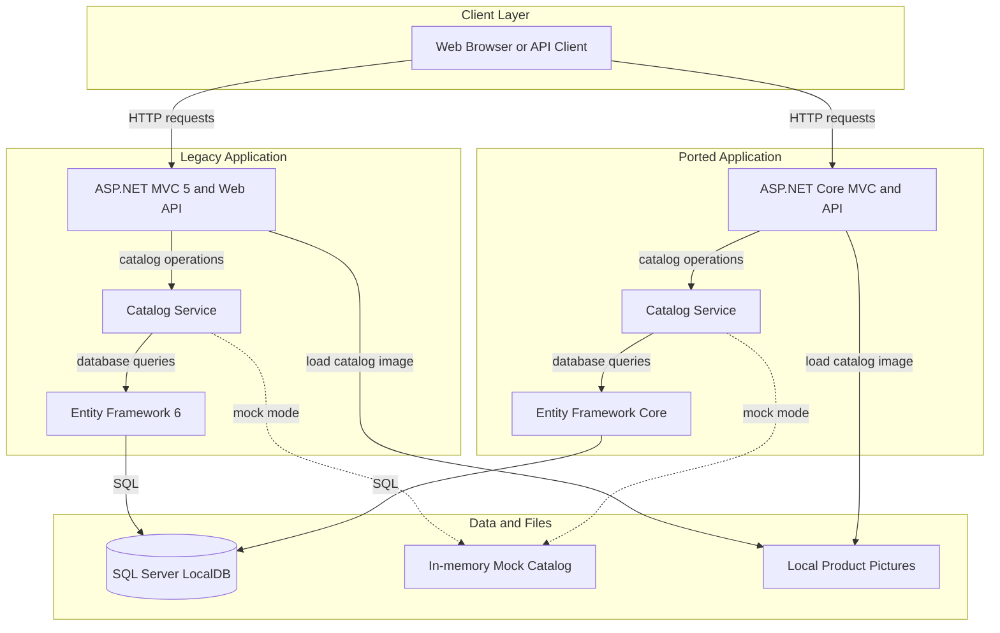
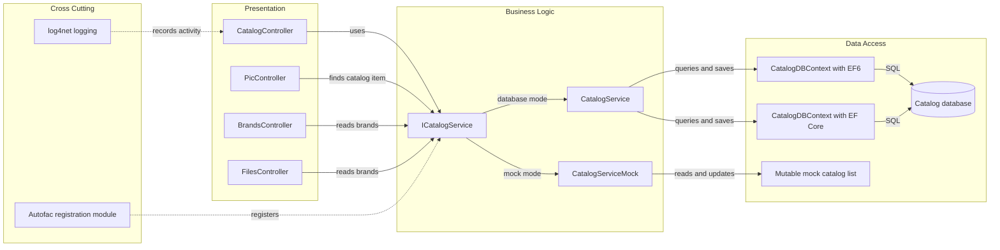

# Architecture Diagram

The solution contains a legacy ASP.NET MVC application and a separately implemented ASP.NET Core catalog application. Both expose catalog browsing and management, and can use SQL Server LocalDB or in-memory mock data.

## Application Architecture

### Technology Stack Summary

| Layer | Technology | Version | Purpose |
|---|---|---:|---|
| Legacy presentation | ASP.NET MVC and Web API | MVC 5.2.7 | Server-rendered catalog pages and REST-style endpoints |
| Ported presentation | ASP.NET Core MVC | 2.2.0 | Second catalog web application |
| Legacy data | Entity Framework 6 | 6.2.0 | Catalog persistence |
| Ported data | Entity Framework Core and SQL Server provider | 2.2.6 | Catalog persistence and migrations |
| Dependency injection | Autofac | 4.9.1 | Service and database component registration |
| Runtime | .NET Framework | 4.7.2 / 4.6.1 | Legacy MVC and ported project target frameworks |
| Logging and telemetry | log4net and Application Insights | 2.0.10 / 2.9.1 | Application logging and telemetry |

### Data Storage & External Services

Both implementations configure SQL Server LocalDB for catalog data. Their mock-data modes instead use an in-memory catalog; no remote API, message broker, cache, or other independently deployed service was identified. Product pictures are read from local application files.

### Key Architectural Decisions

- Controllers depend on `ICatalogService`; the concrete service uses EF while mock mode registers an in-memory implementation.
- The legacy and ported projects maintain separate EF contexts and mappings for the same catalog domain.
- Autofac provides module-based dependency registration in both applications.

## Component Relationships

### Component Inventory

| Component | Layer | Type | Responsibility |
|---|---|---|---|
| CatalogController | Presentation | MVC controller | Displays and edits catalog items |
| PicController | Presentation | MVC controller | Returns a catalog item's picture |
| BrandsController | Presentation | API controller | Lists, looks up, and demonstrates deletion of brands |
| FilesController | Presentation | API controller | Returns brand data serialized for the legacy-compatible files route |
| ICatalogService | Business Logic | Service contract | Separates controllers from catalog access |
| CatalogService | Business Logic | Data-backed service | Reads and changes catalog records |
| CatalogServiceMock | Business Logic | Mock service | Supplies and updates in-memory catalog data |
| CatalogDBContext | Data Access | EF context | Maps catalog entities to SQL Server |
| ApplicationModule | Infrastructure | Autofac module | Registers the selected service and data components |
