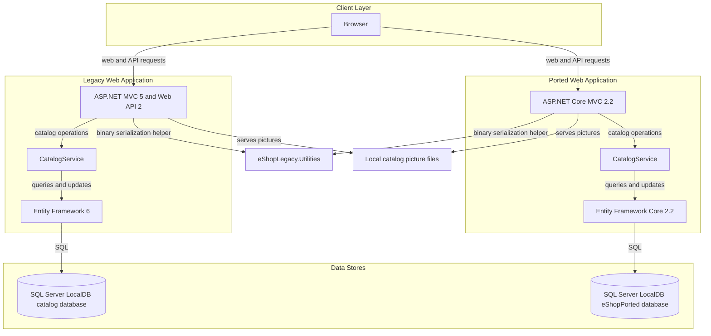
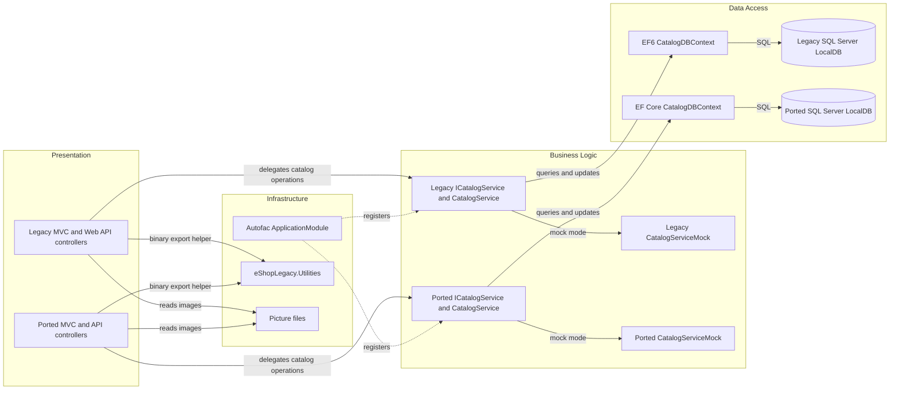

# Architecture Diagram

The solution contains two catalog web applications, a legacy ASP.NET MVC application and a ported ASP.NET Core application. Both have a catalog service layer and SQL Server persistence mode; the ported application selects mock data by default. A small utilities library is shared between them.

## Application Architecture

### Technology Stack Summary

| Layer | Technology | Version | Purpose |
|---|---|---|---|
| Presentation | ASP.NET MVC and Web API | MVC 5.2.7; Web API 5.2.7 | Legacy catalog pages and API |
| Presentation | ASP.NET Core MVC | 2.2.0 | Ported catalog pages and API |
| Business | CatalogService and ICatalogService | In solution | Catalog operations and mock-data selection |
| Data access | Entity Framework 6 | 6.2.0 | Legacy SQL Server persistence |
| Data access | Entity Framework Core and SQL Server provider | 2.2.6 | Ported SQL Server persistence |
| Dependency injection | Autofac | 4.9.1 | Service registration |
| Shared utility | eShopLegacy.Utilities | .NET Framework 4.6.1 | Binary serialization helper |
| Runtime | .NET Framework | 4.6.1 projects | Application and library target framework |

### Data Storage & External Services

The legacy application uses SQL Server LocalDB by default. The ported application's `UseMockData` setting defaults to true; when database mode is enabled, it uses SQL Server LocalDB. Their configured database names are different. The legacy app uses the `CatalogDBContext` connection in `Web.config`; the ported app uses `DefaultConnection` in `appsettings.json`. Catalog pictures are read from local application files. No external service, message broker, or cache integration was identified.

### Key Architectural Decisions

- The solution contains two parallel catalog implementations with separate EF contexts and data stores.
- `ICatalogService` abstracts catalog operations and is registered with either a database-backed or mock implementation.
- Autofac provides dependency injection; the applications share a binary serialization utility.

## Component Relationships

### Component Inventory

| Component | Layer | Type | Responsibility |
|---|---|---|---|
| CatalogController | Presentation | MVC controller | Catalog listing, details, create, edit, and delete flows |
| PicController | Presentation | MVC controller | Loads a catalog item's picture |
| BrandsController | Presentation | API controller | Lists and looks up brands; demo delete action |
| FilesController | Presentation | API controller | Returns serialized brand data |
| CatalogService | Business Logic | Service | Catalog queries and persistence operations |
| CatalogServiceMock | Business Logic | Mock service | Supplies predefined catalog data |
| CatalogDBContext | Data Access | EF context | Maps catalog entities to SQL Server |
| CatalogItemHiLoGenerator | Data Access | ID generator | Allocates catalog item IDs from a SQL sequence |
| ApplicationModule | Infrastructure | Autofac module | Registers services and context dependencies |
| Serializing | Infrastructure | Utility | Serializes objects to a binary stream |
