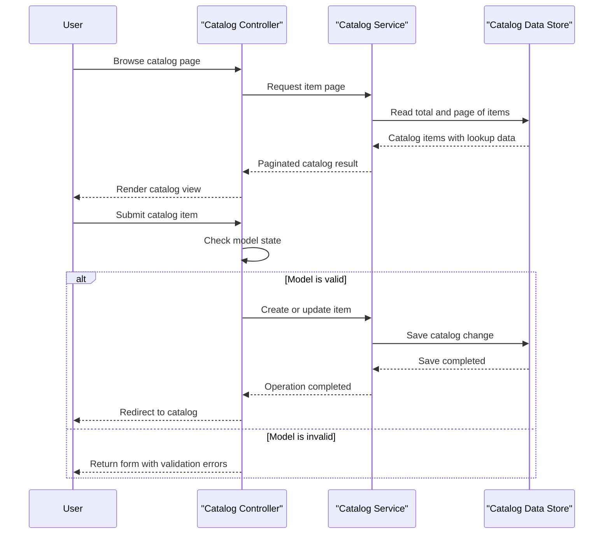

# Core Business Workflows

The application supports browsing and maintaining an online catalog of products, brands, and product types. Catalog data can be served from a mock catalog or from the configured database.

## Domain Entities

| Entity | Service / Bounded Context | Description | Key Relationships |
|---|---|---|---|
| CatalogItem | Catalog | A product offered in the catalog, including its stock and image information | Associated with one CatalogBrand and one CatalogType |
| CatalogBrand | Catalog | A brand used to group catalog products | Can be associated with multiple CatalogItems |
| CatalogType | Catalog | A product type/category used to classify catalog products | Can be associated with multiple CatalogItems |

## Service-to-Domain Mapping

| Service | Domain Context | Owned Entities | External Dependencies |
|---|---|---|---|
| eShopLegacyMVC | Catalog | CatalogItem, CatalogBrand, CatalogType | SQL Server or mock catalog data |
| eShopPorted | Catalog | CatalogItem, CatalogBrand, CatalogType | SQL Server or mock catalog data |

Both applications independently implement the catalog context. No cross-context service communication or shared remote source of truth was identified.

## Primary Workflows

### Workflow 1: Browse the catalog

1. A user requests the catalog list and may provide page size and page index.
2. The catalog controller delegates to the catalog service.
3. The service retrieves the total item count and a page of catalog items with their brand and type.
4. The application derives image links and returns a paginated view.
5. Selecting an item loads its details; an unknown identifier returns not found.

### Workflow 2: Maintain a catalog item

1. A user opens the create or edit form; lookup brands and types are supplied for selection.
2. The user submits the catalog item form.
3. The controller checks the submitted model state. If invalid, the form is returned with lookup values; if valid, the service creates or updates the item.
4. A successful write returns the user to the catalog list.
5. Deletion is confirmed through a separate form and the item is removed by the catalog service.

## Cross-Service Data Flows

There are no cross-service data aggregation or composition flows. Each application obtains catalog, brand, and type information from its own catalog service implementation, which uses either mock data or its own database context. No remote-service fallback behavior was identified.

## Business Workflow Sequence

## Business Rules & Decision Logic

- Catalog-item forms use model validation before writes. `Name` is required; `Price` must be within the configured range and use at most two decimal places; stock and reorder quantities are range-limited.
- Catalog item creation in the legacy MVC application obtains an identifier from its HiLo sequence generator. The ported service persists the item through its configured data context.
- Mock-data settings choose between a sample in-memory catalog and the database-backed service; customization-data settings determine how seed data is supplied.
- There are no documented catalog state transitions, approval process, or price calculation workflow.
- Catalog writes use synchronous ORM save operations. No explicit audit trail, cross-service transaction, or business authorization rule was identified.
