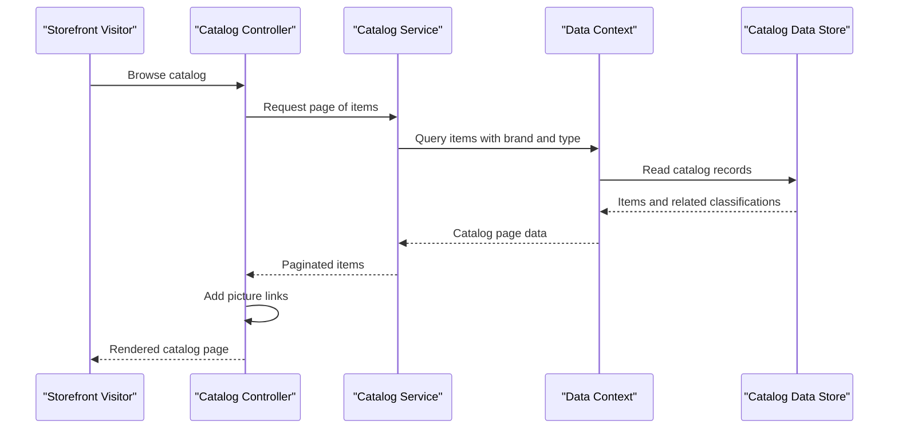

# Core Business Workflows

The application supports product catalog browsing and basic catalog maintenance for an e-commerce storefront. It manages catalog items, brands, types, product images, prices, and stock indicators; checkout and payment workflows are not present in this target.

## Domain Entities

| Entity | Service / Bounded Context | Description | Key Relationships |
|---|---|---|---|
| CatalogItem | Catalog Management | Product offered in the storefront, with pricing and stock information | Belongs to one brand and one catalog type |
| CatalogBrand | Catalog Management | Product brand classification | Has many catalog items |
| CatalogType | Catalog Management | Product type classification | Has many catalog items |

## Service-to-Domain Mapping

| Service | Domain Context | Owned Entities | External Dependencies |
|---|---|---|---|
| eShopLegacyMVC | Catalog Management | CatalogItem, CatalogBrand, CatalogType | SQL Server LocalDB or in-memory mock service |
| eShopPorted | Catalog Management | CatalogItem, CatalogBrand, CatalogType | SQL Server LocalDB or in-memory mock service |

The two applications are alternate implementations of the catalog site, not separate bounded-context services. Each owns its own EF context and maps the same catalog concepts.

## Primary Workflows

### Workflow 1: Browse the Product Catalog

1. A visitor opens the catalog page.
2. `CatalogController` requests a page of items through `ICatalogService`.
3. The service loads related brand/type data and returns a paginated result from SQL or mock data.
4. The controller adds each item's picture URI and renders the catalog view.

### Workflow 2: Maintain a Catalog Item

1. A catalog operator submits the create or edit form.
2. The controller validates the bound `CatalogItem` using model validation.
3. If valid, the service creates or updates the item and persists it through the selected data source.
4. The application redirects to the catalog listing; invalid input is returned to the form.

### Workflow 3: View a Product Picture

1. The visitor requests the picture route for a catalog item ID.
2. `PicController` looks up the item through the catalog service.
3. If the item exists, the controller reads and returns the associated picture; otherwise it returns not found.

## Cross-Service Data Flows

There are no cross-service composition or aggregation flows. Each application serves its own request and reads its own configured persistence source. Mock mode returns local in-memory data. The brand delete endpoints are demos and return success without performing a deletion.

## Business Workflow Sequence

## Business Rules & Decision Logic

- A catalog item requires a name; price is constrained to non-negative values with at most two decimal places and a configured maximum.
- Available stock, restock threshold, and maximum stock values are range-constrained; `OnReorder` indicates reorder state.
- Catalog items reference a catalog brand and catalog type.
- MVC create/edit actions persist only when model validation succeeds. Forms include anti-forgery validation.
- Brand deletion is intentionally a demo-only response and does not change catalog state.
- Database versus mock service selection is controlled by `UseMockData`; there are no checkout, payment, authorization, or cross-service transaction flows.
