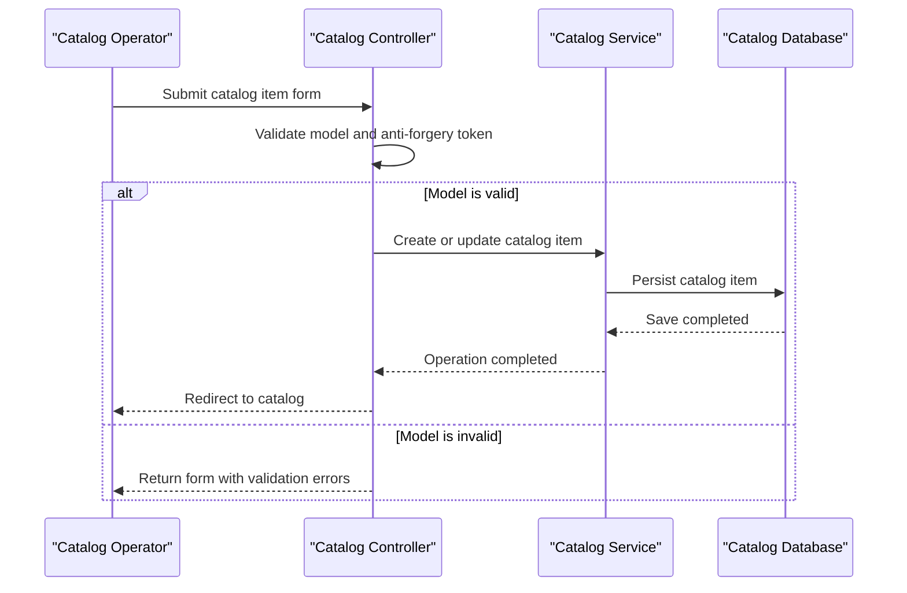

# Core Business Workflows

The application supports browsing and maintaining a sample e-commerce product catalog. It does not implement checkout, payment, order fulfillment, or customer-management workflows in this solution.

## Domain Entities

| Entity | Service / Bounded Context | Description | Key Relationships |
|---|---|---|---|
| CatalogItem | Catalog | A listed product with price, stock, and image reference | Belongs to one CatalogBrand and one CatalogType |
| CatalogBrand | Catalog | Brand classification for products | Can classify many CatalogItems |
| CatalogType | Catalog | Product type/category classification | Can classify many CatalogItems |

## Service-to-Domain Mapping

| Service | Domain Context | Owned Entities | External Dependencies |
|---|---|---|---|
| eShopLegacyMVC | Product Catalog | CatalogItem, CatalogBrand, CatalogType | SQL Server through EF6, or local mock data |
| eShopPorted | Product Catalog | CatalogItem, CatalogBrand, CatalogType | SQL Server through EF Core, or local mock data |
| eShopLegacy.Utilities | Serialization support | None | Binary serialization framework |

Both web projects implement the same catalog boundary independently. No cross-context data exchange or other source-of-truth service was found.

## Primary Workflows

### Workflow 1: Browse the Catalog

1. A visitor opens the catalog page with optional pagination parameters.
2. `CatalogController` delegates to `ICatalogService`.
3. The selected service loads the page and related brand/type information from SQL Server or the mock catalog.
4. The controller renders the paginated results; an item image can be fetched separately through `PicController`.

### Workflow 2: Maintain a Catalog Item

1. A catalog operator submits a create or edit form.
2. The MVC action applies model binding and checks `ModelState`; write forms use anti-forgery validation.
3. A valid item is passed to the catalog service. The database-backed service assigns an identifier and persists changes with EF; mock mode changes its in-memory list.
4. The controller redirects after success or returns the form when validation fails.

### Workflow 3: Initialize Catalog Data

On database initialization, `CatalogDBInitializer` runs SQL sequence scripts and seeds catalog types, brands, and items. When customization data is enabled, CSV data and a catalog-pictures archive are used instead of the built-in sample records.

## Cross-Service Data Flows

No cross-service data aggregation or downstream service calls were identified. The legacy and ported applications independently query their own catalog service and ORM context. If SQL Server is unavailable in database mode, no circuit-breaker or fallback policy was identified; mock data is selected by configuration rather than a runtime failure fallback.

## Business Workflow Sequence

## Business Rules & Decision Logic

- Catalog item names are required; price is constrained to non-negative values with at most two decimal places and a configured maximum.
- Stock, restock threshold, and maximum stock values are range-constrained.
- Each item references a catalog brand and type; identifiers are allocated by the database sequence/HiLo mechanism in persistent mode.
- `dummy.png` is the default picture filename. The image action reads the file associated with the catalog item.
- MVC create, edit, and delete form submissions validate anti-forgery tokens. No role-based authorization or user ownership checks were identified.
- EF `SaveChanges` persists database operations; no explicit multi-service transaction or compensation pattern was found.
- log4net records request and catalog action messages in the legacy app.
