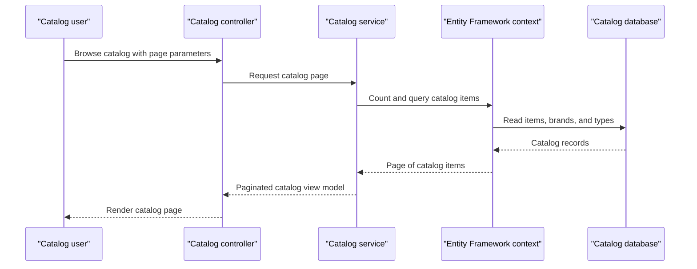

# Core Business Workflows

The application supports browsing and maintaining an e-commerce product catalog. Users can view products, brands, categories, stock information, and product images through the web applications and their catalog APIs.

## Domain Entities

| Entity | Service / Bounded Context | Description | Key Relationships |
|---|---|---|---|
| CatalogItem | Catalog | A product offered in the catalog, including price, stock, and image reference | Belongs to one brand and one category |
| CatalogBrand | Catalog | A product brand | May be associated with many catalog items |
| CatalogType | Catalog | A product type/category | May be associated with many catalog items |

## Service-to-Domain Mapping

| Service | Domain Context | Owned Entities | External Dependencies |
|---|---|---|---|
| eShopLegacyMVC | Catalog | CatalogItem, CatalogBrand, CatalogType | SQL Server LocalDB or mock data |
| eShopPorted | Catalog | CatalogItem, CatalogBrand, CatalogType | SQL Server LocalDB or mock data |

Both applications independently implement the same catalog domain. They do not exchange data with each other; each is the source of truth for its own configured store.

## Primary Workflows

### Workflow 1: Browse Catalog

1. A user opens the catalog listing.
2. `CatalogController` requests a page of items from `ICatalogService`.
3. The service retrieves items and their brand/type data, orders by item identifier, and applies page index and page size.
4. The controller returns the listing view model.

### Workflow 2: Maintain Catalog Item

1. An operator opens the create or edit form and submits catalog item data.
2. The controller applies model validation and the explicit model-binding field list.
3. The service assigns an identifier on creation or updates the existing item.
4. The service persists the change through Entity Framework; successful operations redirect to the catalog listing.

### Workflow 3: Display Product Picture

1. A client requests a picture using the catalog item identifier.
2. `PicController` resolves the catalog item and uses its picture filename to read a local image.
3. The response is returned with an image media type selected from the filename extension.

### Workflow 4: Retrieve Brands

1. An API client requests the brands collection or one brand by identifier.
2. The API controller queries `ICatalogService` and returns the result.
3. The demo delete action checks for the brand but does not actually remove it.

## Cross-Service Data Flows

No cross-service API composition, message exchange, or shared database access was found. The legacy and ported applications each read and write their own catalog store. The only common code is the utilities library; it provides binary serialization for a brands response rather than a business-data synchronization flow.

## Business Workflow Sequence

## Business Rules & Decision Logic

- Catalog item name is required; price must be within the configured nonnegative range and have no more than two fractional digits.
- Stock, restock threshold, and maximum stock values are constrained to nonnegative ranges.
- Catalog items reference a brand and catalog type; the legacy EF model requires both relationships.
- List results are ordered by item identifier and paginated using the provided page size and index.
- The ported application selects mock or database-backed service registration using `UseMockData`.
- Create and edit actions persist only model-bound fields and rely on MVC model validation before saving.
- Brand deletion is a demo-only action and does not mutate data.
- No authentication, authorization, audit trail, or business-event logging policy was identified.
