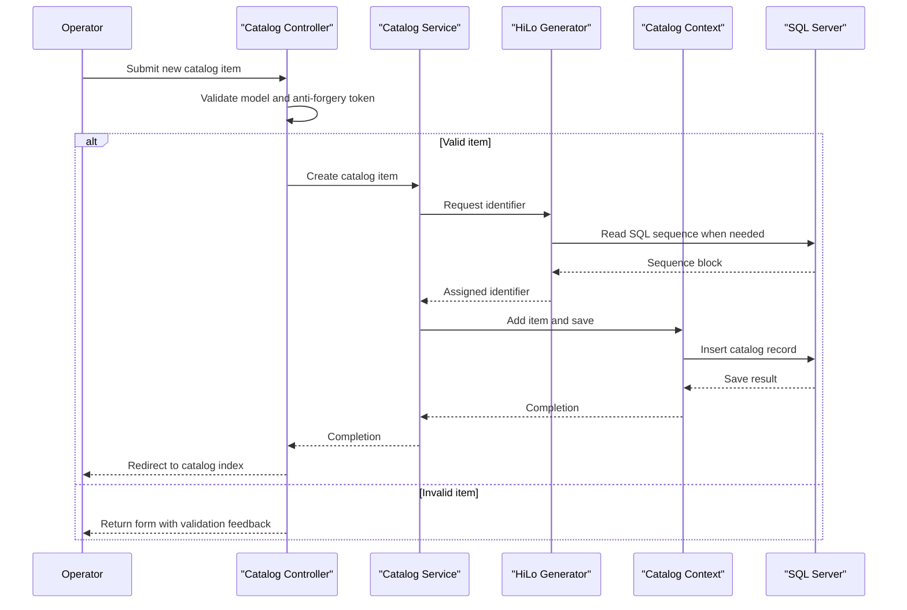

# Core Business Workflows

The applications support browsing and maintaining a product catalog. They expose catalog items with brand and type associations, but no order, payment, or customer workflows were identified.

## Domain Entities

| Entity | Service / Bounded Context | Description | Key Relationships |
|---|---|---|---|
| CatalogItem | Catalog | A product offered in the catalog, with price and stock information | Belongs to one brand and one type |
| CatalogBrand | Catalog | A brand used to group catalog products | Has many catalog items |
| CatalogType | Catalog | A product classification | Has many catalog items |

## Service-to-Domain Mapping

| Service | Domain Context | Owned Entities | External Dependencies |
|---|---|---|---|
| eShopLegacyMVC | Catalog | CatalogItem, CatalogBrand, CatalogType | SQL Server in database-backed mode; local picture files |
| eShopPorted | Catalog | CatalogItem, CatalogBrand, CatalogType | SQL Server in database-backed mode; static picture files |
| eShopLegacy.Utilities | Shared infrastructure | None | Used for binary serialization by files endpoints |

The two web applications implement their own catalog service and persistence context. No cross-context API calls, event exchange, or shared aggregation workflow was found.

## Primary Workflows

### Workflow 1: Browse Catalog

1. A visitor opens the catalog index, optionally supplying page size and page index.
2. The controller asks `ICatalogService` for a page of catalog items.
3. The database-backed service counts and loads items ordered by identifier, including each item's brand and type; mock mode reads the in-memory list.
4. The controller populates picture URIs and renders the catalog view.

### Workflow 2: Create a Catalog Item

1. An operator submits the create form with a `CatalogItem` and anti-forgery token.
2. MVC model validation checks the submitted model. Invalid submissions return the form with validation errors.
3. The service obtains an identifier from the Hi/Lo generator, adds the item, and saves it; mock mode updates its in-memory collection.
4. On success, the controller redirects to the catalog index.

### Workflow 3: Edit or Delete a Catalog Item

The edit flow loads the selected item, validates the submitted model and then saves the modified catalog record. The delete flow resolves the item by identifier and removes it. Both return to the catalog index on completion.

## Cross-Service Data Flows

No cross-service data composition or fallback between independently deployed services was found. Each application serves its own catalog operations and accesses its own service/context. The `BrandsController` delete routes validate that a brand exists but are demonstrative and do not actually delete it.

## Business Workflow Sequence

## Business Rules & Decision Logic

- Catalog items require a name; price has a numeric format and range of 0 through 1,000,000.
- Available stock, restock threshold, and maximum stock threshold each have a configured range of 0 through 10,000,000.
- The persistence model requires each catalog item to reference an existing brand and type.
- The legacy database-backed service allocates identifiers from SQL sequence blocks; the mock service assigns the next value from its current list.
- Create and edit MVC actions use anti-forgery validation. No business-role authorization or audit trail was identified.
- Each database write calls EF `SaveChanges`; no explicit cross-operation transaction or compensating workflow was found.
