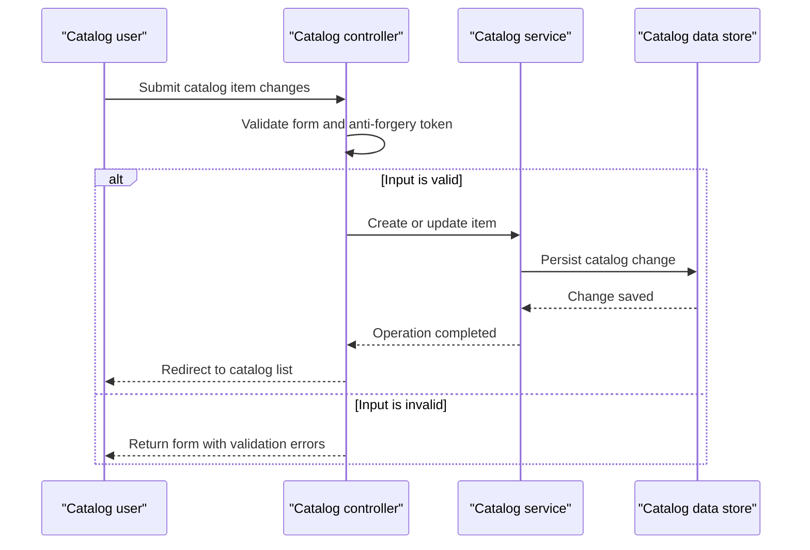

# Core Business Workflows

The application supports a product catalog: users browse, inspect, and maintain items categorized by brand and type. The legacy application and its port implement parallel catalog behavior without coordinating business data between them.

## Domain Entities

| Entity | Service / Bounded Context | Description | Key Relationships |
|---|---|---|---|
| CatalogItem | eShopLegacyMVC / eShopPorted — Catalog | Product offered in the catalog, including pricing, stock, and image reference | Belongs to one brand and one type |
| CatalogBrand | eShopLegacyMVC / eShopPorted — Catalog | Brand used to classify catalog items | Can classify multiple items |
| CatalogType | eShopLegacyMVC / eShopPorted — Catalog | Product category or type | Can classify multiple items |

## Service-to-Domain Mapping

| Service | Domain Context | Owned Entities | External Dependencies |
|---|---|---|---|
| eShopLegacyMVC | Catalog | CatalogItem, CatalogBrand, CatalogType | Its configured SQL Server database or mock catalog service |
| eShopPorted | Catalog | CatalogItem, CatalogBrand, CatalogType | Its configured SQL Server database or mock catalog service |

Both applications implement their own catalog service and persistence context. No external business service or cross-context data exchange was identified.

## Primary Workflows

### Workflow 1: Browse the Catalog

1. A user opens the catalog list or a specific item.
2. The controller requests a paginated item list or item detail from the catalog service.
3. The service loads the item and its brand/type classifications.
4. The application renders the catalog view. Missing or invalid item identifiers produce a client error or not-found response.

### Workflow 2: Maintain a Catalog Item

1. A user opens the create or edit form; the application supplies available brand and type choices.
2. On submission, the controller checks model validity and the anti-forgery token.
3. If valid, the catalog service creates or updates the item and persists the change; otherwise the form is returned for correction.
4. Successful create/update redirects to the catalog list. Deletion is confirmed before the item is removed.

The same core flows are implemented in both applications. The legacy implementation assigns new catalog item IDs using a SQL sequence; the ported implementation uses its configured EF Core key behavior.

## Cross-Service Data Flows

No cross-service composition or aggregation occurs. The two applications maintain separate catalog stores and do not call or synchronize with each other. Within each application, catalog item reads include the associated brand and type; no downstream-service fallback behavior exists.

## Business Workflow Sequence

## Business Rules & Decision Logic

- Catalog item names are required. Price must be within the configured range and match the expected decimal format; stock, restock threshold, and maximum stock have configured numeric ranges.
- Create and edit operations proceed only when model validation succeeds; form submissions include anti-forgery validation.
- Item details and edit/delete views check that the item exists; missing IDs return a not-found response.
- Deletion is initiated through a confirmation page. The brand API's demo delete action reports success for an existing brand but does not actually remove it.
- Brand and type associations are required for catalog items in the ORM mappings. The catalog has no explicit lifecycle state machine, approval flow, or computed pricing rule.
- Persistence uses ORM save operations; no explicit multi-operation transaction, audit trail, business authorization policy, retry, or compensating workflow was identified. Logging records application actions, but is not a separate business audit stream.
