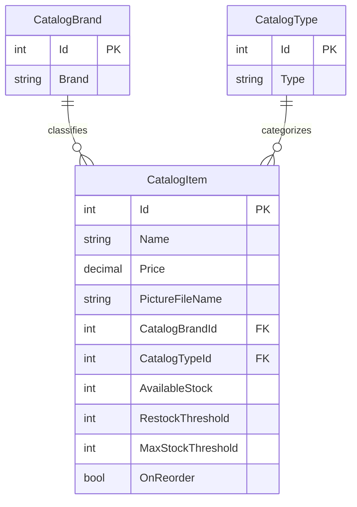

# Data Architecture & Persistence Layer

The catalog data model is implemented twice, with Entity Framework 6 in the legacy MVC app and Entity Framework Core in the ported app. Both use a SQL Server LocalDB connection when database mode is selected, and both can instead run with in-memory mock data.

## Database Configuration

| Service/Module | DB Type | Profile | Driver | Connection | Migration Tool |
|---|---|---|---|---|---|
| eShopLegacyMVC | SQL Server LocalDB | Default database mode; mock mode is available | System.Data.SqlClient | LocalDB catalog database using integrated security | EF6 database initializer and SQL/CSV setup data |
| eShopPorted | SQL Server LocalDB | Default settings enable mock data; database mode reads `DefaultConnection` | EF Core SQL Server provider | LocalDB `eShopPorted` database using trusted connection | EF Core migrations and model seed data |

## Data Ownership per Service

| Service | Tables Owned | ORM Framework | Caching | Notes |
|---|---|---|---|---|
| eShopLegacyMVC | Catalog, CatalogBrand, CatalogType | Entity Framework 6 | None identified | Initializer can load customization data and scripts |
| eShopPorted | Catalog, CatalogBrand, CatalogType | Entity Framework Core | None identified | Migrations contain schema and seed data |

## Entity Model

Both application projects define equivalent catalog entities. `CatalogItem` has required many-to-one relationships to brand and type; its `PictureUri` is computed for presentation and excluded from persistence.

## Key Repository Methods

| Service | Repository | Notable Methods | Purpose |
|---|---|---|---|
| eShopLegacyMVC | `CatalogService` (`Services/CatalogService.cs`) | `GetCatalogItemsPaginated`, `FindCatalogItem`, `GetCatalogBrands`, `GetCatalogTypes`, `CreateCatalogItem`, `UpdateCatalogItem`, `RemoveCatalogItem` | Queries, pages, and mutates catalog entities using `CatalogDBContext` |
| eShopPorted | `CatalogService` (`Services/CatalogService.cs`) | `GetCatalogItemsPaginated`, `FindCatalogItem`, `GetCatalogBrands`, `GetCatalogTypes`, `CreateCatalogItem`, `UpdateCatalogItem`, `RemoveCatalogItem` | Same catalog operations using EF Core |
| Both apps | `CatalogServiceMock` | In-memory equivalents of catalog service operations | Supplies local mock data when enabled |

No separate repository interfaces or custom SQL repositories were identified; services access their EF contexts directly.

## Caching Strategy

No explicit caching layer, cache provider, or cache policy was identified. Mock mode stores catalog records in an in-memory list, but this is the selected data source rather than a cache.

## Data Ownership Boundaries

There are no independently deployed domain services or database-per-service boundaries. The two applications implement the same catalog domain and use similarly shaped SQL tables, but each has its own context and mapping code. Controllers access data through `ICatalogService`; no cross-service database access or CQRS pattern was identified.

### Data Classification & Sensitivity

| Entity | Sensitive Fields | Classification (PII/PHI/PCI/None) | Controls in Place |
|---|---|---|---|
| CatalogItem | Product name, description, price, stock, picture filename | None | No personal or payment data identified |
| CatalogBrand | Brand name | None | No personal or payment data identified |
| CatalogType | Type name | None | No personal or payment data identified |

No PII, PHI, or PCI data was identified in the catalog entity model.
