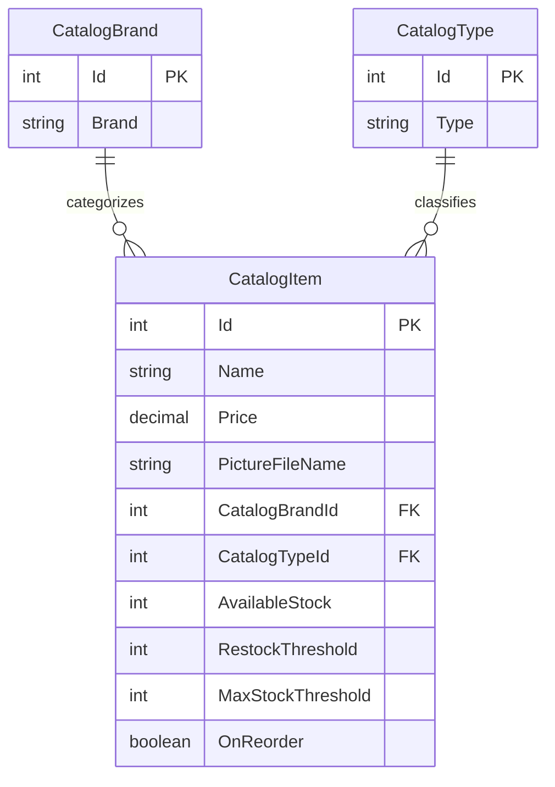

# Data Architecture & Persistence Layer

The catalog domain is persisted by SQL Server through two separate persistence implementations: EF6 in the legacy application and EF Core in the ported application. Both define the same core entities: catalog items, brands, and types.

## Database Configuration

| Service/Module | DB Type | Profile | Driver | Connection | Migration Tool |
|---|---|---|---|---|---|
| eShopLegacyMVC | SQL Server LocalDB | Default; debug/release transforms provide alternate connection settings | System.Data.SqlClient / EF6 | Integrated security; no password configured | Custom initializer and SQL scripts |
| eShopPorted | SQL Server LocalDB | Development appsettings; connection name is configurable | EF Core SQL Server provider | Integrated security; no password configured | EF Core migrations are present |
| eShopLegacy.Utilities | None | Not applicable | None | None | None |

The legacy initializer seeds catalog records and uses SQL sequence scripts for Hi/Lo identifiers. The ported project applies EF Core entity configuration from its assembly.

## Data Ownership per Service

| Service | Tables Owned | ORM Framework | Caching | Notes |
|---|---|---|---|---|
| eShopLegacyMVC | Catalog, CatalogBrand, CatalogType | Entity Framework 6 | None identified | Database-backed service and a separate in-memory mock service |
| eShopPorted | Catalog, CatalogBrand, CatalogType | Entity Framework Core | None identified | Separate context and migration artifacts |
| eShopLegacy.Utilities | None | None | None | Serialization-only shared library |

## Entity Model

The legacy mappings are in `src/eShopLegacyMVC/Models/CatalogDBContext.cs`; corresponding ported entity configuration is under `eShopPorted/Models/Config`. `PictureUri` is computed for presentation and excluded from persistence.

## Key Repository Methods

| Service | Repository | Notable Methods | Purpose |
|---|---|---|---|
| eShopLegacyMVC | CatalogService | `GetCatalogItemsPaginated(pageSize, pageIndex)` | Loads a page of items with brand and type |
| eShopLegacyMVC | CatalogService | `FindCatalogItem(id)` | Finds one item with brand and type |
| eShopLegacyMVC | CatalogService | `GetCatalogTypes()`, `GetCatalogBrands()` | Returns lookup records |
| eShopLegacyMVC | CatalogService | `CreateCatalogItem`, `UpdateCatalogItem`, `RemoveCatalogItem` | Writes catalog items and saves changes |
| eShopPorted | CatalogService | Catalog read/write operations | Implements the same catalog service contract with EF Core |
| eShopLegacyMVC | CatalogDBInitializer | Sequence lookup and seed helpers | Loads seed data and initializes database objects |

Standard CRUD operations are omitted from the table where no custom query is present.

## Caching Strategy

No distributed or application cache provider was identified. Mock mode stores records in an in-memory list for the process lifetime; this is the mock data source, not a configured cache.

## Data Ownership Boundaries

Each web application owns its catalog context and persistence code. There is no separate catalog service or database-per-domain boundary in the solution. Source configuration points both projects at local SQL Server development databases, but does not establish that deployed instances share one database. Controllers call their own catalog service; cross-application data access through APIs or messaging was not found. The legacy service uses sequence allocation for new identifiers; no CQRS or outbox pattern was identified.

### Data Classification & Sensitivity

| Entity | Sensitive Fields | Classification | Controls in Place |
|---|---|---|---|
| CatalogItem | Product names, descriptions, prices, stock levels | None identified | Not applicable |
| CatalogBrand | Brand name | None identified | Not applicable |
| CatalogType | Type name | None identified | Not applicable |

No PII, PHI, or PCI data was detected in the catalog entity model.
