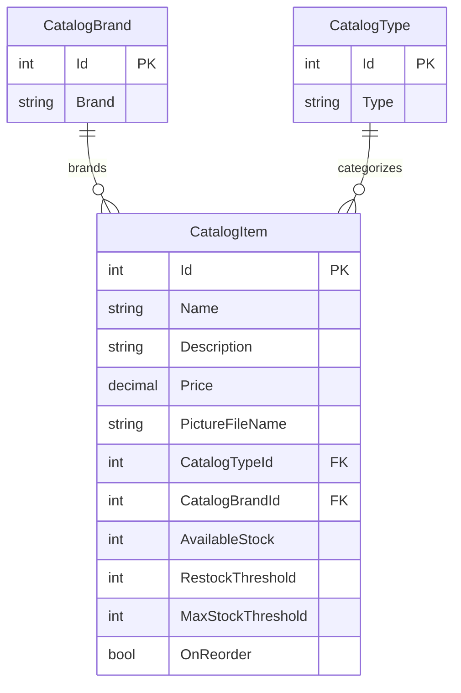

# Data Architecture & Persistence Layer

The solution models three catalog entities and persists them through SQL Server using Entity Framework 6 in the legacy application and Entity Framework Core in the ported application. The two projects maintain parallel models and contexts for the catalog domain.

## Database Configuration

| Service/Module | DB Type | Profile | Driver | Connection | Migration Tool |
|---|---|---|---|---|---|
| eShopLegacyMVC | SQL Server LocalDB | Application configuration | System.Data.SqlClient | LocalDB catalog database | EF6 initializer creates the database and seeds lookup/catalog data; SQL scripts create sequences |
| eShopPorted | SQL Server LocalDB | Application configuration | EF Core SQL Server provider | LocalDB eShopPorted database | EF Core migrations and seeded model data |

The ported app currently enables mock data in its default appsettings, so the configured database connection is not necessarily used at runtime.

## Data Ownership per Service

| Service | Tables Owned | ORM Framework | Caching | Notes |
|---|---|---|---|---|
| eShopLegacyMVC | Catalog, CatalogBrand, CatalogType | Entity Framework 6 | None identified | `CatalogDBContext`; initializer seeds data |
| eShopPorted | Catalog, CatalogBrand, CatalogType | Entity Framework Core 2.2 | None identified | Separate context and migrations; seeded model data |

## Entity Model

`CatalogItem` in both projects refers to one `CatalogBrand` and one `CatalogType`; each lookup entity can be related to multiple catalog items. The classes are defined under `src/eShopLegacyMVC/Models/` and `eShopPorted/Models/`. `PictureUri` is a presentation value and is ignored by the ORM mappings.

## Key Repository Methods

| Service | Repository | Notable Methods | Purpose |
|---|---|---|---|
| eShopLegacyMVC | `CatalogService` (`src/eShopLegacyMVC/Services/CatalogService.cs`) | `GetCatalogItemsPaginated(pageSize, pageIndex)`, `FindCatalogItem(id)`, `GetCatalogBrands()`, `GetCatalogTypes()` | Queries paginated items, related catalog records, and lookup values |
| eShopPorted | `CatalogService` (`eShopPorted/Services/CatalogService.cs`) | `GetCatalogItemsPaginated(pageSize, pageIndex)`, `FindCatalogItem(id)`, `GetCatalogBrands()`, `GetCatalogTypes()` | Same catalog reads using its EF Core context |

No repository interfaces are defined; the catalog service accesses the respective ORM context directly. Both services also expose create, update, and remove operations.

## Caching Strategy

No distributed or in-process query cache, cache provider, or explicit cache-aside strategy was identified. The mock implementations hold sample data in application memory when mock data is enabled; this is the configured default in the ported app.

## Data Ownership Boundaries

Each web application has its own context, ORM setup, and database configuration, but both represent the same catalog domain with equivalent entity sets. No cross-service database access or data aggregation between the applications was identified. Reads and writes occur directly through the local catalog service and its context; the legacy application additionally uses SQL Server sequences to generate identifiers.

### Data Classification & Sensitivity

| Entity | Sensitive Fields | Classification (PII/PHI/PCI/None) | Controls in Place |
|---|---|---|---|
| CatalogItem | None identified | None | No sensitive data controls required based on the model |
| CatalogBrand | None identified | None | No sensitive data controls required based on the model |
| CatalogType | None identified | None | No sensitive data controls required based on the model |

No PII, PHI, or PCI data was identified in the catalog entity model.
