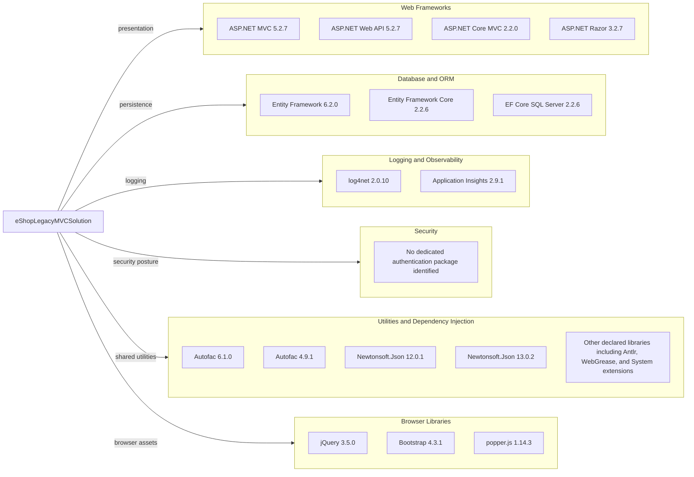

# Dependency Map

The eShopLegacyMVCSolution contains two web applications with 105 external package declaration entries across their manifests (63 `PackageReference` entries and 42 legacy `packages.config` entries), representing 57 distinct package identifiers. Transitive dependencies could not be enumerated because the legacy web project requires unavailable Visual Studio WebApplication build targets.

## Dependencies

### Dependency Summary

| Category | Count shown | Key Libraries | Notes |
|---|---:|---|---|
| Web Frameworks | 4 | ASP.NET MVC 5, Web API 2, ASP.NET Core MVC 2.2, Razor | Legacy and ported frameworks coexist |
| Database / ORM | 3 | Entity Framework 6.2, EF Core 2.2.6, SQL Server provider | Separate ORM versions for the two apps |
| Logging / Observability | 2 | log4net 2.0.10, Application Insights 2.9.1 | Legacy app telemetry and logging |
| Security | 0 | None identified | No dedicated authentication package declared |
| Utilities / DI | 5 shown plus aggregated libraries | Autofac, Newtonsoft.Json, Antlr, WebGrease | Autofac and JSON package versions differ between applications |
| Browser libraries | 3 | jQuery, Bootstrap, popper.js | Legacy MVC UI dependencies |

### Version & Compatibility Risks

The solution targets .NET Framework 4.7.2 and net461 and includes ASP.NET Core 2.2 and Entity Framework Core 2.2.6, all old target/framework lines with substantial migration concerns. The CVE scan identified affected versions of log4net 2.0.10 and Newtonsoft.Json 12.0.1; the ported app's Newtonsoft.Json 13.0.2 was not affected by the matched advisory.

### Notable Observations

- Legacy MVC uses `packages.config`; the ported web project uses `PackageReference`.
- Autofac is declared at different versions across the applications, as are Newtonsoft.Json versions.
- The legacy MVC project contains both package references and a `packages.config` manifest; the package declarations overlap.
- The .NET package-tree scan could not resolve transitive dependencies because Visual Studio WebApplication build targets are not installed.
- No test-scoped package dependencies were found in the solution manifests.

## Test Dependencies

| Framework | Version | Notes |
|---|---|---|
| None detected | — | No test project or test-scoped package dependencies were found in this solution. |

Total test-scope dependencies: 0

The solution currently exposes no test infrastructure in its project manifests.
