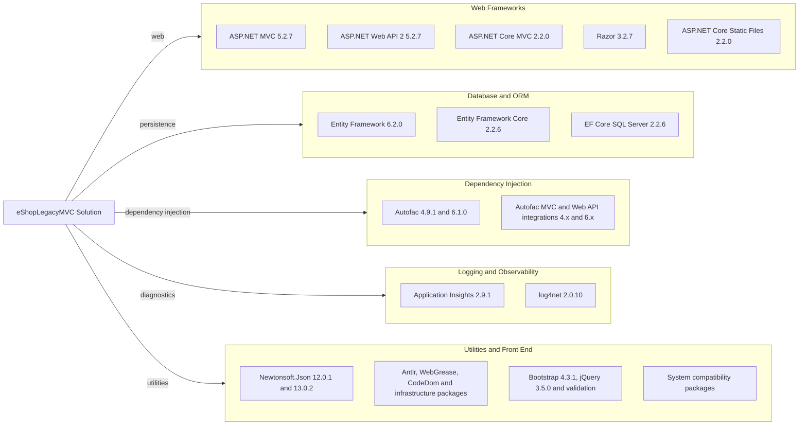

# Dependency Map

The eShopLegacyMVC solution contains a large set of direct dependencies across its legacy MVC and ported ASP.NET Core projects. Framework references are omitted from the package diagram where they are part of the target framework.

## Dependencies

### Dependency Summary

| Category | Count | Key Libraries | Notes |
|---|---:|---|---|
| Web Frameworks | 5 | ASP.NET MVC 5.2.7, ASP.NET Web API 2 5.2.7, ASP.NET Core MVC 2.2.0 | Separate classic and ported web stacks |
| Database / ORM | 3 | Entity Framework 6.2.0, EF Core 2.2.6, EF Core SQL Server 2.2.6 | Both ORM generations are present |
| Dependency Injection | 2 | Autofac 4.9.1 / 6.1.0, Autofac MVC and Web API integrations | Versions differ between applications |
| Logging / Observability | 2 groups | Application Insights 2.9.1, log4net 2.0.10 | Multiple telemetry packages support Application Insights |
| Utilities | 4 groups | Newtonsoft.Json, browser libraries, compatibility packages | Many package declarations are aggregated for readability |

### Version & Compatibility Risks

The ported project targets .NET Framework 4.6.1 while using ASP.NET Core 2.2 and EF Core 2.2, both legacy versions. The primary MVC project targets .NET Framework 4.7.2 and uses MVC 5 and EF6; these components require compatibility review during a framework upgrade. Some package versions differ between the legacy and ported projects, notably Autofac and Newtonsoft.Json.

### Notable Observations

- The solution maintains separate MVC 5 / Web API 2 and ASP.NET Core 2.2 stacks.
- Both Entity Framework 6 and EF Core are present, with SQL Server provider dependencies in the ported project.
- Application Insights has multiple framework-specific collector and telemetry dependencies.
- No central package management file or test-scoped package dependency was found in the solution.

## Test Dependencies

| Framework | Version | Notes |
|---|---|---|
| None detected | — | No test-scoped packages are declared in the inspected project files. |

Total test-scope dependencies: 0

No test projects or test framework packages were found in this solution.
