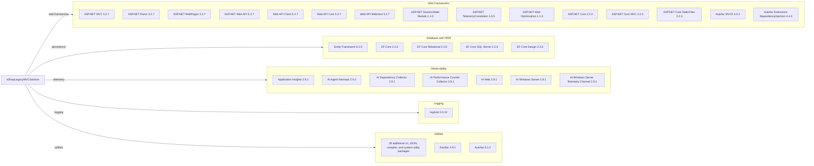

# Dependency Map

The `eShopLegacyMVCSolution` project files declare 63 package references, representing 59 distinct package/version coordinates across the legacy MVC application and its ASP.NET Core port. The legacy application's `packages.config` also records its pinned package inventory.

## Dependencies

### Dependency Summary

| Category | Count | Key Libraries | Notes |
|---|---:|---|---|
| Web Frameworks | 15 | ASP.NET MVC 5.2.7, ASP.NET Web API 5.2.7, ASP.NET Core MVC 2.2.0 | Classic MVC and the separate ASP.NET Core port are both present |
| Database / ORM | 5 | Entity Framework 6.2.0, EF Core 2.2.6, EF Core SQL Server 2.2.6 | Separate persistence stacks are used by the two applications |
| Observability | 7 | Application Insights 2.9.1 family | The legacy application has multiple Application Insights components |
| Logging | 1 | log4net 2.0.10 | Declared in both applications |
| Utilities | 31 | Autofac 4.9.1 / 6.1.0, Newtonsoft.Json 12.0.1 / 13.0.2 | Includes UI, compatibility, compiler, and system support packages |

### Version & Compatibility Risks

The port targets .NET Framework 4.6.1 while using ASP.NET Core 2.2 and EF Core 2.2, and the legacy application targets .NET Framework 4.7.2 with EF 6.2. These framework and package generations are old and require compatibility review for supported .NET targets. ASP.NET Core 2.2 and EF Core 2.2 are end-of-support; the solution also carries version skew in Newtonsoft.Json across projects.

### Notable Observations

- The solution contains two distinct web stacks and ORM generations, so modernization work should preserve each application's boundaries.
- Autofac and log4net are shared across both applications, while the port references the legacy `Autofac.Mvc5` package despite using ASP.NET Core MVC.
- The legacy package inventory includes numerous system and UI support packages; the port separately declares old ASP.NET Core and EF Core packages.

## Test Dependencies

| Framework | Version | Notes |
|---|---|---|
| — | — | No test-scoped dependencies detected |

Total test-scope dependencies: 0

No test projects or test-scoped package references were detected in this solution folder.
