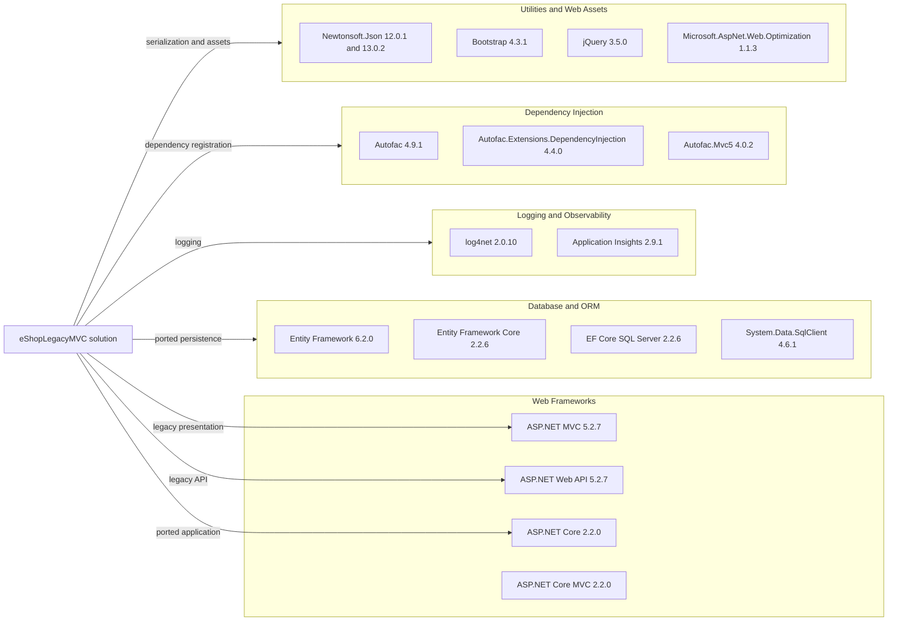

# Dependency Map

The solution has two web applications and one shared library. The legacy application declares 43 packages in `packages.config`; the ported application declares 14 package references and the shared library has no external package declarations.

## Dependencies

### Dependency Summary

| Category | Count | Key Libraries | Notes |
|---|---:|---|---|
| Web Frameworks | 4 | ASP.NET MVC 5, Web API 2, ASP.NET Core 2.2 | Two generations of the web stack coexist |
| Database / ORM | 4 | Entity Framework 6, EF Core 2.2, SQL Server provider | Separate persistence implementations |
| Logging / Observability | 8 | log4net, Application Insights | Legacy telemetry packages and logging |
| Dependency Injection | 3 | Autofac, Autofac MVC integration | Autofac is shared across app implementations |
| Utilities / UI | 40 | Newtonsoft.Json, Bootstrap, jQuery, WebGrease | Includes framework support and frontend packages |

### Version & Compatibility Risks

The projects target .NET Framework 4.6.1, while the web configuration mentions 4.7.2. ASP.NET Core 2.2 and EF Core 2.2 are out of support, and many legacy packages are several major versions behind current releases. AppCAT's full package compatibility and vulnerability details are in the versioned report and security assessment.

### Notable Observations

- The legacy application uses EF6 while the ported application uses EF Core 2.2.
- Newtonsoft.Json is declared at different versions in the two applications.
- No centralized package version management is present.
- No test-scoped packages or test projects were identified in this solution.

## Test Dependencies

| Framework | Version | Notes |
|---|---|---|
| None detected | — | No test dependencies or test projects were identified |

Total test-scope dependencies: 0

No test dependencies detected.
