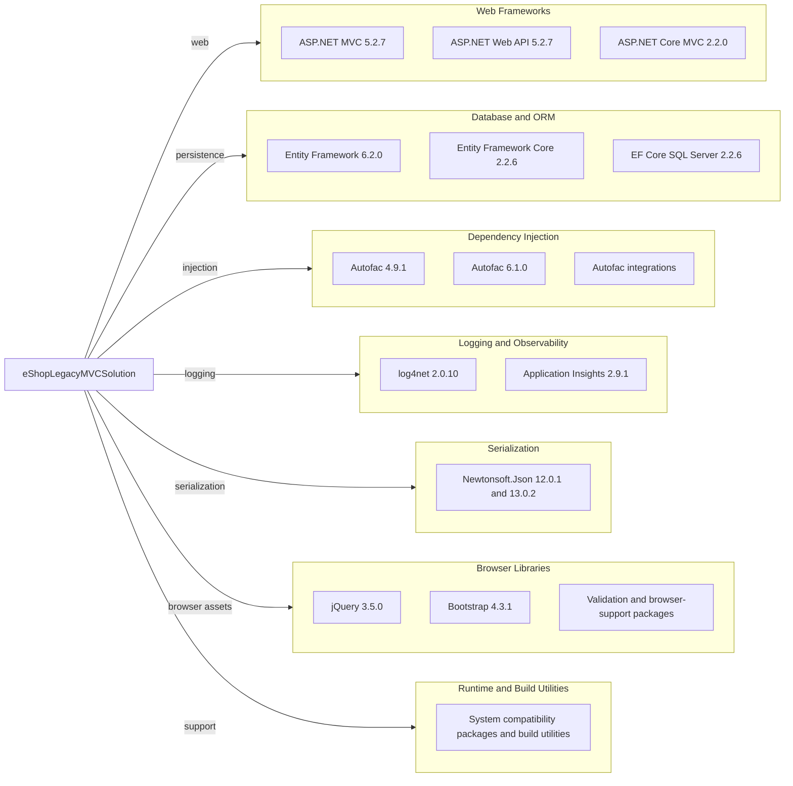

# Dependency Map

The solution declares external packages for its two web projects. After duplicate declarations in the legacy project file and `packages.config` are collapsed, the projects contain approximately 59 unique package/version coordinates; the shared utility project uses framework references.

## Dependencies

### Dependency Summary

| Category | Count | Key Libraries | Notes |
|---|---:|---|---|
| Web Frameworks and Browser Libraries | 20 | ASP.NET MVC, Web API, ASP.NET Core MVC, jQuery, Bootstrap | Two generations of web stack and legacy browser packages coexist |
| Database / ORM | 5 | Entity Framework 6, EF Core, SQL Server provider | Legacy and ported applications use different EF generations |
| Dependency Injection | 5 | Autofac and Autofac integrations | Separate Autofac generations are declared |
| Logging / Observability | 8 | log4net, Application Insights collectors | The legacy application includes telemetry extensions |
| Serialization | 2 | Newtonsoft.Json | Versions differ between the web projects |
| Utilities / Runtime | 19 | System compatibility packages, compiler and build utilities | Includes support packages used by the legacy framework projects |

### Version & Compatibility Risks

The solution targets .NET Framework 4.7.2 and 4.6.1 and includes ASP.NET Core 2.2, EF Core 2.2, MVC 5, and EF6 packages. These are legacy stacks requiring substantial compatibility work for a current .NET target. The CVE scan found medium-severity log4net and high-severity Newtonsoft.Json advisories for the affected declared versions; see the security assessment for affected locations and ranges.

### Notable Observations

- The legacy MVC project contains both `PackageReference` declarations and `packages.config` entries; duplicate package declarations were collapsed for this summary.
- The two applications declare different versions of Autofac and Newtonsoft.Json.
- No test-scoped packages or test projects were detected in the assessed solution.
- Package dependency-tree resolution could not run because the legacy Web Application targets are absent from the installed .NET SDK; this inventory uses direct project declarations and `packages.config`, not transitive resolution.

## Test Dependencies

| Framework | Version | Notes |
|---|---|---|
| None detected | — | No test-scoped dependencies were declared |

Total test-scope dependencies: 0

No test dependencies or test project configuration were detected in the assessed solution.
