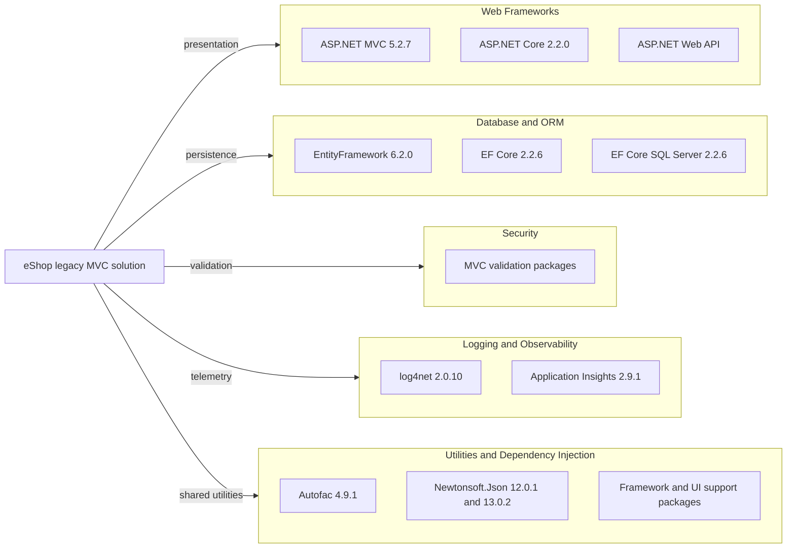

# Dependency Map

The solution declares 52 unique NuGet package/version pairs across its legacy MVC and ported applications. The package-list CLI could not load legacy Web Application targets, so this inventory uses the checked-in `packages.config` and project-file declarations; resolved transitive dependencies are not available.

## Dependencies

### Dependency Summary

| Category | Count | Key Libraries | Notes |
|---|---:|---|---|
| Web Frameworks | 16 | ASP.NET MVC 5, ASP.NET Web API, ASP.NET Core 2.2 | Legacy MVC and ported MVC stacks coexist |
| Database / ORM | 5 | EntityFramework 6.2.0, EF Core 2.2.6, SQL Server provider | Separate persistence implementations |
| Logging / Observability | 7 | log4net 2.0.10, Application Insights 2.9.1 | Telemetry is configured for the legacy web app |
| Security / Validation | 3 | MVC data annotations and client validation packages | No standalone authentication library was found |
| Utilities | 21 | Autofac 4.9.1, Newtonsoft.Json, System.* and UI support libraries | Minor framework and front-end dependencies aggregated |

### Version & Compatibility Risks

The project targets .NET Framework 4.7.2 and .NET Framework 4.6.1, while its ASP.NET Core and EF Core packages are from the 2.2 line. These frameworks and package lines are out of support. The legacy Newtonsoft.Json 12.0.1 declaration is below the patched 13.0.1 version for CVE-2024-21907; the ported project declares 13.0.2.

### Notable Observations

- The older application uses EF6 while the ported application uses EF Core, so persistence behavior and migration tooling differ.
- Autofac is used in both applications, including a singleton in-memory mock service when mock mode is enabled.
- Several front-end and framework support packages are pinned in the legacy `packages.config`.

## Test Dependencies

| Framework | Version | Notes |
|---|---|---|
| None detected | — | No test-scoped package declarations were found in the target projects |

Total test-scope dependencies: 0

No test dependencies were detected in the project manifests.
