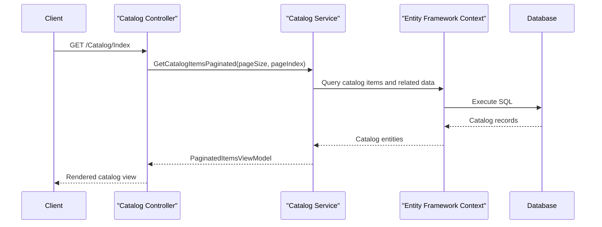

# API & Service Communication Contracts

The solution exposes catalog browsing and maintenance through two web applications, with server-rendered pages and catalog API endpoints. Requests are handled synchronously within each application; no inter-service API calls or asynchronous messaging were found.

## Service Catalog

| Service | Port | Category | Purpose |
|---|---|---|---|
| eShopLegacyMVC | Not configured in application files | API Layer | MVC 5 pages and Web API 2 catalog endpoints |
| eShopPorted | Not configured in application files | API Layer | ASP.NET Core MVC and catalog endpoints |
| eShopLegacy.Utilities | N/A | Business support library | Shared serialization utility referenced by the web projects |

## API Endpoints Inventory

| Service | Method | Path | Request Type | Response Type |
|---|---|---|---|---|
| eShopLegacyMVC | GET | `/api/brands` | None | `CatalogBrand[]` |
| eShopLegacyMVC | GET | `/api/brands/{id}` | Path `id` | `CatalogBrand` or 404 |
| eShopLegacyMVC | DELETE | `/api/brands/{id}` | Path `id` | 200 or 404; demo action does not delete |
| eShopLegacyMVC | GET | `/api/files` | None | Binary-serialized `BrandDTO[]` |
| eShopLegacyMVC | GET | `/api` | None | JSON message |
| eShopLegacyMVC | GET | `/items/{catalogItemId}/pic` | Path `catalogItemId` | Image content, 400, or 404 |
| eShopLegacyMVC | GET | `/Catalog/Index` | Query `pageSize`, `pageIndex` | Paginated catalog view |
| eShopLegacyMVC | GET / POST | `/Catalog/Create` | `CatalogItem` form / bound model | Form or redirect |
| eShopLegacyMVC | GET | `/Catalog/Details/{id}` | Path or query `id` | Catalog item view, 400, or 404 |
| eShopLegacyMVC | GET / POST | `/Catalog/Edit/{id}` | Path `id` / bound `CatalogItem` | Form or redirect |
| eShopLegacyMVC | GET / POST | `/Catalog/Delete/{id}` | Path `id` / form `id` | Confirmation view or redirect |
| eShopPorted | GET | `/api/brands` | None | Catalog brand list |
| eShopPorted | DELETE | `/api/brands/{id}` | Path `id` | 200 or 404; demo action does not delete |
| eShopPorted | GET | `/api/files` | None | Binary-serialized brand data |
| eShopPorted | GET | `/Pic/Index?catalogItemId={catalogItemId}` | Query `catalogItemId` | Image content, 400, or 404 |
| eShopPorted | GET / POST | `/Catalog/Index`, `/Catalog/Create`, `/Catalog/Edit/{id}`, `/Catalog/Delete/{id}` | Query/form `CatalogItem` data | Views or redirects |

The legacy Web API routes use attribute routes and the conventional `api/{controller}/{id}` template. The ported API uses controller route templates for API controllers and a conventional MVC route; the image action's query parameter is shown because the conventional route token is named `id`.

## Management & Observability Endpoints

| Service | Endpoint | Custom Metrics |
|---|---|---|
| eShopLegacyMVC | None identified | No endpoint-exposed custom metrics found |
| eShopPorted | None identified | No endpoint-exposed custom metrics found |

Application Insights and log4net are configured for diagnostics, but no health, metrics, Swagger, or management routes were found.

## DTOs & Contracts

`CatalogItem`, `CatalogBrand`, and `CatalogType` are service-level domain entities used in views and API responses. The `FilesController.BrandDTO` classes (one per web project) define a mutable brand projection used by the binary serialization flow. `PaginatedItemsViewModel<T>` wraps catalog list results for MVC views. No gateway-level aggregation DTO, OpenAPI specification, protobuf schema, or GraphQL schema was identified. The applications use JSON for ordinary MVC/Web API results and a shared binary serializer for the files endpoint.

## Communication Patterns

Communication is synchronous HTTP from clients to each web application, followed by direct in-process controller-to-service calls and synchronous database operations. No service discovery, API gateway, inter-service calls, message broker, retry policy, circuit breaker, or configured request timeout was found. Transport security and authentication/authorization are not configured in the inspected application routes and configuration; no TLS or access-control middleware/attributes were identified.

## Service Technology Matrix

| Service | Web | Data Access | Discovery | Gateway | Actuator | Cache | Metrics |
|---|---|---|---|---|---|---|---|
| eShopLegacyMVC | MVC 5, Web API 2 | Entity Framework 6 | None | None | None | None identified | Application Insights |
| eShopPorted | ASP.NET Core MVC | Entity Framework Core | None | None | None | None identified | log4net |

## Service Communication Sequence

