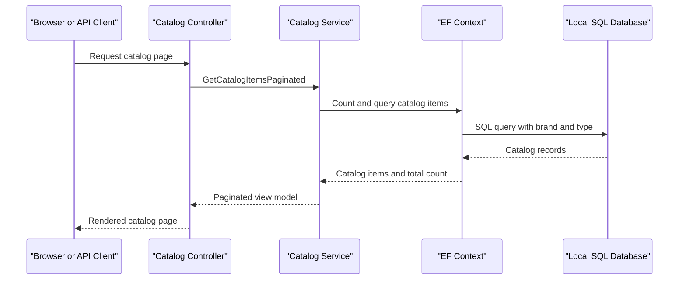

# API & Service Communication Contracts

The solution exposes MVC pages and a small set of synchronous HTTP endpoints for catalog items, brands, and files. The two applications are independently hosted implementations and do not call each other.

## Service Catalog

| Service | Port | Category | Purpose |
|---|---|---|---|
| `eShopLegacyMVC` | IIS/IIS Express configured; no fixed production port in project files | API Layer | MVC catalog pages and ASP.NET Web API endpoints |
| `eShopPorted` | Development profiles: HTTP 5000 / HTTPS 5001; IIS Express HTTP 52637 | API Layer | Ported MVC catalog pages and attribute-routed endpoints |
| `eShopLegacy.Utilities` | — | Infrastructure library | Shared binary serialization helper; not independently deployable |

## API Endpoints Inventory

| Service | Method | Path | Request Type | Response Type |
|---|---|---|---|---|
| `eShopLegacyMVC` | GET | `/Catalog/Index` | Optional `pageSize`, `pageIndex` query values | `PaginatedItemsViewModel<CatalogItem>` view |
| `eShopLegacyMVC` | GET | `/Catalog/Details/{id}` | `id` path value | `CatalogItem` view or 400/404 |
| `eShopLegacyMVC` | GET, POST | `/Catalog/Create` | Form-bound `CatalogItem` on POST | View or redirect |
| `eShopLegacyMVC` | GET, POST | `/Catalog/Edit/{id}` | `id` and form-bound `CatalogItem` | View or redirect |
| `eShopLegacyMVC` | GET, POST | `/Catalog/Delete/{id}` | `id` path/form value | View or redirect |
| `eShopLegacyMVC` | GET | `/items/{catalogItemId}/pic` | Integer `catalogItemId` | Image bytes or 404 |
| `eShopLegacyMVC` | GET | `/api/brands` | None | Brand collection |
| `eShopLegacyMVC` | GET | `/api/brands/{id}` | Integer `id` | Brand or 404 |
| `eShopLegacyMVC` | DELETE | `/api/brands/{id}` | Integer `id` | 200 or 404; demo action does not delete |
| `eShopLegacyMVC` | GET | `/api/files` | None | Binary-serialized brand DTO response |
| `eShopLegacyMVC` | GET | `/api` | None | JSON sample message |
| `eShopPorted` | GET | `/Catalog/Index` | Optional `pageSize`, `pageIndex` query values | Paginated catalog view |
| `eShopPorted` | GET | `/Catalog/Details/{id}` | `id` path value | Catalog view or 400/404 |
| `eShopPorted` | GET, POST | `/Catalog/Create`, `/Catalog/Edit/{id}`, `/Catalog/Delete/{id}` | Form-bound catalog data | View or redirect |
| `eShopPorted` | GET | `/items/{catalogItemId}/pic` | Integer `catalogItemId` | Image bytes |
| `eShopPorted` | GET | `/api/brands` | None | Brand collection |
| `eShopPorted` | DELETE | `/api/brands/{id}` | Integer `id` | 200 or 404; demo action does not delete |
| `eShopPorted` | GET | `/api/files` | None | Serialized brand DTO data |

The legacy Web API routes use `api/{controller}/{id?}`; MVC uses attribute routes and the conventional `{controller}/{action}/{id}` route. The ported API uses `api/[controller]`. No API versioning scheme was found.

## Management & Observability Endpoints

| Service | Endpoint | Custom Metrics (if any) |
|---|---|---|
| Both applications | None identified | No custom metrics or health-check endpoints found |

No Swagger/OpenAPI endpoint, health endpoint, or metrics route was identified.

## DTOs & Contracts

`CatalogItem`, `CatalogBrand`, and `CatalogType` are the domain/API model classes. `PaginatedItemsViewModel<T>` packages paginated results for MVC responses. Each `FilesController` defines a nested `BrandDTO` with `Id` and `Brand` for its serialized response. The DTOs are mutable classes; no OpenAPI, protobuf, or GraphQL contracts were found. Standard MVC/Web API JSON serialization is used for JSON responses, while the files endpoints use the shared `BinaryFormatter` utility.

## Communication Patterns

All service operations are synchronous local method calls from controllers to `ICatalogService`, then to EF6/EF Core or an in-memory mock. No inter-service REST clients, message brokers, retries, circuit breakers, service discovery, API gateway, or client-side load balancing were identified. There is no configured API authentication or authorization policy. Development launch profiles mention HTTPS, but no application-wide TLS enforcement was identified.

## Service Technology Matrix

| Service | Web | Data Access | Discovery | Gateway | Actuator | Cache | Metrics |
|---|---|---|---|---|---|---|---|
| `eShopLegacyMVC` | MVC 5 and Web API 2 | EF6 / SQL Server | None | None | None | None; optional in-memory mock | Application Insights |
| `eShopPorted` | ASP.NET Core MVC 2.2 | EF Core 2.2 / SQL Server | None | None | None | None; default in-memory mock | None identified |

## Service Communication Sequence

